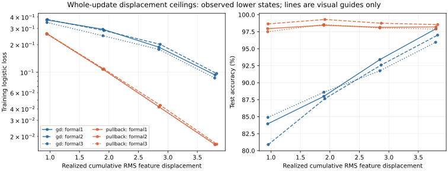

# Stage 6: archived feature geometry and local dynamics

The initial archived-state analysis is complete under the [recorded protocol](representation_analysis_protocol.md) in [6cb553d](https://github.com/Argonriel/pullback-feature-learning/commit/6cb553d09784d0769f0f03138d76e8accce2d9f8). It reconstructs 24 training feature states, summarizes 24 archived spectra, and records 24 displacement-budget comparisons. This phase took 5.02 seconds, with no network training, retuning, or test-prediction recomputation; its displayed test metrics are copied from the original formal archive. The later replay refinement is described separately below.

A subsequent [whole-update refinement](displacement_refinement_protocol.md), recorded before execution in [9a43b15](https://github.com/Argonriel/pullback-feature-learning/commit/9a43b15232e28680bd3f02d75be35b128df4f5b4), deterministically replayed the original training trajectories to resolve the sparse displacement brackets. That separate diagnostic evaluates the newly located crossing states and is reported below; the initial archived analysis remains preserved unchanged.

The three diagnostics tell a consistent but limited story: pullback follows the training representation gradient more closely in the local linear model and its observed training trajectory uses less cumulative feature movement. These properties do not establish better held-out performance. The original formal fixed-readout comparison remains unchanged, and the separate frozen-feature probe assessment addresses feature usefulness.

## Feature clouds

The [results archive](../reports/representation-analysis-v1/README.md) contains training-only feature clouds at initialization, 1,000 updates, 2,000 updates, and the saved two-second endpoints. Each seed has common axes across both methods and all four states, with equal coordinate aspect ratios. The later GD states span a wider horizontal range, so initial clouds occupy a small area; that is an actual scale difference rather than independent rescaling of the panels.

Across these displayed training states, pullback places examples into comparatively compact class groups along the first coordinate, while GD produces more dispersed first-coordinate values. Both methods visibly change the initial two-moons representation. These observations describe the training geometry only. Compact groups, wider margins on training examples, and greater movement cannot be interpreted as better test features without a separate predictive assessment.

At exactly 2,000 updates, mean cumulative RMS feature displacement is **6.7861 for GD** and **3.8101 for pullback**. These are sums of per-update movements on the fixed training inputs, not straight-line distances from the initial feature cloud. Different path lengths can coexist with similar training loss and different held-out performance.

## Local spectra and gradient alignment

Every selected checkpoint has numerical column rank 80 under its archived floating-point threshold. This does not mean the representation map can realize every direction: the Jacobian maps 80 parameter coordinates into 512 stacked representation coordinates.

The table shows arithmetic means over the three seeds. Each row is an archived state along one optimizer's trajectory. The last two columns evaluate both hypothetical local update directions at that same state; they do not compare different training paths while holding the state fixed.

| State | Trajectory supplying the state | Unreachable gradient fraction | GD velocity cosine with -g | Pullback velocity cosine with -g |
| --- | --- | ---: | ---: | ---: |
| Initial | Both, identical paired state | 0.04517 | 0.65319 | 0.78181 |
| 1,000 updates | GD | 0.40371 | 0.31922 | 0.66255 |
| 1,000 updates | Pullback | 0.000126 | 0.87362 | 0.99548 |
| 2,000 updates | GD | 0.61055 | 0.14671 | 0.44353 |
| 2,000 updates | Pullback | 0.0000144 | 0.87358 | 0.99913 |
| Two-second endpoint | GD | 0.30677 | 0.10240 | 0.53514 |
| Two-second endpoint | Pullback | 0.00000904 | 0.86377 | 0.99944 |

Here a cosine closer to one indicates that the first-order feature velocity points more closely along the negative training representation gradient. On the pullback trajectory at 2,000 updates, the mean gradient-weighted pullback filter is 0.99496: most of this gradient lies in directions that the damped local map transmits with little attenuation. The same weighting at the GD states is 0.17778. This is a measured difference between states with different Jacobians and gradients, not evidence that replacing the optimizer at one checkpoint would reproduce the other trajectory.

The active Jacobian condition numbers are also smaller along the learned pullback states in these parameter coordinates. At 2,000 updates the three GD values range from approximately 2.05e7 to 3.03e8, and the pullback values from 4.76e3 to 1.71e5. A condition number alone omits gradient alignment, damping, learning rate, and nonlinear finite-step effects; it does not predict generalization or establish a coordinate-invariant property.

The local quantities explain what the chosen metric is doing geometrically. They do not imply that a large finite update equals its linear prediction, that the training gradient is the best direction for unseen data, or that the observed spectral changes caused the final accuracy gap. The original numerical checks establish the first-order formulas at small steps. The present stage records their state-dependent factors along the actual archived trajectories.

## Displacement budgets and the effect of sparse logging

For each seed, the base ceiling is the smaller cumulative displacement at exactly 2,000 updates. All three base ceilings come from pullback and are approximately 3.80-3.83. Four fractions were declared before this analysis. At each ceiling, retain the last saved checkpoint below it and preserve the next saved checkpoint as a bracket; there is no interpolation.

| Fraction of per-pair base ceiling | GD mean realized displacement | Pullback mean realized displacement | GD mean training loss | Pullback mean training loss |
| ---: | ---: | ---: | ---: | ---: |
| 25% | 0.0000 | 0.9319 | 0.55578 | 0.26547 |
| 50% | 1.5062 | 1.8860 | 0.31004 | 0.10983 |
| 75% | 2.7295 | 2.7819 | 0.20214 | 0.04585 |
| 100% | 3.5467 | 3.8101 | 0.11405 | 0.01638 |

The first row is especially coarse: GD's first logged checkpoint at 100 updates already exceeds the 25% ceiling in every seed, so the rule retains its initial state. Its mean realized distance is therefore zero while pullback has moved almost the full budget. That row cannot support a meaningful claim about performance after exactly equal feature movement. At the 50% ceiling, the largest unused GD budget is approximately 0.7733, about 41% of the target for that seed. Even the closer 75% comparison does not have identical realized distances.

At the full common ceiling, the saved GD checkpoints are steps 800, 700, and 500, while the pullback checkpoints are all step 2,000. GD's unused budgets are 0.1575, 0.2288, and 0.4037; pullback hits these ceilings exactly by construction. The lower training losses of the retained pullback states are genuine recorded values, but their interpretation is a saved-state comparison under common ceilings, not an exact matched-displacement experiment. The full bracket records and original test metrics are retained in [displacement_brackets.json](../reports/representation-analysis-v1/displacement_brackets.json).

The sampled loss-versus-displacement curves are consistent with more direct training-space motion for pullback, in agreement with its higher local directional alignment. Sparse logging prevents a precise all-budget ranking at exactly matched realized motion. In particular, these descriptive diagnostics should not replace the original iteration/time endpoints or be used to select a favorable test checkpoint.

## Whole-update refinement resolves the coarse brackets

The separate [refinement protocol](displacement_refinement_protocol.md) and runner were committed in [9a43b15](https://github.com/Argonriel/pullback-feature-learning/commit/9a43b15232e28680bd3f02d75be35b128df4f5b4) before execution. The refinement replays all six original trajectories through step 2,000, using the original training data, initial parameters, and frozen optimizer settings. All **126 shared archived states** match exactly in both parameter arrays and cumulative displacement. All replays and selections finished before the first new test evaluation. The same four training-displacement ceilings are retained; the lower checkpoint is now the last whole update at or below the target and each available upper checkpoint is exactly one update later.

This removes the 100-update logging gap. The largest unused budget is less than **0.007 feature-distance units**, and the mean realized distances differ by less than 0.0031 between methods at every ceiling. There is still no parameter or metric interpolation and no assertion of mathematically identical realized displacement.

| Ceiling fraction | GD mean realized displacement | Pullback mean realized displacement | GD mean training loss | Pullback mean training loss | GD mean test accuracy | Pullback mean test accuracy |
| ---: | ---: | ---: | ---: | ---: | ---: | ---: |
| 25% | 0.949300 | 0.946221 | 0.365685 | 0.262136 | 83.25% | 98.03% |
| 50% | 1.903745 | 1.903112 | 0.276483 | 0.108055 | 88.08% | 98.77% |
| 75% | 2.855189 | 2.856702 | 0.188859 | 0.042558 | 92.58% | 98.32% |
| 100% | 3.807943 | 3.810067 | 0.092366 | 0.016382 | 96.97% | 98.22% |

At every declared ceiling and in every one of the three pairs, the retained pullback state has lower training loss, lower test loss, and higher test accuracy than the retained GD state. This is a qualified advantage in performance under the common feature-displacement budgets. It is not an advantage in update count or elapsed computation. At the full ceiling, the retained GD states are steps 834, 750, and 593, while pullback uses step 2,000 in all three pairs. The original equal-iteration and equal-time comparisons therefore answer different questions and retain their original conclusions.

The refinement took **7.53 seconds** in total, including **4.13 seconds** of deterministic replay. This is additional diagnostic cost, not a replacement measurement for the original training times. All 24 lower/upper bracket selections, 45 available-state metric rows, exact-replay checks, per-seed values, sample SDs, and paired differences are archived in the [refinement results](../reports/displacement-refinement-v1/README.md). A separate [independent audit](../reports/displacement_refinement_audit.json) passed 324 checks, including its own 12,000-update replay; every numerical discrepancy was zero.

The test split was already used in the original formal report, and this refinement was motivated by the observed sparse-logging limitation. Its checkpoint rule uses only training displacement, and no test score selects a ceiling, optimizer setting, or replacement formal endpoint. It remains a secondary descriptive analysis of three fixed trajectories, not new independent evidence of broad optimizer superiority.

## Scope of the conclusion

The geometric diagnostics supply an observable advantage for pullback in following the desired local training feature direction, and the refined comparisons show better performance under the declared feature-displacement budgets. The earlier formal study shows that these advantages did not translate into better mean fixed-readout test performance at the fixed iteration/time endpoints or lower computation cost in the selected setting. These statements concern different quantities and can both hold.

The evidence comes from one small architecture, one data distribution, and three seeds. The full source arrays, coordinates, spectral summaries, bracket records, and measured cost are preserved in the [analysis archive](../reports/representation-analysis-v1/README.md). The completed [probe analysis](probe_findings.md) shows an early per-update pullback advantage but no terminal probe advantage; feature clouds and spectra alone do not answer the predictive-quality question.
