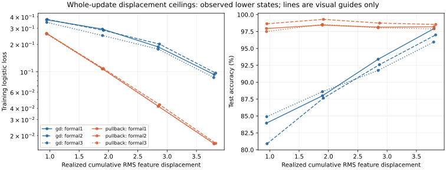

# Whole-update displacement refinement

Deterministic replay of the six original training trajectories through step 2,000; no optimizer setting changed.
Every shared archived parameter state and cumulative displacement matched exactly before any new test evaluation.
The ceilings are the same 25%, 50%, 75%, and 100% of each pair's smaller original terminal displacement.
Retained states are now the last whole update at or below each ceiling; each available crossing is the immediately next update.
Realized distances still need not be exactly equal, but the residual gap is bounded by one observed update, not 100-update logging.

| Ceiling fraction | Method | Mean updates | Mean realized displacement | Largest unused budget | Mean train loss | Mean test accuracy |
| ---: | --- | ---: | ---: | ---: | ---: | ---: |
| 25% | gd | 87.0 | 0.949300 | 0.005409 | 0.365685 | 83.25% |
| 25% | pullback | 102.0 | 0.946221 | 0.006997 | 0.262136 | 98.03% |
| 50% | gd | 226.0 | 1.903745 | 0.002609 | 0.276483 | 88.08% |
| 50% | pullback | 305.3 | 1.903112 | 0.003209 | 0.108055 | 98.77% |
| 75% | gd | 499.3 | 2.855189 | 0.003804 | 0.188859 | 92.58% |
| 75% | pullback | 788.0 | 2.856702 | 0.001276 | 0.042558 | 98.32% |
| 100% | gd | 725.7 | 3.807943 | 0.004165 | 0.092366 | 96.97% |
| 100% | pullback | 2000.0 | 3.810067 | 0.000000 | 0.016382 | 98.22% |

All lower and upper checkpoint metrics are in metrics.csv, and weights/verification checks are in replays.json.
summary.json retains means, sample SDs, and paired pullback-minus-GD differences for the retained lower states.
Ceilings and selection use training displacement only; no metric selects the checkpoints.
Test data come from the previously evaluated formal split, so this is a secondary diagnostic, not new independent test evidence.
Replay cost is recorded separately and never substitutes for the original training-time comparison.
The earlier sparse-checkpoint diagnostic remains preserved; this refinement resolves its wide checkpoint gaps.

Markers show retained observed states at their actual displacements. Connecting lines are visual guides, not interpolated metric estimates.
