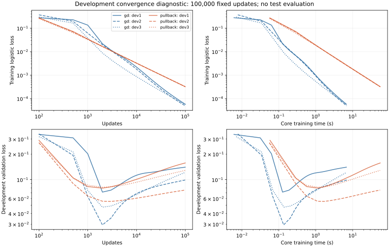

# Long-training development diagnostic

Post-formal exploratory diagnostic with fixed settings and the original development seeds.
These validation data were already used for tuning. This is not independent test evidence.
No optimizer retuning, checkpoint selection, test evaluation, or automatic extension was performed.

| Updates | Method | Train loss, mean | Validation loss, mean +/- SD | Validation accuracy, mean | Mean core seconds |
| ---: | --- | ---: | ---: | ---: | ---: |
| 0 | gd | 0.564438 | 0.566398 +/- 0.00864716 | 70.44% | 0.0000 |
| 0 | pullback | 0.564438 | 0.566398 +/- 0.00864716 | 70.44% | 0.0000 |
| 100 | gd | 0.315196 | 0.334917 +/- 0.0131594 | 85.16% | 0.0069 |
| 100 | pullback | 0.266686 | 0.277608 +/- 0.0105586 | 96.74% | 0.0564 |
| 500 | gd | 0.196083 | 0.238309 +/- 0.0627954 | 89.84% | 0.0332 |
| 500 | pullback | 0.0680569 | 0.0999375 +/- 0.00857649 | 98.44% | 0.2827 |
| 1,000 | gd | 0.0778983 | 0.113173 +/- 0.0768131 | 95.57% | 0.0667 |
| 1,000 | pullback | 0.0335543 | 0.0777802 +/- 0.0119098 | 98.44% | 0.5600 |
| 2,000 | gd | 0.016793 | 0.049446 +/- 0.0210916 | 98.31% | 0.1330 |
| 2,000 | pullback | 0.0165062 | 0.0722792 +/- 0.0143219 | 98.18% | 1.1244 |
| 5,000 | gd | 0.00450353 | 0.0657111 +/- 0.021552 | 98.31% | 0.3328 |
| 5,000 | pullback | 0.00650881 | 0.0773121 +/- 0.0174648 | 98.18% | 2.8047 |
| 10,000 | gd | 0.00162062 | 0.0826498 +/- 0.0259416 | 98.31% | 0.6635 |
| 10,000 | pullback | 0.00323341 | 0.0849319 +/- 0.0214714 | 98.18% | 5.5936 |
| 20,000 | gd | 0.000522732 | 0.0944085 +/- 0.0238498 | 98.31% | 1.3279 |
| 20,000 | pullback | 0.00161069 | 0.0945315 +/- 0.0266188 | 98.05% | 11.1325 |
| 50,000 | gd | 0.000133307 | 0.109003 +/- 0.0213577 | 98.31% | 3.3871 |
| 50,000 | pullback | 0.000642654 | 0.109302 +/- 0.0350966 | 98.05% | 27.8465 |
| 100,000 | gd | 5.41927e-05 | 0.120322 +/- 0.0205889 | 98.31% | 6.8418 |
| 100,000 | pullback | 0.000321023 | 0.120368 +/- 0.0414222 | 98.05% | 55.5266 |

Sample SD describes three-seed variation, not a confidence interval.
Settings were selected for 2,000 updates; this diagnoses their continuation, not optimally tuned long-horizon performance.
Core time excludes warmup, feature diagnostics, checkpoint recording, plotting, and offline evaluation.
The curves are observed checkpoints, with no interpolation used for endpoint metrics.

## Bounded continuation review

The declared rule is a practical diagnostic, not a statistical test or proof of convergence.
- gd: relative mean train-loss decrease = 59.35%; validation-loss decrease = -10.38%; validation improved in 0/3 seeds; continuation criterion met = False.
- pullback: relative mean train-loss decrease = 50.05%; validation-loss decrease = -10.12%; validation improved in 0/3 seeds; continuation criterion met = False.

See config.json for the declared budget and review rule, trajectories.json for weights, metrics.csv for all individual curves,
summary.json for descriptive aggregates, and environment.json/timing.json for provenance and measured costs.
