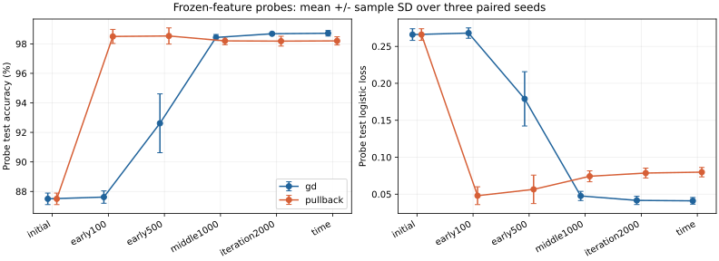

# Frozen-feature linear probes

Regularized logistic probes use training-only standardization and validation-selected regularization.
Every candidate was fitted and every selection saved before any probe test features were evaluated.
The representation network and all archived checkpoints remain frozen. No checkpoint is selected by test performance.
These are planned diagnostics on the previously evaluated formal splits, not a newly independent test study.

| Checkpoint | Method | Fixed-readout test accuracy | Probe test accuracy, mean +/- SD | Probe test loss, mean +/- SD |
| --- | --- | ---: | ---: | ---: |
| initial | gd | 72.08% | 87.50% +/- 0.39 pp | 0.265975 +/- 0.007889 |
| initial | pullback | 72.08% | 87.50% +/- 0.39 pp | 0.265975 +/- 0.007889 |
| early100 | gd | 84.38% | 87.62% +/- 0.42 pp | 0.268004 +/- 0.007055 |
| early100 | pullback | 97.92% | 98.50% +/- 0.48 pp | 0.047948 +/- 0.012040 |
| early500 | gd | 92.18% | 92.62% +/- 1.99 pp | 0.179024 +/- 0.036749 |
| early500 | pullback | 98.57% | 98.53% +/- 0.55 pp | 0.056505 +/- 0.019271 |
| middle1000 | gd | 98.50% | 98.43% +/- 0.20 pp | 0.047582 +/- 0.006202 |
| middle1000 | pullback | 98.23% | 98.20% +/- 0.26 pp | 0.074217 +/- 0.007393 |
| iteration2000 | gd | 98.87% | 98.68% +/- 0.06 pp | 0.041573 +/- 0.005579 |
| iteration2000 | pullback | 98.22% | 98.18% +/- 0.33 pp | 0.078591 +/- 0.006682 |
| time | gd | 98.82% | 98.72% +/- 0.19 pp | 0.040988 +/- 0.004557 |
| time | pullback | 98.22% | 98.20% +/- 0.28 pp | 0.079802 +/- 0.006378 |

The time checkpoint is each method's saved last whole update at or before two core training seconds.
Sample SD describes seed variation; it is not a confidence interval or significance test.
Probe fitting time is separate from the archived network-training time.

candidate_fits.json contains every candidate model, solver diagnostic, and validation score.
selections.json preserves all validation choices; metrics.csv and summary.json contain per-seed and paired results.
Source artifact hashes and protocol revision are recorded in environment.json.
