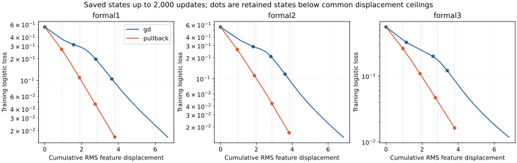
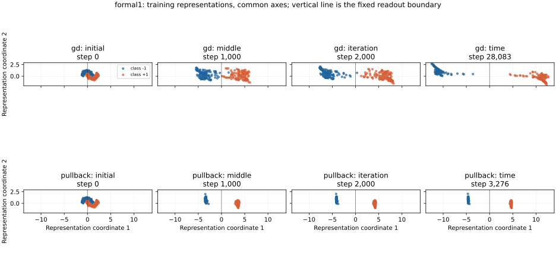
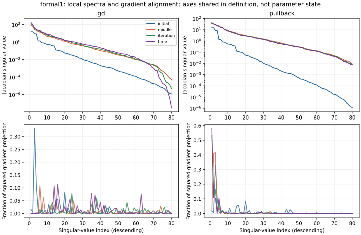
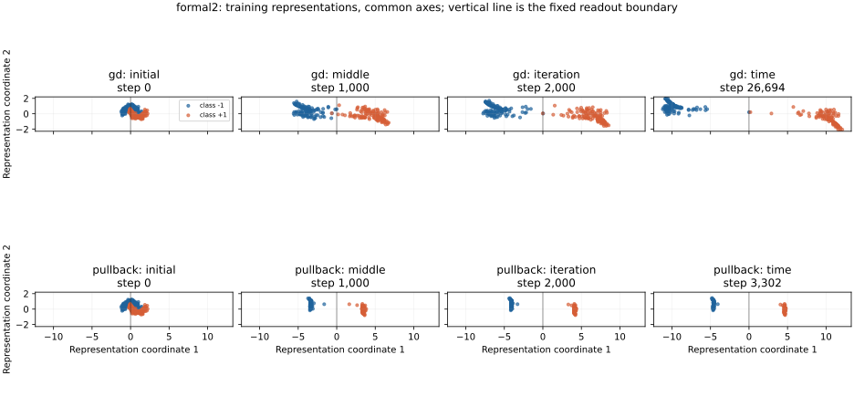
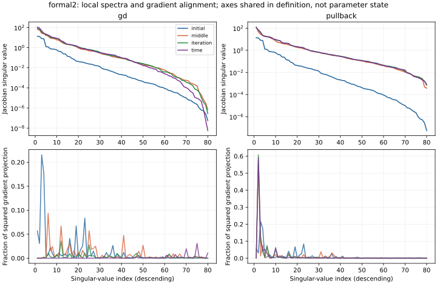
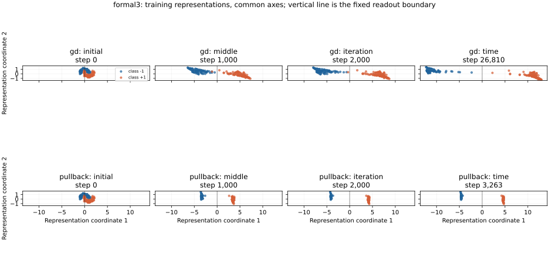
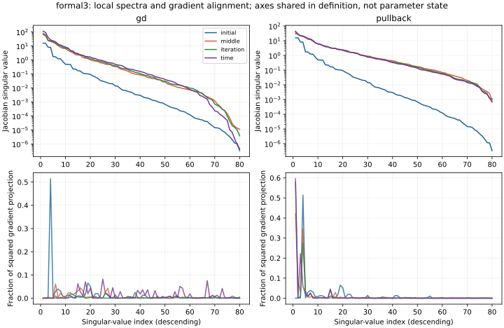

# Archived representation diagnostics

This analysis uses fixed formal checkpoints and already reported classification metrics. No network or probe is trained here.
Training-only point clouds use raw coordinates and common axis bounds within each seed across methods and states.

## Local spectral summaries

Entries are arithmetic means over three paired seeds. Per-state rows are in spectral_summary.csv.
Both hypothetical update directions are evaluated locally at each archived state; these are not realized finite steps.

| State | Trajectory | Mean unreachable gradient fraction | Mean GD velocity cosine | Mean pullback velocity cosine |
| --- | --- | ---: | ---: | ---: |
| initial | gd | 0.0452 | 0.6532 | 0.7818 |
| initial | pullback | 0.0452 | 0.6532 | 0.7818 |
| middle | gd | 0.4037 | 0.3192 | 0.6626 |
| middle | pullback | 0.0001 | 0.8736 | 0.9955 |
| iteration | gd | 0.6105 | 0.1467 | 0.4435 |
| iteration | pullback | 0.0000 | 0.8736 | 0.9991 |
| time | gd | 0.3068 | 0.1024 | 0.5351 |
| time | pullback | 0.0000 | 0.8638 | 0.9994 |

A better local cosine means closer directional alignment with the training representation gradient, not better generalization.
Full numerical rank does not mean all representation directions are reachable: J has 512 rows and only 80 columns.
Individual singular-vector alignments can be unstable within nearly repeated singular-value subspaces.

## Displacement-budget comparison

For each pair, the common base budget is the smaller cumulative displacement at exactly 2,000 updates.
Budgets are 25%, 50%, 75%, and 100% of that value. Retain the last saved state at or below each ceiling.
Realized distances generally differ because logging is sparse. The next saved state and both gaps are retained in displacement_brackets.json.
There is no parameter or metric interpolation, and this does not assert exactly equal realized motion.

| Fraction of common per-pair budget | Method | Mean training loss | Mean test accuracy | Mean realized displacement |
| ---: | --- | ---: | ---: | ---: |
| 25% | gd | 0.555778 | 72.08% | 0.0000 |
| 25% | pullback | 0.265470 | 97.92% | 0.9319 |
| 50% | gd | 0.310045 | 86.73% | 1.5062 |
| 50% | pullback | 0.109825 | 98.77% | 1.8860 |
| 75% | gd | 0.202143 | 91.83% | 2.7295 |
| 75% | pullback | 0.045853 | 98.38% | 2.7819 |
| 100% | gd | 0.114050 | 96.00% | 3.5467 |
| 100% | pullback | 0.016382 | 98.22% | 3.8101 |

These are secondary descriptive comparisons. Ceiling selection uses training displacements only; test metrics are copied from the original formal archive.
Three-seed means and sample SDs are descriptive, not significance evidence. Intermediate test scores do not select a model or replace formal endpoints.

## formal1

## formal2

## formal3

Provenance is in environment.json. Full saved training feature coordinates are in feature_clouds.json; no test point clouds are produced.
