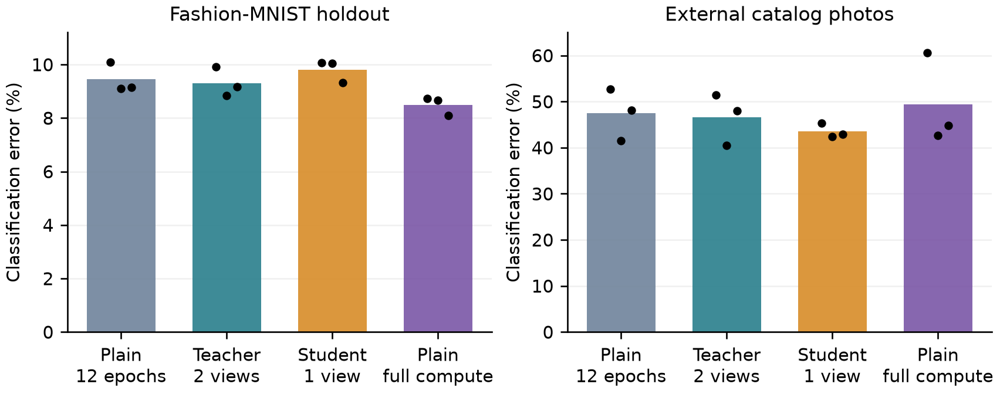
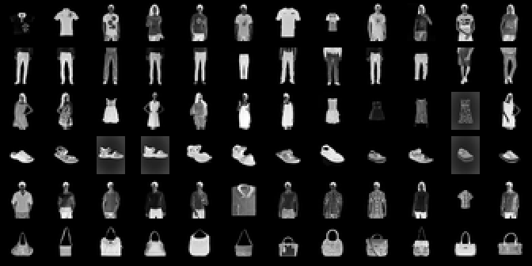
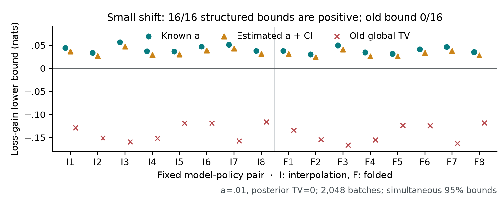

# Training budgets, one-pass transfer, and structured guarantees

Completed 21 November 2026. Three frozen research branches, independent reconstruction, isolated CPU/GPU measurements, and preserved negative results. Earlier studies and models remain unchanged.

**The new controls separate training-data value from extra computation. One-pass distillation does not meet the preservation criterion. A sharper guarantee becomes useful within a stated distribution family.**

|Question|Completed evidence|Decision|
|---|---|---|
|Data versus compute|The 2,304-training-label baseline beats all three smaller allocations in all six primary arithmetic-matched loss comparisons.|Retain the strong baseline; more updates did not replace more data here.|
|One-pass transfer|Student holdout error 9.813%, versus 9.443% plain and 8.497% full-compute control.|The frozen preservation criterion fails.|
|Independent source|On 1,500 new catalog photos, student error is 43.511% versus 47.467% plain.|A favorable shifted-domain result, with large model variability and poor absolute accuracy.|
|Practical guarantee|At input tilt a=.01, both new bounds certify 16/16 lines; the old bound certifies 0/16.|Useful under the specified family and posterior assumptions; no natural-image guarantee.|

The allocation experiment uses 16 new paired seeds, 64 shared training trajectories, nine procedures per seed, and 720 risk rows. Each calibrated procedure has 4,352 accepted fitting labels and unchanged model capacity. The image experiment fits nine CNNs from scratch, with three paired initialization/order streams. Its teacher is also the ordinary augmented baseline, evaluated with one or two views. The theory experiment keeps eight historical models and two selectors fixed, with four independently sampled input laws.

The original Fashion-MNIST holdout remains historically exposed. The external catalog photos are independently sourced, frozen before scoring, and never used for fitting or method selection. Their six-class subset and severe acquisition shift make them a transfer stress test, not a ten-class IID replication.

No failed result caused a new hyperparameter search, replacement seed, changed margin, external recalibration, or post-test preprocessing choice. Each branch protocol and source commitment precedes its new outcomes. Full assumptions, code, raw data, model weights, uncertainty calculations and resource ledgers accompany this report.

<!-- pagebreak -->

## 1. Label allocation under three resource definitions

All calibrated procedures use 4,352 accepted fitting labels. Training sizes 256 / 768 / 1,280 / 2,304 leave 4,096 / 3,584 / 3,072 / 2,048 labels for calibration. Validation is zero except `validation_1280`, which uses 1,280 training + 1,024 validation + 2,048 calibration labels. It executes 896 updates and chooses among 100 / 250 / 500 / 896 using validation loss.

|Procedure|Executed updates|Raw loss|Raw error|Full loss|
|---|---|---|---|---|
|fixed_256|500|0.644989|37.083%|0.616589|
|fixed_768|500|0.590185|31.302%|0.561397|
|fixed_1280|500|0.568220|28.932%|0.543541|
|fixed_2304|500|0.553049|27.471%|0.531434|
|flop_256|4332|0.662787|38.960%|0.641127|
|flop_768|1485|0.588779|30.676%|0.559949|
|flop_1280|896|0.562381|28.239%|0.540497|
|examples_256|4500|0.663056|39.001%|0.641551|
|validation_1280|896|0.562589|28.260%|0.540475|

Every loss above uses a positive scalar fitted to that actual final output. Raw inference needs one model evaluation per input; full mean-logit averaging needs two. Calibration cannot change class decisions. Uncalibrated and raw-temperature-transfer diagnostics remain in the full tables.

The fixed-step endpoints improve raw loss by 0.091941 and error by 9.612 percentage points. That comparison still changes training work. The `flop_*` rows answer the stricter resource question; `examples_256` answers an exact example/Jacobian-work question. The observed lowest raw loss among nominal-compute-matched candidates is fixed_2304; this is an exploratory grid ranking, not a newly confirmed optimum.

Each pair shares initialization, nested class-balanced training increments, validation/calibration streams, and 65,536 evaluation inputs. Training, selection and scalar fitting use sampled labels only. The known synthetic posterior is used by the generator and evaluator. The label budget counts accepted examples exposed to fitting; rejected synthetic generator proposals are separately recorded, so this is not a claim about the monetary cost of real-world annotation.

<!-- pagebreak -->

## 2. Equal work does not mean equal elapsed time

|Primary loss contrast|Difference|99.375% interval|Wins|
|---|---|---|---|
|flop_256 - baseline / raw|+0.109738|[+0.100439, +0.120509]|0/16|
|flop_768 - baseline / raw|+0.035730|[+0.025968, +0.045837]|0/16|
|flop_1280 - baseline / raw|+0.009332|[+0.000781, +0.017029]|4/16|
|validation - flop_1280 / raw|+0.000209|[-0.000101, +0.000806]|5/16|
|flop_256 - baseline / full|+0.109693|[+0.100480, +0.120544]|0/16|
|flop_768 - baseline / full|+0.028515|[+0.020235, +0.037058]|0/16|
|flop_1280 - baseline / full|+0.009063|[+0.003129, +0.014887]|3/16|
|validation - flop_1280 / full|-0.000021|[-0.000274, +0.000207]|10/16|

Negative favors the first procedure. All six smaller-training-versus-baseline loss intervals are strictly positive, favoring the 2,304-label baseline. Exchanging 1,024 calibration labels for validation shows no clear benefit. These eight prespecified intervals use 20,000 paired resamples of 16 seed clusters and a nominal 95% family correction. Error, exact-example and fixed-step comparisons are secondary. Bootstrap uncertainty is approximate and specific to this task and recipe.

The PB update uses a summed Jacobian metric and a mean loss. Rate and damping both scale by n/256, preserving the normalized update; independent duplication and finite-difference checks passed. The literal dense arithmetic ledger, including the 144-dimensional LU solve, is C(n)=179045 n+2001144 scalar operations per update. The reference budget is 207,260,412,000. Floors give 4,332 / 1,485 / 896 / 500 updates for the four training sizes, with less than one update of unused budget.

Exact example matching gives 1,152,000 example-updates and 4,608,000 Jacobian rows for 256 x 4,500 and 2,304 x 500. Solve counts differ, which is why a separate arithmetic-matched comparison is necessary. Transcendental evaluations, memory, allocations and pivot comparisons are separately counted or excluded explicitly; nominal arithmetic matching is not exact hardware-work or energy equality.

After predictive results were committed, an exclusive CPU benchmark measured seven 30-update blocks per size from one fixed historical development state. Projected schedule times are 11.275s / 11.312s / 12.569s / 12.954s for the nominal-compute grid. These are development-workload projections, not newly timed complete fits, and exclude fitting/selection/I/O. They never changed a schedule.

The actual experiment shares trajectories and checkpoints. Its physical work and each standalone procedure's costs are recorded separately, including validation, calibration, scalar optimization, diagnostic forwards, test replay and audits. No shared result is treated as a free standalone computation.

<!-- pagebreak -->

## 3. Distillation did not preserve the original-task gain

Three paired CNNs use 12 epochs of ordinary horizontal-flip augmentation. Each is the plain one-view baseline B and two-view teacher T. Its two-view training logits produce frozen soft targets at temperature 2. Student S uses the same architecture, initialization, orders, flip streams and 12-epoch update count, with equal-weight hard-label and temperature-scaled KL terms. All final outputs receive their own temperature fits on the independent calibration split.

|Pipeline|Views|Holdout loss|Holdout error|
|---|---|---|---|
|Plain augmented, 12 epochs|1|0.261428|9.443%|
|Teacher mean logits|2|0.256656|9.307%|
|Distilled student|1|0.270492|9.813%|
|Plain augmented, full compute|1|0.239055|8.497%|

Student minus plain error is +0.370 points, adjusted interval [+0.070,+0.677]; student minus full-compute control is +1.317 points, [+0.847,+1.800]. Its loss is also worse. The teacher's two-view error gain is only 0.137 points here, with its adjusted interval crossing zero; its loss gain remains positive. These are new fitted models, not a reuse of the previous six CNN weights.

The 10,000-image holdout is excluded from this round's fitting but was historically used. All nine models share the same split. The 16 primary intervals use paired, class-stratified image resampling conditional on these fitted models, not uncertainty over new training datasets.

<!-- pagebreak -->

## 4. Genuine external data reveal a different ordering

The external source is Param Aggarwal's [Fashion Product Images (Small)](https://www.kaggle.com/datasets/paramaggarwal/fashion-product-images-small), Kaggle version 1 (2019). Owner metadata declares MIT licensing; this records the owner's declaration, not an independent ownership investigation. Deterministic ID-hash ranking selected 250 photos for each of Tshirts, Trousers, Dresses, Sandals, Shirts and Handbags before model scoring. The fixed mapping covers six Fashion-MNIST categories; all ten output logits remain active.

|Pipeline|External loss|External error|
|---|---|---|
|Plain augmented|1.606379|47.467%|
|Two-view teacher|1.596302|46.644%|
|One-view student|1.590607|43.511%|
|Full-compute plain|1.698204|49.378%|

Student error beats plain augmentation by 3.956 points, adjusted interval [2.747,5.133], and the full-compute control by 5.867 points, [4.147,7.556]. Yet absolute error remains 43.511%. Seed variability is large: plain -> student -> control errors are 52.73 -> 45.27 -> 60.60%, 41.53 -> 42.40 -> 42.67%, and 48.13 -> 42.87 -> 44.87%. The student does not beat the plain baseline in every seed, and the control comparison is strongly influenced by the first pair.

The frozen joint preservation rule fails: holdout performance worsens, and the external student-versus-teacher loss interval does not meet its fixed noninferiority margin. External labels never select a checkpoint, scalar, preprocessing step or method. Fifteen exact duplicate candidates were skipped; all selected raw photos and processed pixels are retained. No exact overlap with 70,000 Fashion-MNIST images exists. Near duplicates, product-family dependence, partial class coverage and acquisition shift remain limitations.

<!-- pagebreak -->

## 5. Complete training cost and measured serving cost

|Mode|Plain ms|Student ms|Full ms|Full / student|
|---|---|---|---|---|
|One-thread CPU|32.718|33.072|63.341|1.884x|
|GPU resident|0.559|0.581|0.896|1.540x|
|GPU with transfers|0.660|0.790|0.922|1.168x|

Entries are medians of three model-specific medians for batches of 256 normalized tensors. The full comparator is the faster of fused and sequential two-view implementations for each model/mode. Ratios aggregate per model and need not equal ratios of displayed median milliseconds. The student and plain predictor use one view each.

CPU/GPU serving ran in an exclusive window with other research numerical work paused. Three warmup blocks precede seven measured blocks, each of four validation batches. Methods are randomized within blocks. Synchronized FP32 timing includes flips, concatenation, model calls, merging and final scalar correction; transfer mode includes input upload and output return. It excludes loading, decoding and normalization. These are steady-serving, one-thread CPU and RTX 5070 Ti measurements, not universal production latency or cold-start claims.

The full-compute control pays the complete distillation network budget: teacher training, checkpoint validation, both teacher calibration views, 80,000 target-generation forwards, student training, student validation and calibration. The teacher/plain network is shared physically, but its training is charged to the standalone student pipeline. Each procedure uses the same 50,000 fitting labels.

One forward example uses 4,643,840 dense convolution/linear multiply-add FLOPs; one training example uses 13,705,728, excluding the unnecessary first-layer input gradient. Teacher plus student use 13,784,417,280,000 such FLOPs per pair. The control uses 997,270 training examples and its own fitting forwards, within 0.000072% of that budget. This is dense network arithmetic equality, not exact whole-program cost: pooling, activations, Adam, KL/CE, scalar fits and data handling have separately recorded counts and elapsed components.

Full fitting elapsed times for teacher plus student are 23.21 / 19.55 / 19.30 seconds, versus control 18.86 / 19.07 / 19.10 seconds. They were measured amid other work and are descriptive. Hypothetical teacher reuse across 10 or 100 students and sunk-teacher marginal costs are reported separately; neither replaces the full-cost primary comparison.

The frozen serving criterion also fails: pooled student/plain latency ratios are 1.011 / 1.041 / 1.197, exceeding the 1.10 limit in transfer mode. Variability is substantial: the third student's resident-GPU latency exceeds the faster teacher implementation. A single forward does not guarantee measured speed superiority. All 30 CPU/GPU checks preserve argmax, with maximum logit difference 7.63e-6; the unfavorable timing records are retained.

<!-- pagebreak -->

## 6. A local penalty restores useful conditional bounds

The earlier bound paid global logit span D times input TV, even when the selected transformed pairs were much safer. The new bound integrates an explicitly proved, transform-specific weight. It retains deterministic support-wide D only in the confidence radii; it never substitutes a test maximum for D. The table fixes epsilon=0 and 2,048 verification batches.

|Tilt a|Old mean bound|Known-a bound|Estimated-a bound|Estimated positive|
|---|---|---|---|---|
|0|+0.042639|+0.042639|+0.035960|16/16|
|0.01|-0.139809|+0.040657|+0.033196|16/16|
|0.1|-1.781711|+0.022944|+0.015022|16/16|
|0.6|-10.903382|-0.075496|-0.083134|0/16|

At the prespecified a=.01, epsilon=0 primary point, known-a bounds range .030533 to .056370; independently estimated-a bounds range .023795 to .047314. Both certify 16/16 lines, while the old bound certifies none. Mean shift penalty falls from .182434 to .001967 with known a. Unknown a adds a separately paid, 65,536-input parameter sample per law; its primary confidence interval is [0,.047928], conditional on the exact family.

The familywise confidence allocation covers 1,280 moment events and four parameter intervals at nominal 95%. Moments come from the actual deployment law, with two fixed sample-size looks and dependent top-quota masks handled explicitly. These are fixed-model loss guarantees under stated assumptions, not guarantees about classification error or new-model training variation.

<!-- pagebreak -->

## 7. The exact assumptions behind the guarantee

Let T be an involution, z and zT the logits, m=(z+zT)/2, d=(z-zT)/2, and F the log-sum-exp. Define J=(F(z)+F(zT))/2-F(m), S=max(d)-min(d), and t=(F(z)-F(zT))/2-(max(d)+min(d))/2. Then J>=0 and |t|<=S/2. All relevant differences ignore arbitrary common logit offsets.

Let r=d(P-T#P)/d(P+T#P), the odd imbalance within each transform pair. Conditional on other batch inputs, the exact risk identity symmetrizes the chosen input and adds its density-weighted odd component. If posterior TV is at most epsilon, a sharp simplex optimization gives

**Gain >= E M[min(J,c) + r t - (|r|+(1-|r|)epsilon) S/2].**

For r>=0, decompose the two posteriors into a common mass 1-delta and residual masses delta. Place the positive coefficients on max(d), the negative coefficient on min(d), and use delta<=epsilon. This attains the displayed coefficient; interchange the roles for negative r. Coordinatewise mask invariance is essential. Exact quota alone does not justify this conditional symmetrization.

In the specified density family (1+a cos(phi))/(2 pi), a in [0,1], r=a cos(phi). Define W=|cos(phi)|S/2-cos(phi)t and R_a=(1-a|cos(phi)|)S/2. Both are nonnegative and even. The confidence statement becomes **Gain >= L_A-a U_W-epsilon U_Ra**. An independent Hoeffding interval [aL,aU] gives the conservative version **L_A-aU U_W-epsilon U_RaL**. The same-law verification sample and fixed selected model/score are required.

Useful guarantees still need a valid posterior-defect bound and correct family specification. At a=.6, epsilon=0, the model-dependent orbit-worst posterior has negative measured gain on all 16 lines (mean -.014868), while the ordinary invariant synthetic posterior remains positive. At a=.01, epsilon=.4, the model-dependent adversarial posterior has negative gain on 13/16. These are not one shared label population across models. None of these failures is hidden or retuned away.

A deterministic misspecification example is more decisive: density (1+.6 cos(3phi))/(2 pi) has zero first-harmonic moment, while h=.2 cos(3phi), invariant labels p=1, and an independent quarter-quota produce negative true gain, numerically -.006876. Incorrectly assuming the first-harmonic family gives +.000624. Estimating a precisely does not establish that the family is true. The analytic sign proof is independent of the numerical quadrature.

The full proof is in `structured/THEORY.md`. No discriminator lower bound is used as a TV upper bound. The unrestricted-TV obstruction from the previous study remains intact. No natural-image input-law or posterior-defect bound has been established here.

<!-- pagebreak -->

## 8. Independent checks and next decisions

Root independently reconstructed all 720 allocation risk rows, 288 scalar fits, 16 checkpoint choices, all paired intervals and complete test forwards for 144 procedure models. Maximum risk discrepancy is 4.4e-16; model-output discrepancy is 0. Extra audit forwards total 19,890,176. Training itself is not independently repeated in full; committed parameters and all evaluation outputs are checked.

The image audit independently rebuilt all 1,500 external images, checked the split and calibration provenance, replayed every checkpoint's validation outputs, all teacher targets, all holdout/external predictions, 12 scalar fits and 16 bootstrap intervals. Its 618,000 additional forwards reproduce logits and targets exactly. A separate audit reconstructs the failed success decision. External selection order and duplicate exclusions are independently replayed from the original source archive.

The theory audit reconstructs all 640 moment/look rows (two concentration methods each), 1,024 bound rows and 3,072 stress rows, all 32 verification input streams, plus model and selector prefixes. Additional model forwards are 79,958; maximum truth-metric difference is 2.2e-16. Root also checked 240 exhaustive finite-population cases and 6,000 extremal posterior constructions. Written proofs, ordinary numerical validation, and formal directed-rounding proof are distinct; the latter is not claimed.

Next, refine the observed allocation frontier on a new frozen stream, with a separately selected budget and confirmation stage. Test whether validation earns its labels at the promising training sizes; retain the current strong baseline until a fresh comparison replaces it. Do not spend the next experiment merely repeating extra optimization on the smallest dataset.

For images, retain the full-compute ordinary model as the strong within-task comparator. The student is a cross-domain hypothesis, not a deployment recommendation. Use more paired fits and an independently acquired apparel source with clearer category alignment and product-family grouping, then freeze the comparison before outcomes. Do not select a new preprocessing or distillation weight from this external test.

For theory, the next useful step is justified relaxation of the input-family assumption: known residual asymmetry envelopes or bounded-complexity density models with explicit error terms, plus independent labeled evidence about posterior symmetry. More unlabeled samples alone cannot validate an unrestricted family or resolve missing label information.

Prior methods are acknowledged: [Hinton et al. (2015)](https://arxiv.org/abs/1503.02531) introduced the soft-target distillation precedent; [Guo et al. (2017)](https://proceedings.mlr.press/v70/guo17a.html) established temperature calibration; [Chen et al. (2020)](https://jmlr.org/papers/v21/20-163.html) developed group-averaging theory; [Maurer and Pontil (2009)](https://arxiv.org/abs/0907.3740) supply concentration constants. The project's additions are these controlled, audited comparisons and specialized orbit/posterior derivations, without a literature-wide priority claim.
