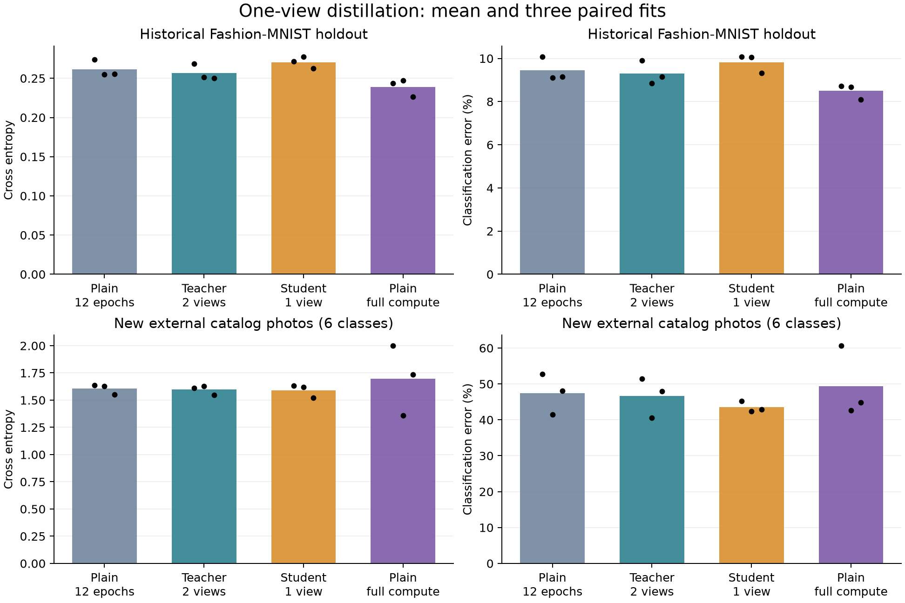
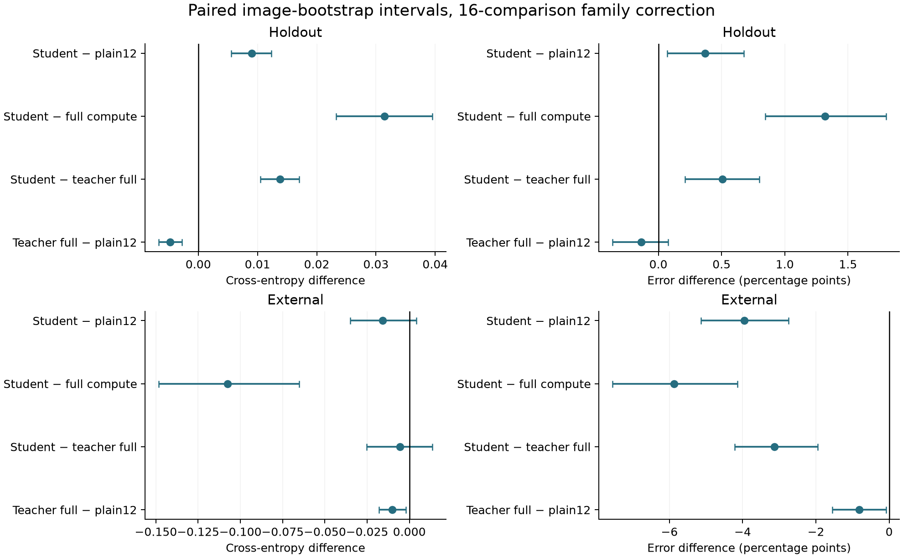

# One-view distillation and a genuinely new external evaluation

The frozen quality preservation criterion fails. All three paired fits and all negative comparisons are retained. No external data selected a setting.

|Population|Pipeline|Cross entropy|Error|
|---|---|---:|---:|
|holdout|Plain augmentation, 12 epochs / teacher raw|0.261428|9.443%|
|holdout|Teacher full, two views|0.256656|9.307%|
|holdout|Distilled student, one view|0.270492|9.813%|
|holdout|Plain augmentation, full compute|0.239055|8.497%|
|external|Plain augmentation, 12 epochs / teacher raw|1.606379|47.467%|
|external|Teacher full, two views|1.596302|46.644%|
|external|Distilled student, one view|1.590607|43.511%|
|external|Plain augmentation, full compute|1.698204|49.378%|

The historical Fashion-MNIST holdout has 10,000 images excluded from this round’s fitting; all were exposed in older studies. The external population has 1,500 newly acquired catalog images: 250 each of Tshirts, Trousers, Dresses, Sandals, Shirts and Handbags mapped to six compatible Fashion-MNIST labels. All ten logits are retained. This is a severe cross-domain, partial-label evaluation, not a ten-class replication.

The source is [Param Aggarwal, Fashion Product Images (Small), version 1](https://www.kaggle.com/datasets/paramaggarwal/fashion-product-images-small). The owner metadata declares MIT licensing. Fixed ID hashing selected the population before any model evaluation. Fifteen exact duplicate candidates were skipped; no selected processed image exactly matches any of 70,000 Fashion-MNIST images. Near duplicates and product-family dependence remain possible. People wearing garments, backgrounds and category conventions differ materially from the source training task.

## Primary contrasts

Intervals use 10,000 paired class-stratified image resamples and 16-way Bonferroni correction (99.6875% individual intervals). They condition on the nine fitted networks; they do not quantify variation over training datasets or product families. Negative differences favor the first pipeline.

|Population|Contrast|Metric|Difference|Adjusted interval|
|---|---|---|---:|---:|
|holdout|S-B|ce|+0.009063|[+0.005528, +0.012347]|
|holdout|S-B|error|+0.370000 pp|[+0.070000, +0.676667] pp|
|holdout|S-C|ce|+0.031436|[+0.023262, +0.039491]|
|holdout|S-C|error|+1.316667 pp|[+0.846667, +1.800000] pp|
|holdout|S-T|ce|+0.013836|[+0.010510, +0.017015]|
|holdout|S-T|error|+0.506667 pp|[+0.210000, +0.797099] pp|
|holdout|T-B|ce|-0.004772|[-0.006682, -0.002768]|
|holdout|T-B|error|-0.136667 pp|[-0.363333, +0.077922] pp|
|external|S-B|ce|-0.015771|[-0.034940, +0.004098]|
|external|S-B|error|-3.955556 pp|[-5.133333, -2.747188] pp|
|external|S-C|ce|-0.107597|[-0.148324, -0.065297]|
|external|S-C|error|-5.866667 pp|[-7.555556, -4.147188] pp|
|external|S-T|ce|-0.005695|[-0.025142, +0.013495]|
|external|S-T|error|-3.133333 pp|[-4.222222, -1.947188] pp|
|external|T-B|ce|-0.010077|[-0.017959, -0.002010]|
|external|T-B|error|-0.822222 pp|[-1.555556, -0.088889] pp|

B = plain 12-epoch augmentation; T = the same fitted network with two-view averaging; S = one-view student; C = plain augmentation with the full distilled-pipeline matrix budget.

External variation across fitted models is substantial. B/S/C error rates are 52.73/45.27/60.60% for pair 1, 41.53/42.40/42.67% for pair 2, and 48.13/42.87/44.87% for pair 3. The external student improves on B in two of three pairs and on C in three of three; external CE improves on C in two of three. The aggregate comparison with C is strongly influenced by pair 1. These three seeds do not establish robustness across training samples.

## Training compute and labels

Each pair trains three networks. B/T and S each use 480,000 training examples (1,884 Adam updates); C uses 997,270 training examples. Every arm uses the same 40,000 training + 5,000 validation + 5,000 calibration labels. Teacher targets require 80,000 additional forward examples. No teacher cost is omitted from the primary comparison.

The exact matching unit is dense convolution/linear multiply-add FLOPs, with 4,643,840 per forward and 13,705,728 per training example. Teacher + student consume 13,784,417,280,000; C consumes 13,784,407,362,560. The gap is less than one training example. Nonlinearities, pooling, Adam, KL, scalar fits and I/O are outside that matrix unit and are documented through actual call counts and inclusive fitting time. This is not whole-program FLOP or wall-time equality.

|Pair|Teacher fitting time|Student fitting time|Full pipeline time|Control fitting time|
|---|---:|---:|---:|---:|
|1|12.83s|10.38s|23.21s|18.86s|
|2|9.42s|10.13s|19.55s|19.07s|
|3|9.33s|9.96s|19.30s|19.10s|

These inclusive times are descriptive and include initialization, validation, scalar fitting, teacher target generation and serialization; they are not isolated training-speed benchmarks. compute_scenarios.csv separately reports teacher-sunk marginal cost and hypothetical sharing across 1, 10 or 100 students. The full-cost comparison remains primary.

## Calibration and serving

Four final pipelines per pair are calibrated on the same 5,000 source fitting-calibration examples only. Teacher raw and two-view outputs each have their own positive scalar fit. Distillation soft-target temperature 2 is a separate fixed training parameter. Positive final scaling preserves class decisions. Calibration arrays, fits and endpoint statuses are saved. No external recalibration or adaptation is performed.

|Mode|Student median latency|Best full-teacher median latency|Full/student: ratio of medians|
|---|---:|---:|---:|
|cpu|33.072ms|63.341ms|1.915×|
|cuda_resident|0.581ms|0.896ms|1.540×|
|cuda_transfer|0.790ms|0.922ms|1.168×|

The predeclared student-within-10%-of-plain serving condition fails across the three modes. Latencies are per 256 normalized inputs, with three warm-up and seven recorded randomized blocks. Full uses the faster measured fused/sequential implementation per pair. Timing runs occur in an exclusive numerical window. The table divides the displayed pooled medians; serving_aggregate.csv separately reports the median of per-pair ratios (CPU 1.8844), which is a different statistic. Pair 3 gives full/student ratios below one in both GPU modes, and the student/plain transfer ratio pooled across pairs is 1.1965. Timing variability prevents a general claim that one pass is faster.

## Scope and reproducibility

See PROTOCOL.md and SOURCE_FREEZE.json for the pre-outcome protocol and file hashes; MODEL_COMMIT.json precedes SCORE_START.json. The first pre-execution freeze is retained alongside its review amendment. Training logs, all checkpoints, selected models, targets, calibration arrays and per-example predictions are preserved. Run study.py freeze only in a fresh prepared directory; then train, score, analyze and benchmark in that order, with explicit root release and timing release files. report.py only reads saved results.

The one-view architecture matches the teacher architecture; the compression is of two prediction views into one pass, not fewer parameters. Three paired seeds share one training dataset. External mapping is a semantic subset and gives no claim for missing classes or the general apparel population. Scalar calibration on the source task need not transfer to new catalog photographs.

Method references: [Hinton, Vinyals and Dean (2015)](https://arxiv.org/abs/1503.02531); [Shanmugam et al., Better Aggregation in Test-Time Augmentation (ICCV 2021)](https://arxiv.org/abs/2011.11156).
