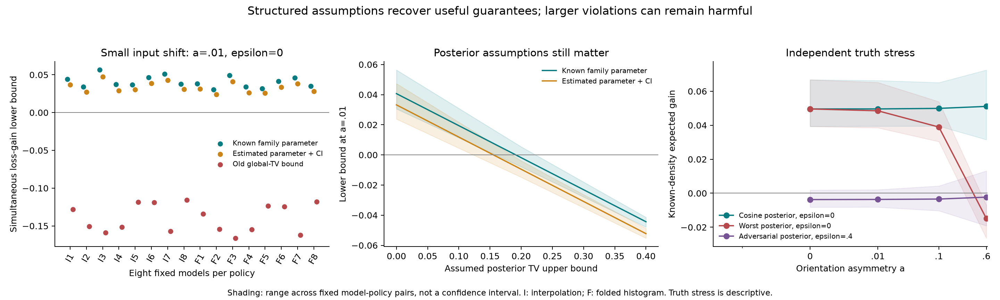

# Explicit orbit structure rescues the small-shift guarantee

Completed 21 November 2026. The new bound certifies all **16/16 fixed model-policy pairs** at the previously fatal a=.01 shift, both when a is known and when it is estimated with a conservative confidence interval. The old bound certifies 0/16. This is a conditional result for an explicitly specified harmonic input law and a supplied posterior-invariance assumption, not an unrestricted natural-data certificate.

The prospective primary setting is epsilon=0, a=.01, 2048 IID batches of 256 inputs per fixed model and law. The known-a lower bounds range from **0.030533 to 0.056370 nats** (mean 0.040657); estimated-a bounds range from **0.023795 to 0.047314** (mean 0.033196). Old global-TV bounds average -0.139809. All are recomputed on the same fresh verification streams at the same 95% simultaneous confidence allocation.

## What changed mathematically

The old penalty was D*TV(P,T#P), with D=24.34--34.22. The new result uses the actual orbit imbalance r=d(P-T#P)/d(P+T#P), the logit difference d=(z-zT)/2, its span S, and t=(F(z)-F(zT))/2-midrange(d). Under posterior TV at most epsilon, the sharp conditional orbit lower bound is

    J + r t - [|r|+(1-|r|)epsilon] S/2.

The coefficient is proved by optimizing jointly over two posterior probability vectors, not by replacing a global range with observed extrema. The proof includes the extremal posteriors, and is valid for any number of classes. All logits may receive arbitrary common offsets without changing the bound. The deployment selector must be invariant when **one input** is transformed with every other input and tie key fixed. Both historical exact-top-quarter policies satisfy this condition.

For the family (1+a cos phi)/(2 pi), r=a cos phi. Nonnegative even weights W=|cos phi|S/2-cos phi*t and R_a=(1-a|cos phi|)S/2 give

    G_P >= L_A - a U_W - epsilon U_Ra.

All moments are measured under the actual deployment P_a. Deterministic D remains in finite-sample concentration; it is not discarded or estimated from a maximum. At the primary setting, the mean new input-shift penalty is 0.001967, compared with 0.182434 for the old global penalty, a 92.7-fold reduction. The gain comes from explicit density structure and the selected local loss geometry, not from an assumed distribution-free TV estimate. No clipped tail is ignored: only the nonnegative Jensen gain is clipped downward; W and S remain untruncated.

THEORY.md gives the complete proof, the same-P conditional expectation identity, deterministic support-wide ranges and the confidence-event accounting. The general group-averaging viewpoint precedes this project; see [Chen, Dobriban and Lee (2020)](https://jmlr.org/papers/volume21/20-163/20-163.pdf). The concentration constants come from [Maurer and Pontil (2009), Theorem 4](https://arxiv.org/pdf/0907.3740), together with [McDiarmid's bounded-differences method](https://doi.org/10.1017/CBO9781107359949.008). The sharp posterior specialization and this fixed-policy experiment are the additions in this round; no literature-wide novelty claim is made.

## All primary lines

Positive numbers certify expected raw-minus-policy cross-entropy gain, conditional on the stated assumptions. Model indices are the eight previously fixed historical networks, with unchanged selectors and clipping rule. They are not independent fresh-model replications.

|Model|Policy|Known a lower|Estimated a lower|Old TV lower|
|---|---|---:|---:|---:|
|1|Interpolation|0.044159|0.036707|-0.128087|
|2|Interpolation|0.033934|0.026980|-0.150834|
|3|Interpolation|0.056370|0.047314|-0.159097|
|4|Interpolation|0.037298|0.029181|-0.151639|
|5|Interpolation|0.036621|0.030234|-0.118672|
|6|Interpolation|0.046642|0.038799|-0.118719|
|7|Interpolation|0.051052|0.042852|-0.157138|
|8|Interpolation|0.037610|0.030649|-0.115524|
|1|Folded|0.038176|0.031181|-0.134191|
|2|Folded|0.030533|0.023795|-0.154291|
|3|Folded|0.049412|0.040900|-0.166198|
|4|Folded|0.034290|0.026431|-0.154715|
|5|Folded|0.031988|0.025866|-0.123374|
|6|Folded|0.041238|0.033695|-0.124201|
|7|Folded|0.046113|0.038232|-0.162161|
|8|Folded|0.035083|0.028313|-0.118101|

The 512-batch look, the other epsilon values and every individual line are retained in certificate_curves.csv. The 2048-batch look was primary before new draws; no sample-size extension or clipping/range change followed the result.

## Unknown parameter: useful, still conditional

One independent sample of 65,536 coordinate inputs per law estimates a=2 E cos phi. There are no model calls or labels in this estimation step. A two-sided Hoeffding interval has radius .03638749, with one of 1284 total probability-event allocations per law. Restrict to a in [0,1]. The conservative propagated bound is

    G_P >= L_A - aU U_W - epsilon U_R(aL).

|True a|Estimate|Simultaneous parameter interval|
|---:|---:|---:|
|0|-0.002454|[0.000000, 0.033934]|
|0.01|0.011541|[0.000000, 0.047928]|
|0.1|0.103866|[0.067479, 0.140254]|
|0.6|0.602412|[0.566024, 0.638799]|

The parameter interval is conditioned on an exact family assumption; it does not validate that family. Conditional on the independent estimation sample, R(aL) is fixed, so the verification concentration remains valid. The union bound covers 1280 one-sided moment/method/model/policy/law/look events and four already-two-sided parameter intervals. Once these events hold, the certificate is uniform over epsilon in [0,1]; the display grid costs no additional events. The whole family has coverage at least 95%, conditional on all historical fitting artifacts.

## Where certification still fails

These are counts of positive lower bounds at the primary 2048-batch look. All negative and inconclusive results are retained.

|a|Posterior epsilon|Known a|Estimated a|Old global TV|
|---:|---:|---:|---:|---:|
|0|0|16/16|16/16|16/16|
|0|0.1|16/16|16/16|16/16|
|0|0.2|7/16|0/16|7/16|
|0|0.4|0/16|0/16|0/16|
|0.01|0|16/16|16/16|0/16|
|0.01|0.1|16/16|16/16|0/16|
|0.01|0.2|5/16|0/16|0/16|
|0.01|0.4|0/16|0/16|0/16|
|0.1|0|16/16|16/16|0/16|
|0.1|0.1|11/16|1/16|0/16|
|0.1|0.2|0/16|0/16|0/16|
|0.1|0.4|0/16|0/16|0/16|
|0.6|0|0/16|0/16|0/16|
|0.6|0.1|0/16|0/16|0/16|
|0.6|0.2|0/16|0/16|0/16|
|0.6|0.4|0/16|0/16|0/16|

At a=.01, both new versions still certify all 16 pairs at epsilon=.1. At epsilon=.2, only 5 known-a certificates remain positive and the parameter-uncertain version has none. At a=.6, neither version certifies any pair even with invariant labels. Thus the method tolerates modest, explicitly structured defects; it does not guarantee averaging will always help.

## Independent truth stress retains real negative gains

The independent 65,536-input evaluation per model/law uses known conditional label probabilities. It reports the ordinary direct IID gain and a density-corrected conditional orbit estimator of the **same** deployment risk. The corrected estimator is used below because it reduces orientation noise; it is not the ordinary unweighted paired-law score, a new certificate, or the exact population risk. Batch standard errors and both estimators are retained for every line in stress_results.csv.

|a|epsilon|Posterior world|Mean corrected gain|Mean direct IID gain|Negative corrected lines|
|---:|---:|---|---:|---:|---:|
|0.01|0|cosine|0.049592|0.049424|0/16|
|0.01|0|orbit_worst|0.048495|0.048695|0/16|
|0.01|0.4|adversarial|-0.003657|-0.003826|13/16|
|0.1|0|orbit_worst|0.038936|0.039077|0/16|
|0.6|0|cosine|0.051077|0.051057|0/16|
|0.6|0|orbit_worst|-0.014868|-0.015266|16/16|

The orbit_worst posterior world attains the sharp local lower bound before Jensen clipping, up to floating-point error. It is deliberately model-dependent; eight models do not share one common label task in this world. The true label law is still invariant at epsilon=0. All 16 averaged policies become harmful at a=.6 in that world, while the original invariant p0 world remains beneficial. Input symmetry and label semantics are separate requirements.

For all model/law/epsilon/policy/posterior comparisons, the smallest corrected Monte Carlo estimate minus known-a certificate is 0.005904, and minus estimated-a certificate is 0.012379. These consistency margins do not prove finite-sample coverage. The theorem supplies the coverage; simulation illustrates its consequences. No coverage claim over a new population of trained models is made.

## A parameter CI cannot repair a wrong family

An analytic counterexample uses density (1+.6 cos 3phi)/(2 pi), model h=.2 cos 3phi, invariant posterior p=1 and an input-independent exact-top-quarter mask. Its first-harmonic moment is zero, so the a estimator converges to zero and its interval narrows. Nevertheless, the correct gain is negative: log cosh v<=v^2/2 proves gain<-0.006875. A deterministic angular calculation gives -0.006875780, while incorrectly using the assumed a=0 family produces a positive +0.000624220 bound. MISSPECIFICATION.json records this illustration.

This is failure of a missing assumption, not a counterexample to the theorem. A discriminator only witnesses a TV lower bound. The previous study's unrestricted-TV obstruction remains valid, and unlabeled inputs still cannot identify the posterior relation. Related insufficiency-of-assumptions results appear in [Ben-David et al. (2010)](https://proceedings.mlr.press/v9/david10a.html); our harmonic counterexample is derived explicitly here rather than attributed to that paper.

## Cost and verification record

|Work|Coordinate inputs|Neural example evaluations|
|---|---:|---:|
|Parameter intervals, all four laws|262,144|0|
|512-batch certificate look, all model/law/policy pairs|4,194,304|2,567,024|
|2048-batch certificate, including nested 512 look|16,777,216|10,267,616|
|Independent posterior stress|2,097,152|4,194,304|
|Deployment replay audits|Reused 256-input batches|20,480|

The two policies share paired evaluations on their selected union, which contained 68--94 of 256 inputs. At deployment each policy uses exactly 256 original plus 64 transformed calls. There is no new model/selector fit and no new fitting label. Historical selector construction used 1,048,576 model forwards and is charged separately from this round. Historical models were trained with labels; this is not a claim of label-free model training.

STATISTICS_LEDGER.json records 640 separate moment/look reductions and 1280 allocated concentration calculations, plus all parameter, curve and posterior-stress work. The independent unit for empirical Bernstein is the full batch; the McDiarmid calculation uses a proved replacement sensitivity over independent records. Neither treats selected records as independent. Source/raw-data hashes, exact sampler seeds, individual forward ledgers and per-moment variances/radii/ranges are retained.

All 12 multiclass algebra cases (49,152 random records) passed. The largest stress identity error is 1.4e-15, sharp extremal equality error 1.39e-15, and partner-posterior error zero. Four single-coordinate mask replacements per model/law passed exactly. Ordinary floating-point parameter arithmetic is used; these checks are not a formal machine-verified interval proof. No natural-image input law or posterior defect is supplied by this controlled experiment.

The source freeze preceded every 233-family fresh sample and internal root approval. No runtime source was altered after release and no failed scientific outcome was discarded. Concurrent wall times (35.95s certificate, 36.23s stress) are descriptive only. Independent root auditing, including its separate calls and fresh random stream, is recorded outside this branch. See README.md for the standalone fresh-directory replay command and the complete file map.
