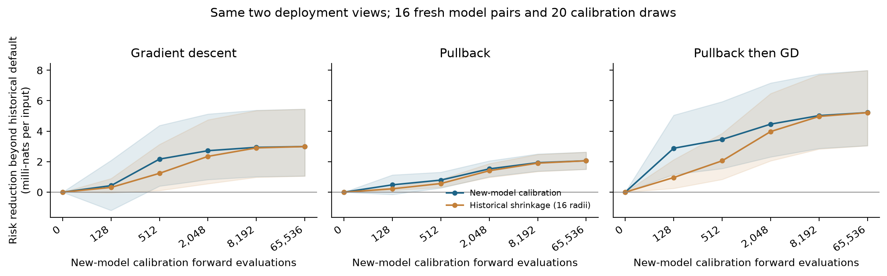
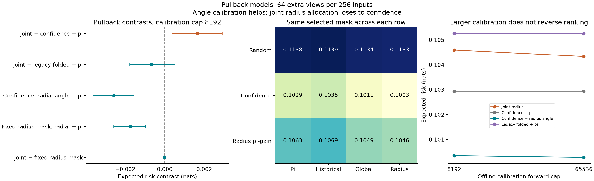
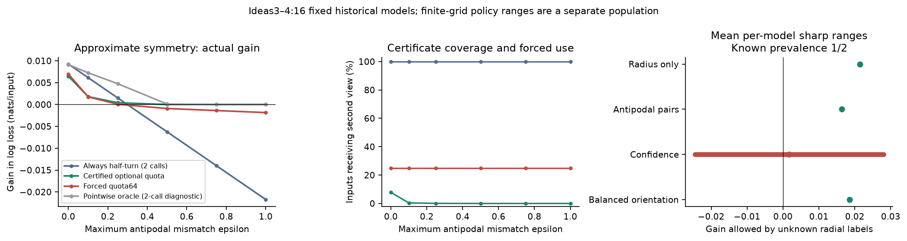

# Calibration cost and selective second views

Completed research agenda items 2A, 2B, 3 and 4 | 21 November 2026

The strongest practical result is that modest calibration can improve the angle used for a second prediction. The tested joint radius-based allocator did not outperform a simpler confidence allocator. The theory checks establish both a valid safety bound under approximate symmetry and a precise limit on what unlabeled observations can reveal about selective prediction gains.

## What was tested

Ideas 2A and 2B share 16 newly trained model groups, each containing gradient descent (GD500), pullback (PB500), and a PB100-to-GD400 hybrid. Their calibration and held-out evaluation draws are separate. Idea 2A repeats calibration 20 times per model; these repeats are not additional trained models. Ideas 3 and 4 instead use 16 fixed, previously inspected PB models for bounded mathematical and sensitivity checks.

All risks are binary log losses in nats per input; lower is better. A reduction of 0.0026 nats is not a 0.26 percentage-point accuracy improvement. Reported confidence intervals resample whole model-seed groups, not individual angular nodes or batches. Intervals are pointwise and not adjusted for the many secondary comparisons.

| Agenda item | Main finding | Essential limit |
|---|---|---|
| 2A: calibration budget | 8,192 forward evaluations recovered 93.9% of PB's additional gain over its historical default. | This is a cohort-average result relative to finite 65,536-call calibration, not a per-model guarantee. |
| 2B: exactly 64 extra views per 256 inputs | Keep the confidence-selected samples and learn their angles: PB risk fell from 0.102932 to 0.100349. | The primary joint allocator lost to confidence plus a half-turn; calibration and latency costs remain. |
| 3: approximate symmetry | The mismatch-corrected safety bound is valid and sharp. | The executable certificate becomes conservative and eventually selects nothing. |
| 4: unlabeled identification | Conditional signed balance identifies gain without labels; an orientation-sensitive finite construction satisfies it. | Balancing broad radius bins is insufficient; continuous deployment remains unproved. |

No unsuccessful policy, seed, calibration draw or tested mismatch level was removed. The original strong IID-calibrated gate was retained at the same forward cap. A calibration phase-stream correction and its superseded outputs are archived; the correction preceded all 2B test evaluation.

The source agenda is retained alongside this report. Full methods and tables are in the three study READMEs; proofs are in ideas34/THEORY.md. Raw predictions, decisions, fixed policies, model states, costs and independent audits accompany the report.

<!-- pagebreak -->

## 2A. A small amount of new calibration is useful

Historical defaults were chosen only from the old model bank: GD 180 degrees, PB 143.4375 degrees, and hybrid 163.125 degrees. The motivating PB result on an already inspected cohort was reproduced: the shared angle removed 62.70% of angular excess loss, versus 54.87% for a half-turn. Those retrospective values were not counted as fresh confirmation.

On the new cohort, the shared PB default had slightly higher mean loss than the half-turn: 0.105377 versus 0.104865. Its paired improvement was -0.000512, with 95% interval [-0.001691, 0.000715]. Thus there is no established transferable advantage; the interval also does not establish that this PB default is universally worse. The hybrid default was worse on average as well.

| New-model calibration forwards | Independent radii | GD risk | PB risk | Hybrid risk |
|---|---|---|---|---|
| 0: historical default | 0 | 0.172338 | 0.105377 | 0.046311 |
| 128 | 1 | 0.171909 | 0.104896 | 0.043430 |
| 512 | 4 | 0.170168 | 0.104584 | 0.042852 |
| 2,048 | 16 | 0.169616 | 0.103847 | 0.041849 |
| 8,192 | 64 | 0.169397 | 0.103442 | 0.041287 |
| 65,536 | 512 | 0.169342 | 0.103316 | 0.041090 |
| 0: fixed half-turn | 0 | 0.172338 | 0.104865 | 0.044960 |

PB's 8,192-call result recovered 93.89% [90.26%, 96.56%] of the full reference's extra gain over the historical default. It uses one eighth of the full reference's calibration forwards. The first tested 90% budget was 2,048 for GD and 8,192 for PB and hybrid. PB needed the full reference in 1.84% of model-cluster bootstrap draws. These percentages measure additional gain, not total model quality.

Full PB calibration improved on the half-turn by 0.001548 [0.000714, 0.002482] nats. It still lost on two of sixteen models after averaging calibration repeats. Fixed historical shrinkage reduced occasional low-budget losses but reduced average gain at every tested nonzero budget. Independent sampled-label tests agreed with the budget ordering. All policies on this page use two model calls per deployed input.

<!-- pagebreak -->

## 2B. Improve the angle while keeping a strong sample selector

Every limited policy gives a second view to exactly 64 of each 256 inputs: 1.25 model evaluations per input. The primary cap is 8,192 offline calibration forwards; 65,536 is a prespecified sensitivity analysis. Random, confidence, and radius-based masks are each held fixed while the angle changes, separating the two effects. The legacy folded-angle gate retains its original IID calibration design at the same cost cap.

The primary PB joint allocator did not succeed. Relative to confidence plus a half-turn, its risk increased by 0.001657 [0.000356, 0.002912], losing on 14/16 models. Relative to the legacy IID folded gate, the difference was -0.000667 [-0.001781, 0.000527], leaving the ranking uncertain. Increasing calibration to 65,536 did not reverse these main conclusions.

The useful prespecified secondary result was an angle change on an identical confidence mask. Learning an angle by radius reduced loss by 0.002583 [0.001572, 0.003649], winning on 15/16 models. This is about 2.5% of the reference log loss. Updating the radius mask after optimizing angles added only 0.000019 mean gain, with an interval spanning zero.

| PB policy at primary cap | Expected risk | Calls/input | New calibration forwards |
|---|---|---|---|
| Confidence + half-turn | 0.102932 | 1.25 | 0 |
| Confidence + learned global angle | 0.101101 | 1.25 | 8,192 |
| Confidence + learned radius angle | 0.100349 | 1.25 | 8,192 |
| Joint radius selector + radius angle | 0.104588 | 1.25 | 8,192 |
| Legacy IID folded gate + half-turn | 0.105255 | 1.25 | 8,192 |
| All inputs + radius angle | 0.102995 | 2.00 | 8,192 |

Selecting by first-view confidence can skip orientation-specific harmful changes, so a selective method can outperform averaging every input. Such a mask does not inherit a universal symmetry guarantee. All 18 limited policies passed executed 256-plus-64 call audits. Fewer forwards did not guarantee lower local CPU latency: selection overhead sometimes outweighed the saved calls. Calibration, model-call counts and measured time are reported separately.

<!-- pagebreak -->

## 3. The approximate-symmetry bound is correct, but coverage is limited

For an equiprobable antipodal pair with logits a and b, true label probabilities p and q, and averaged logit m=(a+b)/2, let A(t)=log(1+exp(t)) and J=[A(a)+A(b)]/2-A(m). Exact expected gain is:

**Gain = J - (p-q)(a-b)/4.**

If the label mismatch satisfies |p-q| <= epsilon, a sharp lower bound is J-epsilon|a-b|/4. The equality construction and proof are retained. A negative lower bound means the certificate is inconclusive; it does not by itself prove harm.

The executable gate uses offline interval propagation over polar cells to bound both logits before querying any new second view. Its folded-angle lookup and tie handling preserve antipodal selection symmetry. It selects only positive certificates, up to 64 per batch. This certifies expected pair/orbit risk under the stated input law and mismatch assumption, not the realized loss of every labeled example. Epsilon must come from a credible external assumption or validation; unlabeled scores do not identify it here.

| Mismatch epsilon | Full half-turn gain | Certified gain | Inputs receiving certified second view | Forced-64 models harmed |
|---|---|---|---|---|
| 0 | 0.009250 | 0.006478 | 7.769% | 0/16 |
| 0.10 | 0.006151 | 0.001805 | 0.402% | 5/16 |
| 0.25 | 0.001502 | 0.000400 | 0.084% | 9/16 |
| 0.50 | -0.006245 | 0 | 0% | 14/16 |
| 0.75 | -0.013992 | 0 | 0% | 14/16 |
| 1.00 | -0.021740 | 0 | 0% | 14/16 |

The certified rule selected no measured harmful pair, but its useful coverage collapsed quickly. At epsilon 0.5 and above it abstained entirely. Forcing all 64 extra calls can turn a conservative, harmless rule into a harmful one. Even at epsilon 0.1, the tested forced rule harmed five models. At epsilon zero, zero-bound inputs could also be filled safely by the symmetry theorem; the implemented rule deliberately accepts only strict positive bounds.

This is a sensitivity experiment with fixed historical models and changed label posteriors, not a new training replication. The input distribution stays fixed. Offline work was 32,768 interval propagations per model, separate from ordinary forward evaluations. A diagnostic rule that reads both exact logits is charged two calls per input. The interval construction is mathematically conservative and numerically checked; the floating-point implementation is not a formally verified directed-rounding proof system.

<!-- pagebreak -->

## 4. What unlabeled predictions can and cannot tell us

For a fixed input-only selection rule g, let a be the original logit and m its replacement. Write C=E[g(A(a)-A(m))] and b(r)=E[g(a-m) given radius r]. If the unknown label posterior is radial, exact gain is:

**Gain(p) = C - E[p(R)b(R)].**

Without label information, gain is identified for every radial posterior if and only if b(r)=0 almost everywhere. Its sharp possible range is [C-E max(b,0), C+E max(-b,0)]. If overall class prevalence is known and strictly between zero and one, identification instead requires b to be constant. Sharp endpoints allocate the available positive-label probability to the largest or smallest values of b, allowing fractional allocation at ties.

This is a real ambiguity, not merely noisy estimation. A four-input example has identical unlabeled observations and the same 50/50 class prevalence in two possible worlds, yet its gain is +0.094971 in one world and -0.155029 in the other. Knowing the overall class ratio does not generally fix the problem.

The finite construction uses 16 radii and 16 orientations. At every radius, it randomizes between at most two four-point subsets, balancing signed logit change in expectation. Every batch still uses exactly 64 extra views. Its marginal selection probabilities genuinely differ at antipodes, showing that orientation sensitivity need not destroy identification.

The balanced policy improved on the same-per-radius antipodal-pair baseline by 0.002057 nats, winning on all 16 old models. It lost to the radius-only policy on average by 0.002930; that comparator can allocate calls freely across radii. The construction is therefore a feasibility and constrained-optimization result, not an overall winning allocator.

Confidence-based selection admitted both positive and negative gains for every model even at known prevalence 1/2; the mean model-specific interval was [-0.024478, 0.027978]. Balanced and symmetric rules had point-identified gains. This finite support is fully covered by 256 offline forwards and could be cached, so it is not a fundamental compute-saving demonstration. Balancing one broad radius bin is also insufficient on continuous inputs: unobserved variation within that bin can reverse the gain. Continuous approximation and finite-sample uncertainty require additional work.

<!-- pagebreak -->

## Independent checks and retained evidence

The independent auditor does not call the investigators' selector functions when reconstructing decisions and test risks. It checked frozen source/data hashes and chronological commitments; all 11,520 calibration decisions and population-risk records; every summary mean and quota contrast; 18 raw orbit/prefix reconstructions; 24 independently regenerated 2A IID risk comparisons; and 252 full-test 2B masks and expected/sampled-label risks.

All 2,016 2B deployment records respected their stated call budgets, and the fixed-mask factorial groups used identical masks. The largest independent risk discrepancy was below 6e-17. All finite-support tables and 128 identification intervals were reconstructed. Subset-mixture quotas and linear-program dual certificates passed. Another 80,000 random points inside interval boxes across all 16 old models satisfied the logit enclosures and all six mismatch bounds. Separate mathematical audits verify the exact identity, sharpness, prevalence constraint, and continuous-bin counterexamples.

The 2A population integrals refined from 192 by 512 to 384 by 1,024 nodes for all 48 models; the maximum observed risk/gain-vector change was 2.82e-8. Separate independently seeded IID tests support the results. These checks are evidence of reproducibility and numerical consistency, not proofs that the synthetic setting transfers to other datasets.

Preserved limitations include the failed primary joint allocator; uncertain transfer of historical angles; occasional finite-calibration regressions; conservative certificates; the finite grid's caching advantage; and the fact that 2A/2B share a training cohort. Research-wide simulation work, historical setup, per-policy calibration and deployment cost remain distinct.

## Recommended next direction

**First: confirm the simple empirical combination.** Freeze confidence-based selection plus low-budget angle calibration against confidence plus a half-turn, the legacy folded gate, and full averaging. Use genuinely new model seeds and another data geometry with verified label-preserving transformations; otherwise evaluate the change as an approximate-symmetry test. Treat 8,192 as a promising tested budget, not a universal constant. Report calibration amortization, latency and every model that worsens. The present factorial evidence justifies this confirmation, not tuning another elaborate allocator on the same outcomes.

**Second: turn conditional balance into a continuous method.** Extend the finite construction while retaining the exact deployment quota. Derive a finite-sample bound on residual conditional imbalance, or state and validate a smoothness assumption that controls within-bin error. Compare with both the simple confidence rule and free allocation across radii. This connects the practical observation in 2B with the identification obstacle in 4 and is the clearest candidate for a substantive methodological contribution.

**Third: make the approximate-symmetry certificate useful.** Test tighter bounds and adaptive regions at a fixed offline cost. Prespecify a minimum useful coverage and gain target. If a credible mismatch bound still leaves almost no selectable inputs, present the certificate as a boundary result rather than a deployment improvement. Do not force unused quota merely to preserve a nominal call count.

The next immediate experiment should prioritize the first recommendation. The research argument should center on when unlabeled selection is identifiable and when it is not, using the second and third recommendations to address the observed limits. The present results do not support a universal historical angle or a universal superiority claim for the joint radius allocator.

The individual study READMEs map the raw results and scientific figures. REPRODUCE.md gives the environment and fresh-output commands. Run verify_archive.py for file integrity; the two scripts under audit/ independently check the mathematics and numerical results. Both original and superseded pre-test materials are retained.
