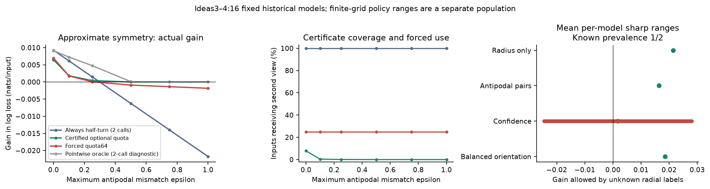

# Approximate symmetry and identifiable selective gains

These checks use sixteen fixed, previously inspected historical PB500 models. They are separate from the fresh-model2A/2B experiments. We froze the source, epsilon grid, policies and model hashes before held-out scoring. Theoretical identification and numerical sampling precision are reported separately.

## Idea3: a valid certificate can become conservative

For an antipodal pair, exact gain is J−(p−q)(a−b)/4. Under |p−q|≤epsilon, J−epsilon|a−b|/4 is sharp. Our executable gate never obtains the second logit before deciding. Offline interval propagation supplies a conservative cellwise certificate, indexed by radius and folded angle. It selects at most64 of256 only where the bound is strictly positive. Zero certificates are deliberately skipped; at epsilon0 the symmetry theorem would also permit filling remaining capacity without harm.

|epsilon|Always-half-turn gain|Certified gain|Certified usage|Forced64 gain|Forced models harmed|
|---:|---:|---:|---:|---:|---:|
|0|0.0092497|0.0064780|7.769%|0.0069868|0/16|
|0.1|0.0061507|0.0018052|0.402%|0.0017604|5/16|
|0.25|0.0015023|0.0004000|0.084%|0.0000565|9/16|
|0.5|-0.0062450|0.0000000|0.000%|-0.0009143|14/16|
|0.75|-0.0139923|0.0000000|0.000%|-0.0013795|14/16|
|1|-0.0217397|0.0000000|0.000%|-0.0018437|14/16|

Every selected pair of the certified rule had nonnegative measured gain, consistent with the pointwise guarantee. Its useful coverage collapses as the allowed label mismatch grows: this is a real limitation, not hidden by calling abstention a practical success. Forcing64 calls can include uncertified harmful pairs. At epsilon0.1, five models had negative forced-policy mean gain even though universal averaging was beneficial on every model; the forced rule is an illustrative lower-bound ranking, not claimed to be an optimal shift-aware policy.

A negative pointwise or cell bound does not imply actual harm. The archived rows report both positive-gain/negative-bound frequencies. The full second-view policy first had negative cohort mean at tested epsilon0.5. Coarse-region diagnostics preserve every region with at least32 held-out inputs; their first tested harmful regions are exploratory descriptive localizations, not independently confirmed thresholds. Known p_epsilon is used only to evaluate risk, never by the deployment gate.

Offline bounds use16,384 cells and32,768 interval propagations per model; median construction time was0.0514s. Interval operations are not ordinary model forward evaluations. Executed gates call the model once on256 inputs then only on their selected subset. The pointwise-bound oracle already needs both logits on every input and is explicitly charged2calls/input. All policies share independent held-out inputs within a model.

## Idea4: orientation sensitivity need not destroy identification

For a fixed rule, gain is C−E[p(R)b(R)]. With unrestricted unknown radial p, its exact sharp range is [C−E b_+,C+E b_-]; exact identification holds iff b=0 almost surely. With known prevalence pi strictly between0and1, identification holds iff b is constant; sharp bounds allocate positive-label probability to the top or bottom pi-mass of b. The mathematical proof and fractional-atom treatment are in THEORY.md.

The finite construction has16radii×16orientations per stratified batch. A mixture of atmost2 four-point subsets at each radius gives exactly64 extra calls in every realization and conditional signed balance in expectation. Its marginal selection probabilities truly differ at antipodes. The table covers all256support points, so this is an exact finite-support construction with explicit calibration and caching qualifications, not a continuous deployment claim.

|Policy|Mean gain range with prevalence1/2|Models admitting both signs|
|---|---:|---:|
|radius_only|[0.021418,0.021418]|0/16|
|antipodal_pairs|[0.016431,0.016431]|0/16|
|confidence|[-0.024478,0.027978]|16/16|
|balanced_orientation|[0.018488,0.018488]|0/16|

The balanced orientation-sensitive rule improved over the equally constrained antipodal-pair rule by0.0020571nats/input on average (descriptive paired95%interval[0.0016036201594987472, 0.0025539180802307965], wins16/16). Its conditional imbalance was at most2.78e-17; every model had marginal antipodal selection asymmetry at least1.000.

It did not dominate allocation across radii: its mean difference versus the radius-only rule was-0.0029298nats/input, winning4/16. The radius-only rule can spend all16calls on a chosen radius, whereas the constructive balanced rule reserves4perradius. This makes the latter a conditional-balance feasibility/optimization result under its stated per-radius restriction, not the globally optimal64-call policy.

Confidence admitted opposite gain signs for every model even when class prevalence was known to be1/2. Hidden evaluator posteriors include each policy’s actual extremizers; balanced and symmetric rules keep their exact gains across these worlds. Displayed mean interval endpoints average model-specific sharp bounds; their extremizing posteriors can differ across models, so no common adversarial posterior is claimed to attain all endpoints simultaneously. The finite policy used256offline support forwards per model. A complete support cache could eliminate subsequent model calls; our executed256+64 path deliberately reevaluates predictions and verifies the budget, without claiming a fundamental compute saving on this artificial support.

## Checks, counterexamples and remaining limits

The four-point same-prevalence gains were0.094971373 and-0.155028627. Sharp epsilon-bound equality was checked to1.80e-15. One hundred unequal-weight fixed-prevalence problems matched exhaustive linear-program vertices to4.44e-16. All256conditional subset-mixture optima had valid numerical dual certificates, maximum violation5.55e-17.

A single continuous-radius bin with average imbalance0 still admits same-prevalence gains-0.201612 and0.298388; smooth posterior alternatives give-0.166957 and0.263733. Finite-bin balance cannot stand in for conditioning on every radius. If a credible L-Lipschitz posterior bound is available, the residual ambiguity is at most L times bin width times E|b|/2. No such regularity is inferred from unlabeled scores.

Randomized-batch repetitions estimate a fixed-model policy expectation; they are not extra trained-model replications. Paired descriptive intervals resample the16oldmodels. The graphical comparison combines two deliberately different input populations, clearly labeled; their absolute gains are not a cross-experiment ranking. No numerical failure or losing epsilon/policy was dropped.



## Reproduction

Use NumPy, threadpoolctl and Matplotlib in the project environment. Keep the bundled source/ and legacy/ siblings. To reproduce without overwriting this archive, copy the source files into a fresh ideas34 directory with the same parent layout, then run:

```powershell
python study.py freeze
python study.py fit
python study.py evaluate
python analyze.py
```

The freeze, calibration manifest and scoring timestamps establish the recorded sequence. Raw per-model, per-batch, hidden-world, region, deployment and algebraic-audit records are under results/. The scientific figure is available as PNG and PDF.