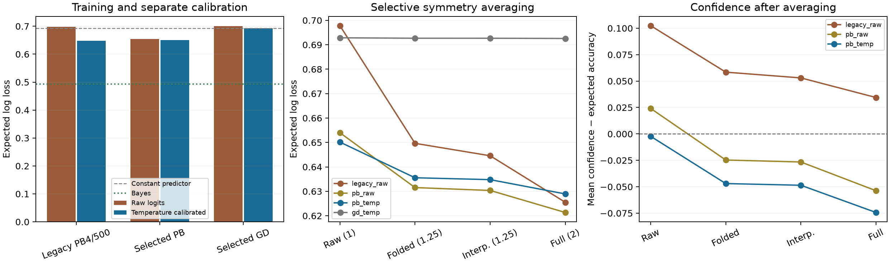
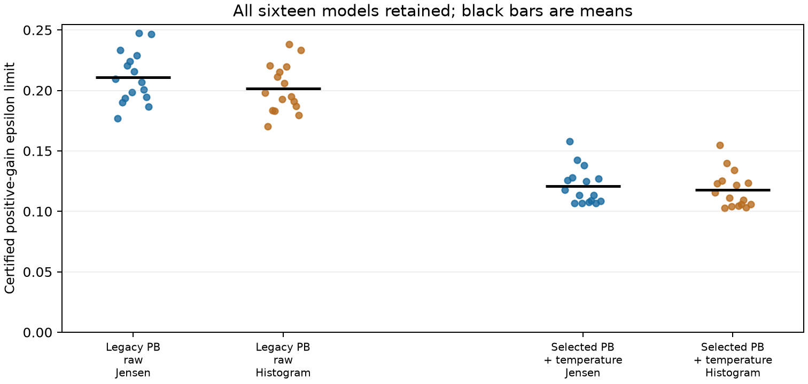
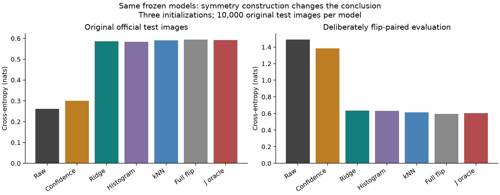
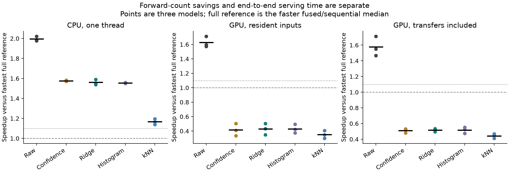

# Calibration helps; real-image augmentation fails

Completed 21 November 2026. All three authorized follow-ups are finished: training and probability calibration, bounded symmetry-error guarantees, and a real-image CPU/GPU cost study. Earlier research archives remain unchanged. Negative results are retained and independently reproduced.

## The decision supported by this round

**Keep probability calibration as a useful tool, but apply it to the final prediction pipeline. Do not deploy the current reflection-based image gate.** The clearest improvement is the simple legacy synthetic model plus independent temperature calibration. The more elaborate training procedure does not dominate it, and the real-data augmentation harms predictions.

|Question|Completed evidence|Consequence|
|---|---|---|
|Can training/calibration help?|Legacy temperature lowers mean loss from 0.697837 to 0.647410; its error is unchanged.|Useful probability improvement; no temperature-caused accuracy gain.|
|How much label-symmetry error is tolerable?|All 64 primary safe-policy lines remain positive at a uniform posterior gap of 0.10.|A conditional guarantee with explicit limits, not safety on arbitrary real inputs.|
|Does the real-image method work and save time?|Original-test error rises from 9.59% to 20.91% with the ridge gate. GPU selection is slower than full averaging.|A negative deployment result despite loss gains on an artificial pair-closed law.|

The synthetic confirmation uses 16 independent train/init pairs, three model families and six raw/temperature variants. All 384 outcome rows are retained. The real task uses official Fashion-MNIST, three fixed 426,122-parameter CNNs, separate fitting/validation/calibration splits, and all 10,000 official test images. The three CNNs share one dataset split; they are initialization/order replications, not three independent datasets.

Methods, choices and uncertainty rules were frozen before their confirmation data were accessed. Calibration labels never came from performance samples. The robustness source was fixed before reading the new model artifacts or drawing verification inputs. Image test arrays were not decoded until model and policy commits plus internal scientific release.

The practical next priority is to calibrate completed prediction pipelines and make transformations reliable during training, then compare them on new held-out evaluation. Increasing selector complexity or using an extra view by default is not justified by these results.

<!-- pagebreak -->

## 1. Calibration works, but benefits do not automatically add

The bounded pilot ran 72 trajectories: four seeds, PB/GD optimizers, three learning rates and three weight-only L2 strengths, with four validation checkpoints. PB rate 2 and GD rate 0.3 won; both chose zero L2. Thus this study does not show a regularization benefit. Architecture and 256-example training sets remain unchanged.

|Raw-output variant|Expected loss|Expected error|Binned calibration error|Labeled examples used|
|---|---|---|---|---|
|Legacy PB|0.697837|37.304%|0.1035|256|
|Legacy PB + temperature|0.647410|37.304%|0.0237|2,304|
|Selected PB|0.654007|37.890%|0.0362|2,304|
|Selected PB + temperature|0.650172|37.890%|0.0248|4,352|
|Selected GD + temperature|0.692856|49.192%|0.0105|4,352|

Validation and temperature fitting each use 2,048 independent sampled labels. The extra labels are an explicit resource; comparison with the 256-label legacy predictor is not at equal total label budget. Calibration error uses ten fixed bins and the known synthetic posterior, as an evaluation diagnostic only.

All four primary loss contrasts improve on 16/16 fresh pairs. Selected PB plus temperature reduces raw loss by 0.047665 versus legacy; its 98.75% paired-bootstrap interval is [-0.061755,-0.034219]. Interpolation then reduces its own raw loss by another 0.015386, interval [-0.017838,-0.013192]. Four prespecified primary comparisons share a nominal 95% bootstrap family; these are approximate finite-model intervals, separate from the certificates.

Three limits matter. Selected training slightly increases error, from 37.304% to 37.890%. Legacy temperature alone has better mean raw loss than the combined procedure while using fewer labels. Finally, a temperature fitted to raw predictions can hurt already-averaged predictions: selected-PB interpolation loss rises from 0.630366 to 0.634786, and full averaging from 0.621340 to 0.628933. The correction can make those outputs underconfident. No post-test temperature was refitted to repair this result.

<!-- pagebreak -->

## 2. A quantified boundary for imperfect label symmetry

Keep the input law exactly half-turn-invariant. Let d=(h-hT)/2 and J be the logistic Jensen gap. The exact-quota mask M comes from a frozen pointwise half-turn-even score and independent tie keys: transforming one input leaves M unchanged with other inputs and keys fixed. Exact quota alone is insufficient. Pairing gives expected gain E[M(J-(p-pT)d/2)], so a supplied bound abs(p-pT) <= epsilon gives

**Gain >= L_A - epsilon U_B / 2**, where L_A lower-bounds E[M min(J,c)] and U_B upper-bounds E[M abs(d)].

Both moments are verified on independent inputs. Their empirical-Bernstein and bounded-difference bounds account for quota dependence. A 95% joint family covers 64 policy/predictor lines, two moments, two methods and two fixed looks: 512 elementary events. Each resulting line is valid for every epsilon in [0,1], not just the plotted grid. The primary look is 2,048 batches; the additional fixed look is 512.

|Predictor / selector|Mean positive-gain limit|Smallest limit among 16|
|---|---|---|
|Legacy / interpolation|0.210883|0.177009|
|Legacy / strong histogram|0.201520|0.170163|
|Selected PB + temperature / interpolation|0.120789|0.106555|
|Selected PB + temperature / histogram|0.117812|0.102635|

All 64 primary lines are positive at epsilon=0.10. This means a uniform difference of at most ten percentage points between paired true class probabilities; it does not mean ten percent arbitrary label corruption. In an adversarial epsilon=1 world, all 16 models in both groups are harmed by each symmetric selector. The interpolated mean gains become -0.024380 and -0.021037. These are model-dependent stress worlds, not a common population across models.

The improved group changes both training and temperature, so its smaller certified tolerance is not a causal temperature-only conclusion. The proof also requires exact input-law symmetry and a justified posterior bound; neither follows from unlabeled agreement. The binary post-outcome input-TV extension is documented separately and is not a certificate for the multiclass image experiment.

<!-- pagebreak -->

## 3. Real images expose the missing assumption

Official Fashion-MNIST provides actual garment images. Each fixed CNN trains on 40,000 images; separate 5,000/5,000/8,000/2,000 splits handle validation, temperature, selector fitting and selector selection. No training augmentation is used. All official 10,000 test images are retained, including the final 16-image batch with quota four.

The image surrogate uses 98 reflection-even pooled pixel features and ridge regression to unlabeled multiclass Jensen gaps. It is an adaptation of the allocation principle, not the previous low-dimensional interpolator. Histogram and kNN controls use the same fitting information; validation chooses kNN as the strongest control for all three models.

|Policy|Original-test loss|Original-test error|Artificial paired loss|
|---|---|---|---|
|Raw image|0.261212|9.593%|1.488390|
|Confidence gate|0.299925|10.680%|1.384417|
|Ridge gate|0.585911|20.907%|0.633750|
|Histogram gate|0.583871|20.873%|0.632139|
|Strong kNN gate|0.590612|21.060%|0.613723|
|Full reflection average|0.593886|21.240%|0.593886|

The ridge gate is slightly less harmful than kNN on original images: loss difference -0.004701, descriptive cluster-bootstrap interval [-0.006295,-0.003152]. Raw loss is much lower. On the pair-closed law, kNN beats ridge by 0.020027, interval [0.017655,0.022250]. Each bootstrap keeps both orientations and the three models together inside 40 test-batch clusters. Even paired-law loss gains do not imply accuracy gains: ridge raises paired error from 20.36% to 22.84%.

Independent replay verifies the official checksums, all labels and ordering, width-axis reflection and every model's direct two-view predictions. No implementation discrepancy explains the failure. Ankle-boot error averages 3.93% on original inputs, 100% on reflected inputs and 95.8% after full averaging. This is consistent with learned orientation sensitivity, not a causal proof of its origin. Semantic label preservation alone does not make the original input distribution reflection-invariant.

<!-- pagebreak -->

## 4. Your 5070 Ti helps the CNN; selective views do not help GPU latency

The three 426,122-parameter CNN training runs take 17.914 GPU seconds in total under the fixed 12-epoch recipe. This training timing is descriptive. Serving measurements are separately controlled: one CPU thread, synchronized FP32 CUDA, TF32 disabled, three warmup blocks and seven measured blocks per model/mode/policy, four 256-image batches per block. Other experimental numerical work was held during timing.

|Policy|CPU ms/batch|GPU resident ms/batch|GPU transfer ms/batch|
|---|---|---|---|
|Raw|28.065|0.349|0.546|
|Full fused|58.272|0.557|0.847|
|Full sequential|55.879|0.760|0.940|
|Ridge gate|35.973|1.354|1.621|
|Strong kNN gate|48.590|1.679|1.877|

Entries are medians across the three model-specific medians. Transfer includes normalized CPU tensors to GPU and logits back to CPU. Resident runs still include features, scoring, sorting, indexing, transformations, network inference and merging. Image decoding/normalization, model loading, fitting and training are separate costs. Both fused and sequential full averaging are measured; each limited policy is compared with the faster full reference for that model and mode.

The median modelwise ridge speed ratio versus the strongest full reference is 1.553x on CPU, 0.431x on resident GPU and 0.519x with GPU transfers. All limited GPU policies fail the frozen 1.10x target. The target means at least 1.10 times the full reference's throughput-equivalent speed, not exactly ten percent lower latency. Ratios are aggregated per model, so they need not equal ratios of displayed median times.

All CPU limited policies pass the frozen full-relative timing/loss target, but full averaging itself is harmful. Raw prediction is both faster and more accurate on the original task. A pass against that full baseline is therefore not a deployment recommendation. The oracle is charged two views on every image. Selector fitting and selection use 60,000 shared CNN forward examples across three models; recorded serving blocks use 774,144, warmups 331,776, and official quality evaluation 720,000.

<!-- pagebreak -->

## Recommended next direction

1. **Calibrate the final output, with a fixed total label budget.** Compare legacy plus temperature, selected training, and completed averaging pipelines on separate validation/calibration data. Fit each final pipeline's scalar correction to its own outputs. Include a control that spends the same extra labels on training. Report loss and error separately; temperature alone cannot fix classification mistakes. The current legacy-plus-temperature result is the simplest useful baseline.

2. **Teach and test the transformation before using it at prediction time.** Compare the same CNN trained with and without horizontal-reflection augmentation, keeping raw inference as the primary reference. Freeze choices before new held-out evaluation. Require original-task accuracy/loss to remain acceptable before investigating any inference saving. The present image gate and unconditional full-reflection average should not be deployed on this evidence.

3. **Cover input-law mismatch explicitly.** The primary certificate only perturbs labels under a symmetric input law. A reviewed post-outcome binary calculation adds a D*eta penalty when TV(P,T#P)<=eta, yielding L_A-epsilon U_B/2-D eta. It requires moments verified on that same input law and justified defect bounds. The synthetic moments cannot be reused for Fashion-MNIST, and the CNN needs a separate multiclass range argument. This is an explanatory extension, not a newly verified real-data guarantee.

## Evidence and limits retained in the archive

The synthetic audit reconstructs all 384 metric rows, 96 variant outputs and masks, 48 temperature fits, 32 checkpoint selections and all 16 data streams. Maximum metric discrepancy is 2.23e-16; all masks and output relations agree. Its 98,304 deployment records total 34,603,008 model-example forwards. Actual shared selector calibration uses 6,291,456, versus 12,582,912 standalone equivalent forwards.

The robustness audit reconstructs all 512 elementary bounds exactly and all 2,560 stress outcome rows within 2.23e-16. Six 128-batch replays agree. The main certificate uses 10,036,010 shared model-example forwards. Independent audit work is additional: 265,216 synthetic-training checks, 116,564 robustness checks, and 61,536 direct real-image replay forwards. Separate image-temperature diagnostics use 15,000 validation forwards. The real-image arithmetic audit reproduces all 504 timing rows and all 12 descriptive bootstrap intervals. CPU/GPU masks and predicted classes are identical; small FP32 logit differences are retained. A too-strict initial normalization equality check was corrected in an audit-only revision; that failed attempt made zero CNN calls and is preserved.

Limitations include synthetic binary guarantees, only 16 synthetic seed clusters, three image initializations on one split, extra calibration labels, selected-model underfitting, constructed paired-image symmetry, approximate bootstrap uncertainty, and floating-point rather than formal machine proof. No model or policy was retuned after the test failures.

The main precedents are [Guo et al., ICML 2017](https://proceedings.mlr.press/v70/guo17a.html) for temperature calibration, [Chen et al., JMLR 2020](https://jmlr.org/papers/v21/20-163.html) for group averaging and approximate invariance, and [Fashion-MNIST's authors](https://arxiv.org/abs/1708.07747) for the image benchmark. Existing [empirical Bernstein](https://arxiv.org/abs/0907.3740) and [bounded-difference](https://doi.org/10.1017/CBO9781107359949.008) tools supply concentration. No first general calibration, robustness or identifiability principle is claimed. Full source notes, protocols, freezes, arrays, ledgers, audits, figures and the official dataset license are retained.
