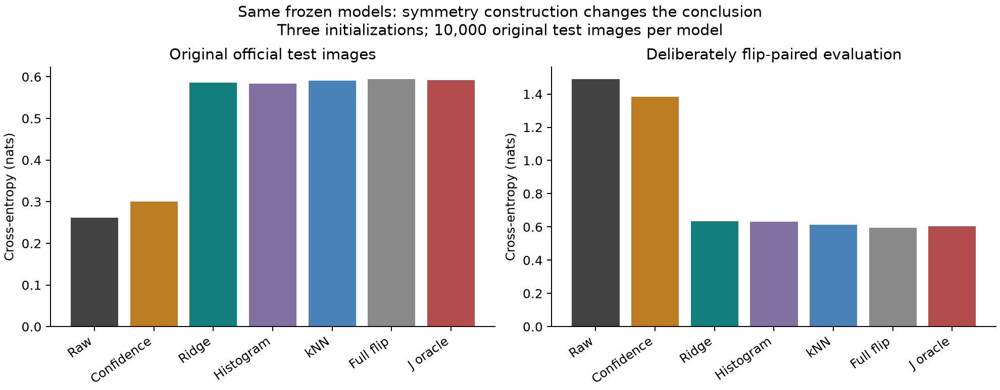
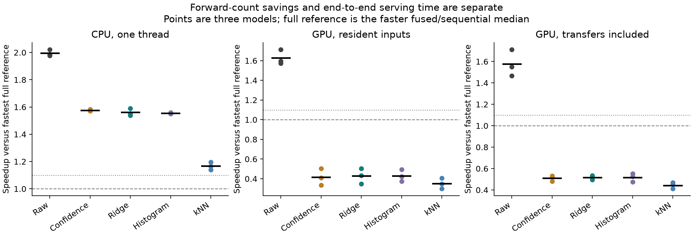

# Fashion-MNIST: a negative original-distribution transfer result

The frozen real-data study is complete. Original Fashion-MNIST performance
does not support applying horizontal-flip averaging to these models. The
candidate ridge selector's original-test cross-entropy is 0.585911,
versus 0.261212 for raw prediction. The separately constructed flip-paired
evaluation improves, illustrating the distributional boundary of the theorem.
No model, selector, temperature, or threshold was retuned after test access.

## All primary CUDA quality results

|Policy|Original loss|Original error|Pair-closed loss|Paired-J oracle fraction|
|---|---:|---:|---:|---:|
|Raw|0.261212|9.593%|1.488390|0.0000|
|Confidence|0.299925|10.680%|1.384417|0.0754|
|Ridge|0.585911|20.907%|0.633750|0.9679|
|Histogram|0.583871|20.873%|0.632139|0.9698|
|kNN|0.590612|21.060%|0.613723|0.9905|
|Full flip|0.593886|21.240%|0.593886|1.0129|
|J oracle|0.592162|21.163%|0.605326|1.0000|

The selected kNN is the stronger validation control for every model. The
table reports mean metrics over three initialization/order replications on
one shared training split. The original and paired columns refer to different
evaluation laws. The full and oracle references cost 2 forward examples per
input; deployable limited policies cost 1.25, and raw costs 1. Oracle fractions
refer to the exact-quota Jensen objective, not original-test loss optimality.



## Fixed paired cluster-bootstrap contrasts

Negative loss differences favor ridge. These 95% intervals resample the 40
original-image batches, retaining all 10,000 images including the final 16-image
batch and keeping both orientations and all three fixed models together.
They are descriptive approximations, not three-dataset replication or a
distribution-free real-data guarantee.

|Evaluation law|Contrast|Mean|Interval|
|---|---|---:|---|
|original|ridge_minus_strong_control|-0.004701|[-0.006295, -0.003152]|
|original|ridge_minus_full_fused|-0.007975|[-0.010887, -0.004867]|
|original|ridge_minus_confidence|0.285986|[0.271483, 0.301799]|
|pair_closed|ridge_minus_strong_control|0.020027|[0.017655, 0.022250]|
|pair_closed|ridge_minus_full_fused|0.039864|[0.037376, 0.042295]|
|pair_closed|ridge_minus_confidence|-0.750667|[-0.790360, -0.714685]|

## Serving measurements

The latency comparator is the faster median full_fused/full_sequential path
for each model and mode. Values below summarize the three per-model medians.
The frozen practical target is at least 1.10x speedup and original loss within
0.01 nats of full averaging. It is kept unchanged even though full averaging
itself is harmful here. A pass against that reference is therefore not a
claim of useful predictive deployment. Raw prediction is both cheaper in
model examples and substantially more accurate on the original test law.
This raw-baseline interpretation is an explicit post-result assessment,
not a changed prespecified success threshold.

|Mode|Policy|Median speedup|Model range|Frozen full-relative target passes|
|---|---|---:|---:|---:|
|cpu|confidence|1.572x|1.572–1.582x|3/3|
|cpu|ridge|1.553x|1.539–1.590x|3/3|
|cpu|histogram|1.556x|1.549–1.558x|3/3|
|cpu|knn|1.164x|1.138–1.197x|3/3|
|cuda_resident|confidence|0.409x|0.336–0.504x|0/3|
|cuda_resident|ridge|0.431x|0.347–0.505x|0/3|
|cuda_resident|histogram|0.422x|0.374–0.495x|0/3|
|cuda_resident|knn|0.348x|0.298–0.407x|0/3|
|cuda_transfer|confidence|0.521x|0.481–0.531x|0/3|
|cuda_transfer|ridge|0.519x|0.496–0.535x|0/3|
|cuda_transfer|histogram|0.526x|0.474–0.553x|0/3|
|cuda_transfer|knn|0.451x|0.411–0.468x|0/3|



All feature extraction, kNN distance work, scoring, sorting, selection,
transformations, model calls, and output merging are timed. GPU-transfer
mode additionally includes image/needed-key transfer and output return.
Both modes begin with normalized FP32 tensors. Download, decoding,
normalization, model loading, training, and selector calibration are separate
setup costs. This is not a disk-to-prediction benchmark. Models and tables
are resident; full references never transfer unused tie keys. Three warmups
and seven randomized blocks of four batches are retained for every path.

## Costs and integrity

- Training used 1,440,000 forward/backward image examples in total, with 60,000
  validation forward examples and 15,000 temperature-fitting examples.
  The fixed training protocol took 17.914 GPU wall seconds summed
  across three sequential models, including validation/checkpoint overhead.
- Selector fitting and selection used 60,000 shared CNN forward examples:
  16,000 fit plus 4,000 selection-validation per model. Shared selector
  preparation took 0.538 seconds, with component timings retained.
- Executed original-test quality paths used 720,000
  CNN forward examples across three models, CPU/CUDA, and eight policies.
  Paired diagnostics reuse those paid all-view outputs and do not give free
  partner access to a deployable policy.
- CPU quality was separately evaluated on every test image. Maximum saved
  CPU/CUDA logit difference was 7.62939e-06; total mask differences were
  0. Per-policy/seed risk and class differences are preserved.
- All official compressed files match the published MD5 checksums. The MIT
  license is included. All five training-data splits are disjoint; the test
  arrays were decoded only after source freeze, model/policy commit, and
  root approval. Every development candidate and all checkpoints are kept.
- The benchmark used 774,144 measured and 331,776
  warmup forward examples, or 1,105,920 in total.
  Additional post-fit temperature diagnostics use 15,000 validation forwards
  and reuse the stored temperature-fitting logits. They change no choice and
  are explicitly descriptive because validation selected the checkpoint.

`LITERATURE_AND_THEORY.md` states the provenance and multiclass identity.
`PRETEST_CLARIFICATION.md` fixes the exact 1.10x threshold and FP32 pairing
qualification. Source hashes and read-only access boundaries are in the
training/source freezes, model/policy commits, and test approval. The primary
sources were not edited after test access. Independent true-partner and
classwise audits are maintained by the root audit branch.

## Interpretation and next action

This is a valid negative result for the proposed real-data application.
Semantic plausibility of a reflected garment label does not make the
original input distribution reflection-invariant. The manufactured paired
law meets a different condition and must not be used to advertise an
original-test guarantee. A later study could separately validate augmentation
training or transformation choice on new development data, then freeze and
test anew. None was added to rescue this result. The current evidence favors
raw prediction on this official test distribution.

The 98-feature ridge/kNN/histogram adaptation is not the previous interpolation
algorithm. Three CNN initializations, a small grayscale dataset, and a single
reflection do not establish general real-data or GPU utility. Forward-count
savings are reported separately from latency, and favorable timing against
a harmful full reference is not a sufficient reason to deploy augmentation.

## Reproduction

Use the installed GPU environment or a compatible PyTorch/NumPy runtime.
Run in a new copy with generated outputs absent; write-once files prevent
silently overwriting results. The original commands are:

```text
python data.py
python train.py freeze
python train.py train
python study.py freeze
python study.py calibrate
# After independent review, write TEST_APPROVAL.json binding POLICY_COMMIT.json.
python study.py score
python study.py benchmark
python study.py analyze
python report.py
```

Keep protocol/source freezes and actual model/policy hashes in the reproduced
approval. Do not bypass the test lock or reuse the historical approval hash
with newly generated artifacts. Downloaded bytes, split indices, checkpoints,
calibration targets, all test predictions, ledgers, raw latency blocks, and
summary tables are included for read-only reconstruction.
