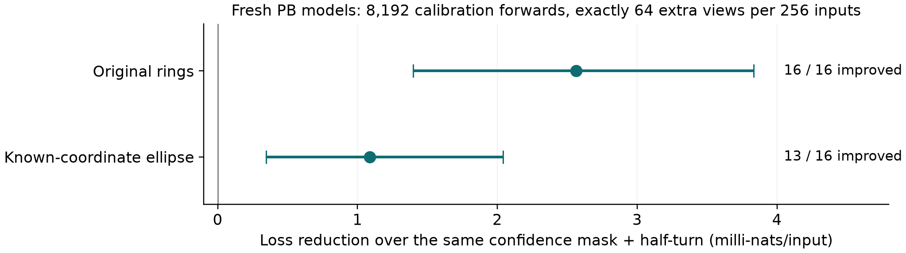
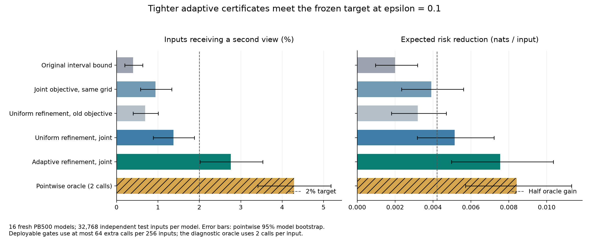

# Independent confirmation and continuous selective prediction

Completed follow-up to all three recommended directions | 21 November 2026

The practical angle-calibration result replicated on new models and on a transformed input geometry. A continuous, exact-quota balance construction was derived and implemented, but its trained-network version is not yet competitive or usefully certified. A tighter adaptive safety certificate met its prespecified coverage and gain targets. None of these results establishes faster inference on the small network used here.

## Completed outcomes

| Direction | Result | Decision supported by the evidence |
|---|---|---|
| Independent confirmation | Confidence selection plus calibrated radius angles reduced PB loss in both geometries: 16/16 original models and 13/16 ellipse models improved. | Keep this as the leading empirical candidate. Its benefit is prediction quality, not demonstrated latency. |
| Continuous conditional balance | One selection per group of four gives exactly 64 extra views per 256 continuous inputs. An exact continuous example exists; the fitted network method greatly reduces numerical ambiguity. | The extension is mathematically substantive, but its conservative error bound is vacuous and it loses to strong allocators. |
| Useful approximate-symmetry certificate | At epsilon 0.1, adaptive coverage rose from 0.398% to 2.757%; it recovered 89.60% of the charged oracle's gain. All prespecified targets passed. | The certificate is substantially more useful at its target mismatch level. Larger mismatch and routing cost remain limitations. |

## Study boundaries

There are 32 new training groups: 16 original-ring and 16 ellipse groups. Each contains GD500, PB500, and PB100-to-GD400, for 96 newly trained models. All schedules are unchanged from the earlier study. Primary inference concerns PB models at 8,192 calibration forwards. Each group has 65,536 independent test inputs; calibration and tests use separate seeds. All limited empirical policies select exactly 64 of each 256 inputs.

The ellipse is x=A z with A=diag(1.5,0.7) and latent z following the original rings law. The transformation A R A^-1 preserves the label law. Every router receives the same known A. This changes the observation geometry and optimization while retaining the latent Bayes problem; it is not a demonstration on unrelated real-world tasks.

The continuous and certificate studies share the 16 fresh original-ring PB models. They have independent calibration/evaluation draws and froze their algorithms before inspecting these states. Historical models support development or checks only. Shared models are not counted again as new replications. Empirical scoring began after both theory-method freezes.

All risk values are logistic losses in nats per input. Percent loss reductions are not accuracy percentage points. Model-seed groups are the replication units. The two primary geometry contrasts use 97.5% bootstrap intervals for their two-comparison family; secondary intervals are pointwise. All losses, failed criteria, diagnostic corrections and timing versions are retained.

<!-- pagebreak -->

## 1. The practical combination replicated

The candidate first selects the 64 smallest absolute first-view logits in each batch, then uses a radius-specific angle learned from 64 unlabeled radii with 128 angular views each. The comparison keeps exactly the same selected inputs and uses a fixed half-turn. Thus the primary contrast isolates angle calibration rather than a change in sample selection.

| PB policy, 8,192 cap | Original-ring risk | Ellipse risk | Deployment calls/input |
|---|---|---|---|
| Confidence + half-turn | 0.100848 | 0.097467 | 1.25 |
| Confidence + global angle | 0.098963 | 0.096971 | 1.25 |
| Confidence + radius angle | 0.098283 | 0.096378 | 1.25 |
| Legacy IID folded gate + half-turn | 0.102530 | 0.100977 | 1.25 |
| Joint radius selector + radius angle | 0.101970 | 0.101014 | 1.25 |
| Full half-turn averaging | 0.102281 | 0.100505 | 2.00 |

Fixed half-turn references need no new-model calibration; 8,192 is the cap for learned-angle and legacy-gate policies.

The primary risk reductions were 0.002565 nats on original rings, with 97.5% interval [0.001398, 0.003833], and 0.001089 on ellipses, interval [0.000345, 0.002042]. These are approximately 2.54% and 1.12% of the respective half-turn reference losses. Independent sampled-label losses support the same conclusions. Three ellipse models worsened; they remain in all summaries. The candidate beat the legacy folded and joint radius policies on all 16 models in each geometry.

The time result is negative. In a separate benchmark with identical outputs and minimal half-turn implementations, PB median time per batch was 0.10752 ms for the candidate versus 0.08280 ms for confidence plus a half-turn on original rings; corresponding ellipse times were 0.10866 versus 0.07634 ms. Full half-turn averaging was about 0.06700 and 0.06602 ms. No PB model had a finite latency break-even against either half-turn reference.

At the 8,192 cap, fewer model forwards than full averaging are achieved after 11,008 deployed inputs when rounded to full batches. This is a forward-count break-even, not a time break-even. Calibration setup was about 9.75/10.08 ms; setup cost fell below 10% of cumulative deployment time after median thresholds of approximately 227,000/234,000 inputs. The full 65,536 cap, GD/hybrid controls, every seed and all amortization failures are reported separately.

<!-- pagebreak -->

## 2. Conditional balance now has a continuous, exact-quota construction

Independently partition a batch of 256 IID inputs into 64 groups of four. A fixed field u(x) in [-1,1] assigns within-group probability

**q_i = 1/4 + (u_i - group mean of u)/6.**

The four probabilities sum to one and lie in [0,1/2]. Selecting one member per group gives exactly 64 extra model evaluations in every realization. There is no quota-repair approximation and no unqueried partner logit is used for deployment routing.

The marginal inclusion probability is 1/4+(u(x)-E u)/8. Our Fourier fields have zero angular mean at every radius, so this becomes 1/4+u(x)/8. For d=(h(x)-h(-x))/2, the conditional imbalance is exactly b(r)=E[u d given r]/8. The previous identification formula therefore applies on a genuinely continuous input law, not merely a finite support.

An analytic existence example uses h(r,phi)=1+2r cos(phi), with continuous r uniform on [0.5,1.5], and u=-cos(3phi). Harmonic orthogonality gives b(r)=0 for every radius while u differs at antipodes. Its gain is numerically 0.051169 versus 0.049657 for uniform quarter-selection and is unchanged across arbitrary radial posteriors. Exact balance follows analytically; this example is separate from trained networks.

For trained networks, the method fits eight Fourier harmonics on 129 radial anchors and 512 angles, using 66,048 offline forwards. A small linear program balances the signed moment at each anchor under a coefficient l1 bound. Coefficients are interpolated between anchors and vanish outside radius three. This gives a bounded continuous field, but anchor balance does not imply exact balance between anchors.

| Continuous method finding on 16 fresh PB models | Result |
|---|---|
| Anchor moment residual | Approximately 1e-16 |
| Largest observed off-anchor absolute b(r) | Approximately 0.00501 |
| Mean numerical unrestricted gain-interval width | 0.00003765 balanced; 0.012827 unbalanced |
| Exact symmetric even-harmonic control width | 0 |
| Actual rings risk | Balanced 0.109036; confidence 0.100739; folded gate 0.102494 |
| Paired advantage over grouped even control | 0.00006372 nats, 95% interval [0.00001181, 0.00012062] |

The balanced field reduces numerical ambiguity by about 340-fold relative to its unconstrained counterpart and beats the equally grouped even control slightly. It loses to global confidence and folded allocation on all 16 models. The grouping restriction is a real cost, not a technicality hidden by comparing only weak baselines.

<!-- pagebreak -->

## 2 continued. A valid bound can still be unusably loose

The network's weights give a global Lipschitz constant for the logit and a Hessian bound. These yield explicit angular quadrature error bounds and a pointwise radial interpolation error bound for b(r). The derivation separates anchor residual, angular approximation, and interpolation; angular nodes are deterministic quadrature points, not independent calibration samples.

For adjacent anchors, let E_j bound the true angular signed moment, gamma_j be the coefficient l1 norm, L the logit Lipschitz constant, and t the interpolation fraction. Then

**|b(r)| <= [(1-t)E_j + t E_(j+1) + L t(1-t) Delta-r (gamma_j+gamma_(j+1))]/8.**

This is a continuous, pointwise bound. It does not replace conditioning on radius with a single bin average. Even-only harmonics have b=0 exactly by antipodal symmetry; the learned balanced network field does not inherit that exactness.

The global bound is valid but much too wide: its mean uniform bound is about 2.108 nats, while observed gains are orders of magnitude smaller. A separate, valid one-sided 95% Hoeffding lower certificate is also negative for all 16 models, approximately -4.29 to -0.609. Therefore the small numerical ambiguity cannot be advertised as a useful distribution-free non-harm guarantee.

That finite-sample certificate requires both predictions on 65,536 independent validation inputs: 131,072 additional model-example forwards per model, separate from field calibration and deployed 256-plus-64 calls. Validation computations reuse stored outputs in the study, but those predictions are not free information available to a deployed selector.

## Hidden-posterior diagnostic correction

An independent audit caught a boundary case in the original numerical prevalence-constrained worlds: a threshold can cut through a positive-mass plateau of equal b values. A strict indicator alone cannot always assign exactly half the positive-label mass. Sixty of 96 originally named prevalence-half worlds missed the tolerance, with maximum prevalence error 0.006724. The original integral and deployed strict-threshold convention also differed on plateau mass.

Those original worlds and outcomes are retained and labeled as failing the intended prevalence constraint. A separate evaluation repair assigns a fractional posterior on threshold atoms and uses one world definition for integration and replay. All 96 repaired prevalence-half worlds attain the target numerically; 62 require fractional atoms. The repair changes no fitted policy, selected mask, true-rings primary result, or conditional moment curve. These extrema concern the interpolated numerical moment function; they do not establish exact identification for the neural network. An independent attainment audit accompanies the corrected diagnostics.

Independent integration checked all 192 repaired worlds, with maximum half-prevalence error 1.61e-15. All 1,920 repaired mask records match the originals. Repair required 13,631,488 evaluation-only forward examples; this additional research work is recorded separately from calibration and deployment budgets.

The resulting evidence distinguishes three claims: exact continuous identification in the analytic example; exact identification for the symmetric control; and approximate, numerically small but conservatively uncertified imbalance for trained networks. Only the first two are exact identification results.

<!-- pagebreak -->

## 3. The safety certificate became substantially less conservative

Given an external mismatch bound |p-q|<=epsilon, pair-averaged gain is bounded below by J(a,b)-epsilon|a-b|/4. The earlier method separately minimized J and maximized |a-b| over possible logits. We now minimize their combination jointly, enumerating rectangle corners, the diagonal and stationary edge points. A proof excludes non-diagonal interior minima; independent numerical minimization verified the implementation.

An adaptive polar partition then concentrates interval work on regions with useful unresolved potential at epsilon 0.1. It uses coordinate-only calibration samples and the fixed network, never the hidden posterior. All parent work is counted. Its 65,536 interval propagations are compared with a uniform refinement at the same propagation count; equal counts do not imply equal elapsed setup time.

| Fresh policy at epsilon 0.1 | Selected inputs | Gain, nats/input |
|---|---|---|
| Original independent bound | 0.3979% | 0.00199521 |
| Joint bound on original grid | 0.9392% | 0.00390410 |
| Equal-cost uniform joint bound | 1.3725% | 0.00513821 |
| Adaptive joint bound | 2.7571% | 0.00754331 |
| Charged two-call pointwise oracle | 4.2873% | 0.00841891 |

The adaptive policy passed all frozen criteria: at least 2% coverage, at least 50% of the positive oracle gain, and a positive lower interval for improvement over the original. It recovered 89.60% [85.59%, 92.25%] of oracle gain. The gain advantage over the original was 0.005548 [0.003882, 0.007281], and over equal-cost uniform refinement was 0.002405 [0.001705, 0.003230]. All 16 fresh models improved against both controls; 10 individually met the 2% coverage target.

Average deployment uses 1.02757 model calls per input, with at most 64 extra calls per batch. The guarantee is for expected pair/orbit risk under the stated input symmetry and external epsilon assumption, not every realized labeled example. Numerical enclosures and conservative tolerances are checked; this is not a formally verified directed-rounding system.

<!-- pagebreak -->

## Limits, independent checks, and resulting priorities

The safety partition is targeted at epsilon 0.1. At epsilon 0.25, adaptive gain is only 0.000953 compared with 0.002694 for uniform joint refinement. At epsilon 0.5, it selects just one of 524,288 test inputs. These are preserved failures of broader usefulness, not thresholds adjusted after the results.

Its measured resident-table latency is also unfavorable: 0.14034 ms per batch versus 0.06176 ms for full half-turn averaging, about 2.27 times slower. Original archive-backed timings had included repeated decompression; a separate randomized benchmark loaded tables once and verified identical masks, outputs and calls. Both timing versions remain archived. Query savings and time savings are kept separate throughout the report.

## Independent verification completed

- Confirmation: all frozen source/state/calibration hashes and 1,536 call records; identical confidence masks across angle policies; 192 full-test replays with independently generated inputs, posteriors, conjugated transformations and risks. Maximum risk discrepancy was below 6e-17.
- Continuous construction: exact group-probability identities and quota checks; 2,032 anchor LP optimality checks; 896 fresh-angle off-anchor moment evaluations; 30 full-test mask/risk reconstructions; all deployment call records. Independent risk discrepancies were zero.
- Safety certificate: 1,500 independent rectangle minimizations across six mismatch values; all 384 fresh gain rows; all 196,608 adaptive split records; interval enclosures, positive-score selection and quota accounting. Maximum gain discrepancy was below 4e-18.
- Diagnostic integrity: original numerical failures and timing limitations remain visible. The plateau-aware hidden-posterior repair is independently reviewed and retains all pre-repair evidence.

An interrupted audit harness, a coarse independent reference grid, and a corrected grouping test size are documented under audit/VALIDATION_NOTES.md. These changes affected verification code, not fitted scientific policies. Numerical consistency does not establish transfer beyond the specified input laws and model architecture.

## What should lead the next phase

**The empirical lead is now clear:** retain confidence selection plus modest angle calibration as the reference method for prediction-quality work. Test an expensive model and another independently justified label-preserving transformation family before claiming useful runtime savings or broad application. The known-coordinate ellipse result is a geometry check, not that broader validation.

**The theoretical lead is conditional balance with honest error accounting.** The continuous construction resolves the exact-quota obstacle. The remaining obstacles are the grouping restriction and a useful conditional-error certificate. The current trained-network rule should be presented as a constructive result and a documented practical failure, not as a replacement for the stronger allocator.

**The certificate is a positive, bounded result.** Joint minimization and adaptive refinement produce a large replicated improvement at the frozen target mismatch. Serving overhead and epsilon-specific partitioning should be addressed before a deployment claim. The external mismatch assumption must remain explicit.

All three requested directions are complete, including their negative findings. The individual study READMEs contain full tables, protocol commitments, raw outputs and exact regeneration commands. REPRODUCE.md describes the shared layout, and verify_archive.py checks the delivered archive manifest. No original research outputs were overwritten or externally published.
