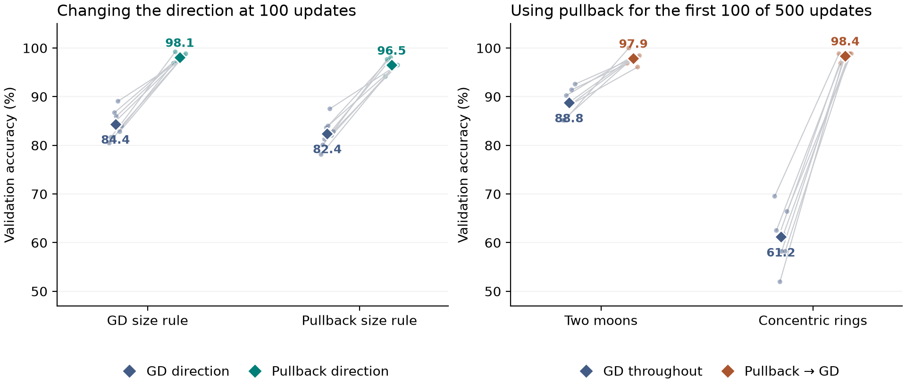

# When Is a Pullback Step Worth Its Cost?

This local exploration connects a geometric result to a training choice. At a common state, the pullback update makes better use of a short feature displacement for the training objective. Paying for that direction for the first 100 updates helped early classification on two synthetic tasks. After tuning the GD learning rate and measuring a fixed CPU budget on the rings task, the average practical difference between the mixed schedule and GD was small and varied across pairs.

## Direction or length?

For a fixed Jacobian and training gradient, scale the GD and pullback directions to the same predicted feature displacement. The pullback direction has at least as much first-order training-loss decrease, and the inequality is strict when the gradient spans two distinct positive spectral modes. The proof compares the cosine of each direction with the negative training feature gradient. Across 40 sampled states the observed cosine increases ranged from 0.067 to 0.631. Across both lengths at each of these states, the measured finite-step training loss favored pullback in 80/80 comparisons. These are repeated comparisons on eight seeds. At the late pullback states only 5/16 of the same comparisons also favored pullback on validation loss. [Proof](direction_at_equal_motion.md) · [Direction controls and paired records](new-directions-geometry/README.md)

At 100 training updates on two moons, the native GD and pullback directions achieved 84.38% and 98.10% mean validation accuracy, respectively, when both used the GD feature-length rule. With both using the pullback length rule, the accuracies were 82.42% and 96.48%. Each direction recomputed the prescribed length at its own evolving state. The same-state one-step interventions above address the stricter matched-motion question.

## Buying geometry early

Use the full pullback for 100 updates and then switch to ordinary GD. The number 100 was motivated by the earlier study. The switch and learning rates were fixed before evaluating these draws. With 500 updates and the original learning rates, the switch reached 97.90% validation accuracy on two moons and 98.39% on rings. GD reached 88.77% and 61.18%. The ring classes have evenly distributed angles and differ in radius. A straight boundary in the initial coordinates performs near chance there. At 2,000 updates on two moons, GD reached 98.68%, the switch 98.78%, and full pullback 97.56%. The switch required 100 full metric constructions instead of 2,000. [Two-moons switch](new-directions-hybrid/README.md) · [Rings transfer](new-directions-rings/README.md) · [Feature coordinates on the first rings pair](new-directions-rings/rings_features_pair1.png)

Each thin line joins two methods on the same data and initialization. Diamonds show the mean over eight pairs per task. The right panel uses the original two-moons learning rates on both tasks. [Vector figure](early_geometry.svg)

## Time and tuning change the practical interpretation

| Comparison | GD | 100 pullback updates, then GD |
| --- | ---: | ---: |
| Two moons, 100 ms, original learning rates, validation loss | 0.07315 | 0.06945 |
| Two moons, same budget, validation accuracy | 97.51% | 98.10% |
| Rings, 100 ms, independently selected GD-phase rate, validation loss | 0.06764 | 0.06708 |
| Rings, same budget, validation accuracy | 97.67% | 97.93% |

On both comparisons the switch had lower validation loss on four of eight evaluation pairs. The rings follow-up selected the GD-phase rate from the same five candidates separately for each schedule using four tuning pairs, then averaged three timed repeats within each of eight new evaluation pairs. The selected rates were 0.5 for pure GD and 2 for the GD phase of the switch. The pullback rate, damping, and switch point were fixed. The observed mean accuracy difference on rings was 0.26 percentage points, and its sign favored the switch on three pairs. This check changed both the budget and the rate selection relative to the original transfer comparison. The results apply to these small synthetic problems and this single-threaded CPU implementation. [Timed comparisons on two moons](new-directions-cache/README.md) · [Tuned, timed rings comparison](new-directions-rings-budget/README.md)

## Reusing an old metric

A further two-moons comparison recomputed the training gradient at each step and refreshed the pullback matrix every 10 or 50 steps. At 500 updates the two variants achieved 63.67% and 83.06% validation accuracy, compared with 98.10% for a fresh matrix every step. At 2,000 updates both periodic variants saved time, with substantial validation losses at the inherited learning rate and damping. Lower rates or an adaptive refresh rule are separate questions. [Periodic-refresh data and implementation note](new-directions-cache/README.md)

## Relation to prior work

The direction and size experiment adapts the parameter-space grafting idea in [Agarwal et al. (2020)](https://arxiv.org/abs/2002.11803) by measuring predicted feature-space displacement. [Keskar and Socher (2017)](https://arxiv.org/abs/1712.07628) studied switching from Adam to SGD. This study instead uses a fixed switch from a Euclidean representation pullback to full-batch GD. Periodically paying for curvature-related computations also has precedent in [Martens and Grosse (2015)](https://proceedings.mlr.press/v37/martens15.html). Their K-FAC matrix approximates the Fisher information. Here the matrix comes from the full representation Jacobian.

These are exploratory extensions of the original project. Each subfolder contains its design, code, seed-level records, and interpretation. The fresh comparisons reported here use validation data. The original formal test results are recorded separately in the [research archive](../../README.md).
