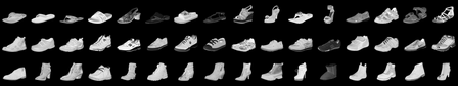
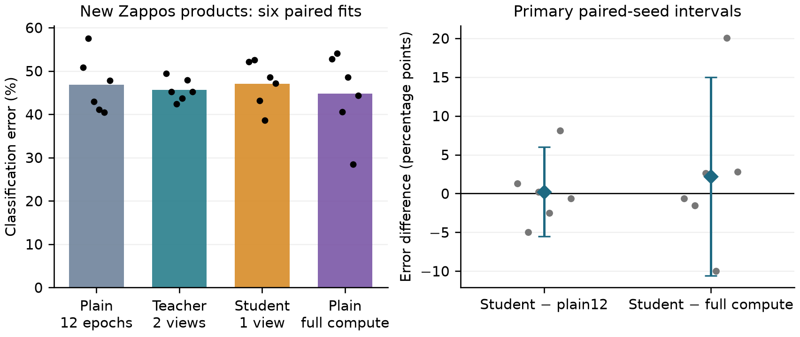

# Allocation confirmation, independent replication, and residual-aware guarantees

Completed 21 November 2026, local time. Three prospectively frozen follow-ups, independent reconstruction, isolated timing, and preserved earlier studies.

**The allocation search retains the existing baseline. The favorable external distillation ordering does not replicate. The expanded certificate remains useful under explicit density and posterior assumptions.**

|Question|New evidence|Decision|
|---|---|---|
|Can more training labels improve the fixed-budget recipe?|The original 2,304-training allocation wins the eight-pair development rule; sixteen fresh baseline fits give raw expected loss 0.552949.|Retain it. No alternative was promoted after selection.|
|Does the student transfer advantage replicate?|On 1,500 new footwear products, student error is 47.011%, versus plain 46.778% and full-compute plain 44.800%.|The frozen replication criterion fails.|
|Can the guarantee cover omitted structure and use labels?|At the covered third harmonic, 16/16 estimated-density lines certify under epsilon=0; 14/16 remain positive with independently labeled epsilon bounds.|Useful conditionally; residual and cell-model assumptions remain substantive.|

The allocation study separates recipe selection from subsequent confirmation. Because the baseline itself wins, confirmation measures its absolute performance; identity contrasts are not evidence of superiority. The image study increases from three to six new training pairs and uses a distinct retailer source with product grouping. The theory study adds a third harmonic, an explicit remainder envelope and independent observed-label evidence under a finite-cell posterior model.

Every main protocol, source, random-stream family, comparison and failure rule was committed before its new outcomes. Earlier negative results remain intact. A truth-stage floating-point endpoint repair preserves the failed attempt and reruns identical streams; its scope and work are recorded explicitly.

English protocols, proofs, raw predictions, checkpoints, source images, costs, audits and replay instructions accompany this report. The final archive manifest checks every delivered file. The three predecessor archives were rechecked without discrepancies.

<!-- pagebreak -->

## 1. The selection rule retained its baseline

Keep the same 144-parameter synthetic model, mean logistic loss and normalized PB update. Every calibrated fitted procedure receives 4,352 accepted labels. A fixed nominal dense-arithmetic training budget of 207,260,412,000 gives the following schedules; floors leave less than one update unused. Validation labels remain zero, following the preceding study's unhelpful validation allocation.

|Training|Calibration|Updates|Development raw calibrated loss|
|---|---|---|---|
|2,304|2,048|500|0.553170|
|3,072|1,280|375|0.558800|
|3,584|768|321|0.570441|
|3,840|512|300|0.576344|

Eight paired development fits share initialization, nested balanced training increments and calibration prefixes. The frozen selection criterion is mean sampled-label raw calibrated NLL on 65,536 independent evaluation items per pair. Only that criterion chooses the recipe. Its winner is train_2304. The selection commit precedes every confirmation training stream.

Sixteen independent confirmation pairs therefore fit the baseline once each, as prespecified. Raw/full own-temperature expected NLL is **0.552949 / 0.532814**; expected error is **27.394% / 25.522%**. The selected-minus-baseline differences are exactly zero because they name the same procedure. No confidence interval or improvement test is reported for that identity.

This does not prove a global optimum or prove that every larger-training alternative is worse. Indeed, the development full-output loss at 3,072 is 0.530289, slightly below baseline 0.530731. That secondary development observation was not the raw selection criterion and received no independent higher-training confirmation. It remains an exploratory hypothesis.

The search has an explicit cost: 47,104 unique development fitting labels plus 524,288 development selection labels. Confirmation adds 69,632 fitting labels and 1,048,576 labeled evaluation items. These are synthetic accepted-label counts, with rejection proposals recorded separately. The 4,352-label number describes one fitted procedure, not the full cost of discovering it. Across both phases, 48 final model states, 96 temperature fits and 240 risk rows are retained.

<!-- pagebreak -->

## 2. A separate source, sampled by product

The new external source is [UT Zappos50K](https://vision.cs.utexas.edu/projects/finegrained/utzap50k/), collected by Yu and Grauman from Zappos.com. The official terms restrict it to academic, noncommercial use. Exact documentation and source metadata are retained. This origin differs from the earlier Myntra catalog.

|Fixed source category|Fashion-MNIST label|Eligible products|Selected|
|---|---|---|---|
|Sandals|5|2,607|500|
|Shoes / Sneakers and Athletic Shoes|7|6,008|500|
|Boots / Ankle|9|3,365|500|

Seven product IDs whose variants map to conflicting target labels were excluded by metadata before scoring. Products are ranked by a fixed SHA-256 rule within category, and one independently hash-ranked color is selected per product. All 1,500 chosen products are distinct, spanning 435 brands. No missing, corrupt or duplicate candidate required a selection fallback. Root independently reconstructed the full ranking and pixels from the official archive.

Preprocessing remains grayscale, inversion, aspect-preserving resize within 24x24, and centering on a black 28x28 canvas. All ten output logits remain active. No external labels tune weights, checkpoints, temperatures, preprocessing or method choice. Exact pixel overlap with 70,000 Fashion-MNIST images and the preceding 1,500 Myntra photos is zero.

This is a three-category footwear robustness test. The preceding catalog covered six apparel categories; only sandals overlap. Retailer origin and category composition therefore change together. These results do not isolate a causal retailer effect or provide a ten-class IID replication. Product grouping removes repeat colors under one identifier, while related designs and brand dependence remain unresolved.

All Fashion-MNIST images and the old Myntra population have historical exposure. Their new-model outcomes are secondary evidence. Every evaluated original image is archived; the larger unused source ZIP is retained locally with its retrieval URL and digest.

<!-- pagebreak -->

## 3. The external student advantage did not replicate

Six new paired seeds train eighteen CNNs with unchanged 426,122-parameter architecture, Adam settings, augmentation and split. B is ordinary augmentation for twelve epochs; T averages B's two views. S uses twelve epochs with the same fixed temperature-2, half-hard-label/half-distillation recipe. C uses the complete teacher-plus-student network-work budget. All methods share initialization and order/flip prefixes within each pair; final temperatures use only source calibration labels.

|Population|Plain B error|Teacher T error|Student S error|Full-compute C error|
|---|---|---|---|---|
|New Zappos products|46.778%|45.644%|47.011%|44.800%|
|Exposed Myntra photos|46.311%|45.767%|45.511%|46.367%|
|Exposed source holdout|9.538%|9.292%|9.753%|8.400%|

The primary new-source student-minus-plain error difference is **+0.233 percentage points**, adjusted interval **[-5.523,+5.990]**. Student-minus-full-compute is **+2.211 points**, **[-10.583,+15.005]**. Each comparison improves in only three of six seeds. Both fail the frozen requirements: at least one point mean improvement, adjusted upper endpoint below zero, and at least five strict seed wins.

The intervals are paired Student-t intervals over six training randomizations, with five degrees of freedom and Bonferroni adjustment over two primary comparisons. Approximate normality at six pairs is a fragile assumption. The secondary crossed seed/product bootstrap also crosses zero: [-3.167,+4.467] and [-5.267,+11.422] points. It shares the resampled product multiset across seeds and methods, preserving pairing; it does not resolve brand dependence or variation across new training datasets.

<!-- pagebreak -->

## 4. Complete cost and measured latency

Each image pipeline uses the same 50,000 distinct source fitting/validation/calibration labels. The full distilled pipeline pays teacher training, checkpoint selection, two-view target generation, student fitting and calibration. Its dense convolution/linear work is 13,784,417,280,000 operations per pair. The ordinary control uses 997,270 training examples and 13,784,407,362,560 operations, a gap smaller than one training example. Nonlinearities, pooling, optimizer/scalar work, transfers and I/O are separately accounted; nominal matrix work is not whole-program or wall-time equality.

|Serving mode|Plain ms|Student ms|Best full ms|Median pair full/student|
|---|---|---|---|---|
|One-thread CPU|28.981|28.534|57.790|2.023x|
|GPU resident|0.414|0.382|0.709|1.729x|
|GPU with transfers|0.674|0.645|0.885|1.361x|

Numbers summarize six model-specific medians for normalized batches of 256. The full reference is the faster fused/sequential two-view implementation per model/mode. Three warmup blocks precede seven recorded blocks, each containing four batches; method order is randomized. Serving uses FP32 on an RTX 5070 Ti or one CPU thread; CUDA boundaries are synchronized. Transfers include input upload and output return; loading/normalization are excluded. Other research numerical work was paused throughout.

The observed pooled S/B ratios are 0.98457, 0.92365 and 0.95648: the frozen criterion, S/B <=1.10 in every mode, passes. Individual outcomes still vary. In pair 1 with transfers, student is slower than the faster two-view implementation (full/S=0.92067); several individual S/B ratios exceed 1.10. Ratios of pooled full/student medians are 2.02531, 1.85469 and 1.37319, distinct from the displayed medians of paired ratios. All reversals remain recorded.

Allocation timing now measures complete procedures rather than extrapolating update blocks. One warmup and three measured one-BLAS-thread baseline fits on fixed development pair 1 give median **11.275s**, range **11.138-11.319s**. This includes 500 updates, four diagnostic checkpoints, calibration forwards and both scalar fits; input generation/loading, output I/O, test scoring and verification comparisons are excluded. Parameters and temperatures match the committed fit. Because the baseline won selection, this benchmark makes no comparative speed claim.

There are 630 recorded image timing rows, 903,168 measured and 387,072 warmup forward examples. All sixty CPU/GPU checks preserve class decisions; maximum logit difference is 7.63e-6. Quality replication still fails regardless of this separate latency result.

<!-- pagebreak -->

## 5. A guarantee with explicit residual uncertainty

Keep eight historical predictors and two fixed top-quarter selectors. Each batch contains 256 IID inputs from the same P and independent tie keys. The involution T shifts angle by pi. A valid selector is invariant when any one record alone is transformed, with other records and tie keys held fixed. Exactly 64 of 256 records receive a second model view, so deployment costs 320 model example evaluations per batch.

Let the invariant reference law have independent uniform radii in [.4,1.4] and uniform angle. Write P=(1+r)mu with r=theta1 cos(phi)+theta3 cos(3phi)+e(phi). The residual is odd, orthogonal to both retained harmonics and bounded everywhere by a supplied rho, with |r|<=1. These are assumptions; a finite unlabeled sample does not establish an unrestricted residual envelope.

Independent coordinate samples estimate each theta as twice its cosine mean. Simultaneous Hoeffding intervals and rho yield a pointwise interval [l,u] for r, clipped to [-1,1]. Its endpoints transform as l(Tx)=-u(x). For logits z,zT, let d=(z-zT)/2, S=max(d)-min(d), J be the log-sum-exp Jensen gap, and t the log-sum-exp half-difference minus the midpoint of d. Then J>=0 and |t|<=S/2.

Assume posterior TV(p(x),p(Tx))<=epsilon, with 0<=epsilon<=1. The exact robust penalty is

**H = max over v in {l,u} of ([|v|+(1-|v|)epsilon] S/2 - v t).**

The endpoint maximum follows from convexity of this penalty in v. It preserves the joint worst case rather than separately optimizing unrelated terms. H is nonnegative and transform-even. With a frozen parameter-derived S<=D and interval-wide |v|<=rbar, its support-wide range is **D[epsilon/2+(1-epsilon/2)rbar]**. No empirical maximum replaces D or the residual envelope.

For A=E[M min(J,c)], the expected raw-minus-selected-average cross-entropy gain obeys **G >= A-E[M H]**. Lower/upper concentration bounds give **G >= L_A-U_H**. Estimated coefficients, epsilon and their ranges are fixed by samples independent of verification. Conditional empirical Bernstein and bounded-differences bounds are combined after paying for both events.

The family contains 8,576 moment/method events, fourteen coefficient intervals and thirty-two label-cell intervals: delta=0.05/8,622. All covered, prespecified grid and labeled certificates hold simultaneously with probability at least 95%, under the stated assumptions. The finite epsilon grid is explicitly counted; no uncounted continuum guarantee is claimed. This is a loss guarantee, not a classification-error guarantee or a natural-image certificate.

<!-- pagebreak -->

## 6. Independent labels narrow the assumption gap

The labeled extension assumes the binary posterior is constant inside eight fixed cells: two bins for each radius, crossed with the two paired angular half-circles. Four independent audits each draw 131,072 actual labels under the target law. Conditional-on-count Hoeffding intervals bound each cell probability. A zero-count cell receives [0,1]. The largest paired-cell interval difference supplies epsilon_U.

|Covered input law|True cell defect|Labeled epsilon_U|Positive estimated certificates /16|
|---|---|---|---|
|Third harmonic 0.10|0|0.044102|14|
|Third harmonic 0.10|0.10|0.141525|0|
|Mixed with residual rho=0.025|0|0.046253|15|
|Mixed with residual rho=0.025|0.10|0.143335|0|

The primary third-harmonic law gives 16/16 positive estimated-coefficient certificates when epsilon=0 is supplied, with mean lower bound 0.014078 and minimum 0.002031. After independent labels replace exact epsilon=0 by the conservative 0.044102 bound, 14/16 remain positive and the mean is 0.005430. The old global-TV comparison certifies 0/16. These are eight models times two fixed policies, not sixteen newly trained independent models.

At supplied epsilon=0, the estimated mean bound is 0.022936 for the covered first/third mixture and 0.017937 for the covered fifth-harmonic remainder; all sixteen lines are positive. A strong third harmonic of 0.60 makes all sixteen lower bounds negative. The procedure preserves these failures.

Independent labels support epsilon only within the constant-cell model. They do not establish that model. For p(phi)=(1+sin(3phi))/2, every orientation-cell mean is 1/2 under the study's cosine-only laws, yet the pointwise posterior defect reaches one. Arbitrarily many labels summarized in these same cells cannot remove the omitted within-cell variation. A justified smoothness or other regularity assumption would be needed to extend this inference.

Parameter evidence uses 262,144 coordinate-only inputs per law, with a simultaneous coefficient radius 0.019726. All fourteen coefficient and thirty-two cell intervals cover their generator values in this run; this observation does not itself validate the assumptions on natural data. Cells, basis, residual envelopes and sample sizes were fixed before these outcomes.

<!-- pagebreak -->

## 7. Covered failures, uncovered failures, and recovery

The prior counterexample has input density (1+0.6 cos(3phi))/(2pi), scalar logit h=0.2 cos(3phi), invariant label posterior p=1 and an input-independent quarter quota. Its true averaging gain is -0.00687578. A first-harmonic-only analysis incorrectly pretends r=0 and produces +0.00062422. The expanded basis represents the third harmonic and returns the correct negative un-clipped expression; clipping Jensen gaps can only lower it further. Covering a failure means avoiding a false positive, not certifying a harmful operation.

Replacing cos(3phi) by cos(5phi) produces the same obstruction unless the supplied residual envelope covers it. A valid rho=0.6 yields a negative lower expression. Deliberately supplying rho=0 is outside the theorem. The numerical violated-envelope row produces sixteen apparently positive values at epsilon=0, explicitly marked invalid and excluded from all success counts. Accurate estimates of the first two coefficients cannot certify that all omitted components are small.

The finite-cell posterior counterexample is a separate limitation: correct input information cannot reveal arbitrary missing label structure. Model-adversarial truth worlds are intentionally constructed separately for each model; they are stress tests, not one common natural task. Full derivations, exact assumptions and all 5,504 truth rows accompany the report.

The original truth-stage run stopped on its first case because theoretical zero probabilities acquired tiny negative roundoff (up to 2.78e-17 in the recovery check). The frozen code, start record, empty raw directory and failure record remain preserved. A separately reviewed recovery clips endpoints only after asserting the excursion is at most 1e-12, then replays the identical streams into a new directory. The failed attempt's 65,536 inputs and 131,712 model forwards are charged separately. No certificate, evidence sample or scientific choice was replaced.

Verification used 29,360,128 coordinate inputs and 17,967,530 model forwards. Truth used 3,670,016 coordinate inputs, 7,340,032 forwards and 35,840 deployment-replay forwards. Parameter and label evidence add 1,835,008 and 524,288 coordinate observations with zero model calls. These costs are separate from historical model fitting and independent root audits.

<!-- pagebreak -->

## 8. Independent checks and next decisions

|Independent reconstruction|Completed evidence|
|---|---|
|Allocation|48 final models, 96 scalar fits, 240 risk rows, development selection and identity handling; 6,430,720 extra forwards.|
|Image study|18 checkpoint selections from 72 validation replays, 24 fits, all targets and three populations; 1,272,000 extra forwards.|
|Uncertainty|All 24 image seed intervals, 20,000 crossed bootstrap draws and 630 timing rows reconstructed.|
|Structured study|4,288 moment rows, 1,920 certificates, 5,504 truth rows; all 56 verification and 56 truth streams regenerated.|
|Provenance|All 1,500 new product ranks/originals/pixels reconstructed; three predecessor manifests unchanged.|

Root uses independent forward implementations and independently rebuilds concentration, temperature fits and inference. All retained structured selected logits and truth outputs are replayed; selectors are independently checked on sixteen-batch prefixes of every verification/truth stream. The additional structured audit cost is 25,307,562 model forwards. Maximum discrepancies are at ordinary floating-point precision. Full training trajectories are not independently retrained; no formal directed-rounding proof is claimed.

Next allocation work should retain the current raw-output recipe while separating the effects of fewer optimizer updates from fewer calibration labels. A dedicated full-output objective could be prospectively confirmed on new streams; the small development full-output advantage at 3,072 is not yet such a result. Avoid expanding another grid without a decision and resource question.

For images, the student is not a supported transfer improvement. A more informative next study would first diagnose target-domain representation and label alignment, then test a small, explicitly budgeted target-label adaptation baseline on untouched product groups. Compare plain training, two-view inference and distillation only after that baseline is fixed. The existing selected Zappos/Myntra products are now exposed; they must not become a newly claimed pristine test.

For theory, the priority is a justified residual or smoothness envelope and posterior regularity beyond fixed cells, with its estimation cost included. The present result demonstrates what follows from supplied structure and independent evidence; it does not validate those assumptions for images.

Primary context: [Cawley and Talbot](https://jmlr.org/papers/v11/cawley10a.html) on selection bias; [Hinton et al.](https://arxiv.org/abs/1503.02531) on distillation; [Chen et al.](https://jmlr.org/papers/v21/20-163.html) on group averaging; [Maurer and Pontil](https://arxiv.org/abs/0907.3740) on concentration. These established methods are attributed in full branch notes. This project's contribution is the controlled follow-up, audited implementation and specialized derivation, without a literature-wide priority claim.
