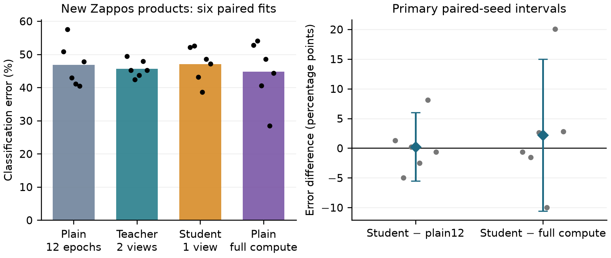
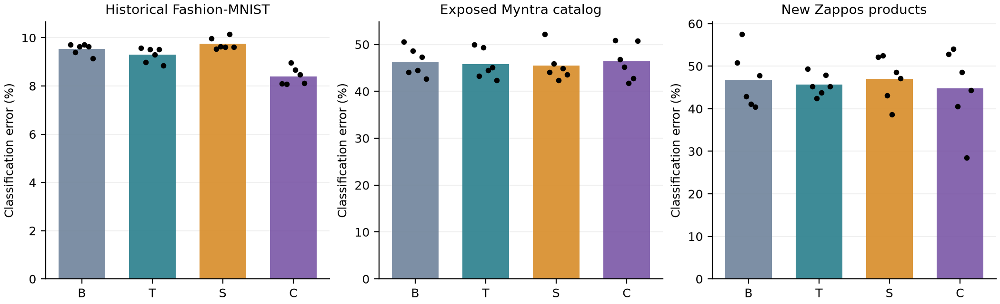

# Independent-source replication of one-view distillation

The frozen primary external-error replication criterion fails. This result uses six new paired training seeds and 1,500 newly acquired, product-grouped Zappos images. Earlier outcomes were preserved and no new outcome selected a setting.

## New source and primary comparisons

The independent source is [UT Zappos50K](https://vision.cs.utexas.edu/projects/finegrained/utzap50k/), collected from Zappos.com. It is distinct from the earlier Myntra catalog. The official terms permit academic, non-commercial use only; source documents and selected originals are retained. This evaluation uses 500 distinct products each of sandals, sneakers/athletic shoes, and ankle boots, mapped to Fashion-MNIST labels 5, 7 and 9. All ten logits remain active. It is a three-category footwear evaluation, not a ten-class benchmark replication. The new labels 5/7/9 overlap the earlier six-label Myntra sample only on sandals (5), so source and category composition change together; this does not isolate retailer-origin effects.

ProductID grouping excludes repeated colors of one product. Seven ambiguous cross-category products were excluded before scoring; 435 brands remain, so product grouping does not remove brand/design dependence. Hash selection, unchanged grayscale/invert/resize/pad preprocessing and all sample IDs were committed before any new outcomes. There is no exact processed overlap with all 70,000 Fashion-MNIST images or the previously exposed 1,500 Myntra images.

|Pipeline|New-source CE|New-source error|Across-seed error SD|
|---|---:|---:|---:|
|Plain 12 epochs|1.240660|46.778%|6.645 pp|
|Teacher 2 views|1.115086|45.644%|2.604 pp|
|Student 1 view|1.191373|47.011%|5.382 pp|
|Plain full compute|1.184657|44.800%|9.482 pp|

B is plain augmentation for 12 epochs and the teacher’s raw output; T uses the same teacher with two-view averaging; S is the one-view distilled student; C is plain augmentation under the full teacher-plus-student network compute budget.

|Primary error contrast|Mean difference|Adjusted paired-seed interval|Improving seeds|
|---|---:|---:|---:|
|S-B|+0.233 pp|[-5.523, +5.990] pp|3/6|
|S-C|+2.211 pp|[-10.583, +15.005] pp|3/6|

The primary rule requires both S-B and S-C error contrasts to improve by at least one percentage point, have an adjusted interval upper bound below zero, and improve in at least five of six pairs. Primary intervals are 97.5% Student-t intervals on six paired seed differences (df=5; two-comparison Bonferroni correction). They assume approximately normal seed differences and address one fixed training dataset and evaluated population. Six pairs are a small sample; these are not finite-sample guarantees.

Bars are six-seed means; black and gray points show every seed result and difference. Diamonds and whiskers show means and the adjusted paired-seed intervals. No extreme seed or interval is clipped.

|Secondary crossed seed/product bootstrap|Error difference|Interval|
|---|---:|---:|
|S-B|+0.233 pp|[-3.167, +4.467] pp|
|S-C|+2.211 pp|[-5.267, +11.422] pp|

The 20,000 crossed bootstrap replicates jointly resample six seed pairs and product IDs within each category, with the same product-index multiset across all chosen seeds and methods. One image per product means product and image resampling coincide here. The two displayed error sensitivity intervals use 97.5% individual coverage. These intervals remain approximate and do not capture brand dependence or new training datasets. Secondary evidence cannot reverse the primary failure rule.

## All populations and seed outcomes

|Population|Pipeline|CE|Error|
|---|---|---:|---:|
|holdout|B|0.263069|9.538%|
|holdout|T|0.256412|9.292%|
|holdout|S|0.270165|9.753%|
|holdout|C|0.232230|8.400%|
|myntra_seen|B|1.570169|46.311%|
|myntra_seen|T|1.561400|45.767%|
|myntra_seen|S|1.582962|45.511%|
|myntra_seen|C|1.634072|46.367%|
|zappos_new|B|1.240660|46.778%|
|zappos_new|T|1.115086|45.644%|
|zappos_new|S|1.191373|47.011%|
|zappos_new|C|1.184657|44.800%|

The source holdout and old Myntra population are exposed secondary evaluations. They are not new external data. Every Fashion-MNIST image was used in earlier work; this round retains the existing fitting/holdout split. The previous three model seeds are not pooled into the new six-pair confirmatory analysis.

|New-source seed|B error|T error|S error|C error|
|---|---:|---:|---:|---:|
|1|50.867%|49.400%|52.133%|52.800%|
|2|57.533%|45.200%|52.533%|54.067%|
|3|42.933%|42.400%|43.133%|40.533%|
|4|41.133%|43.733%|38.600%|48.600%|
|5|40.400%|47.933%|48.533%|28.467%|
|6|47.800%|45.200%|47.133%|44.333%|

All CE, additional error contrasts, classwise metrics, strict seed win counts and flip agreement are saved in seed_contrasts.csv, per_seed_contrasts.csv, classwise.csv and flip_diagnostics.csv. Ordinary 95% intervals on secondary contrasts are distinguished from the adjusted primary intervals.

## Full costs and final calibration

All 18 CNNs use the unchanged architecture and recipe. Teacher and student each receive 480,000 training examples (1,884 updates), while C receives 997,270 examples (3,914 updates). Each pair shares initial weights and order/flip streams on common prefixes. Distillation temperature 2, weight .5 and the source split remain fixed.

Per pair, the distilled procedure consumes 13,784,417,280,000 network matrix FLOPs and C consumes 13,784,407,362,560, a gap smaller than one training example. Teacher training, 80,000 target forward examples, validation and all calibration forwards are charged. Dense matrix work is not whole-program operations or elapsed time; KL, nonlinearities, Adam and scalar fits are counted/timed separately.

|Pair|Teacher fitting|Student fitting|Full distilled fitting|Control fitting|
|---|---:|---:|---:|---:|
|1|11.28s|9.04s|20.32s|18.27s|
|2|9.48s|10.06s|19.53s|18.76s|
|3|9.52s|9.95s|19.47s|19.06s|
|4|9.63s|9.94s|19.57s|18.86s|
|5|9.49s|9.98s|19.47s|18.95s|
|6|9.75s|9.42s|19.17s|16.86s|

Inclusive elapsed fitting times include initialization, validation, scalar fits, teacher targets and artifact I/O. They are descriptive because other ordinary workloads may coexist. full_cost_accounting.csv preserves exact budgets; amortized_scenarios.csv separately models shared teacher/target costs for 1, 10 and 100 students. The full-cost comparison remains primary.

Each final B/T/S/C output is calibrated on the same 5,000 source-only calibration examples. No external label is used for fitting, selection or recalibration. Positive scalar calibration leaves class decisions unchanged. Calibration logits, fits, all checkpoints, targets and prediction arrays are retained.

## Secondary serving result

The retained serving criterion passes: student/plain latency must be within 10% in every mode.

|Mode|Student median|Best-full median|S/B ratio of medians|Median pair full/S ratio|
|---|---:|---:|---:|---:|
|cpu|28.5339ms|57.7900ms|0.9846|2.0229|
|cuda_resident|0.3821ms|0.7087ms|0.9236|1.7289|
|cuda_transfer|0.6447ms|0.8854ms|0.9565|1.3614|

Latencies are per 256 normalized inputs. The full reference is the faster fused/sequential implementation per pair. Median pair ratios need not equal ratios of displayed medians; both aggregates and every reversal are saved. Six pairs each receive three warm-up and seven recorded randomized blocks in an exclusive numerical window. No repeats are performed to improve a result; one forward alone implies no latency guarantee. The earlier three-pair serving failure is preserved and is not erased by this new six-pair result.

## Reproduction and sources

PROTOCOL.md and SOURCE_FREEZE.json precede new training/outcomes; MODEL_COMMIT.json precedes SCORE_START.json. Preserve the official source terms with the data. All selected original JPEGs, product/color IDs, complete metadata and processed arrays are archived. The optional omitted full source ZIP is identified by URL and SHA256 in external/DOWNLOAD.json; it remains preserved locally.

The report is generated by report.py; statistics by the frozen inference.py; fitting/scoring/timing by study.py. Repository copies belong in experiments/distillation_replication, separate from the immutable earlier implementation.

Primary sources: [Yu and Grauman, CVPR2014](https://openaccess.thecvf.com/content_cvpr_2014/html/Yu_Fine-Grained_Visual_Comparisons_2014_CVPR_paper.html); [Yu and Grauman, Semantic Jitter, ICCV2017](https://vision.cs.utexas.edu/projects/semjitter/); [official data/grouping/terms](https://vision.cs.utexas.edu/projects/finegrained/utzap50k/readme.txt); [Hinton et al.](https://arxiv.org/abs/1503.02531); [Shanmugam et al.](https://arxiv.org/abs/2011.11156); [Bouthillier et al., benchmark variance](https://arxiv.org/abs/2103.03098).
