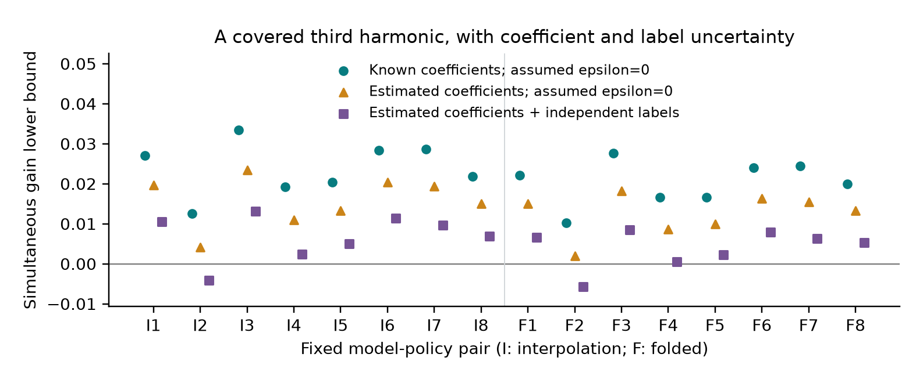
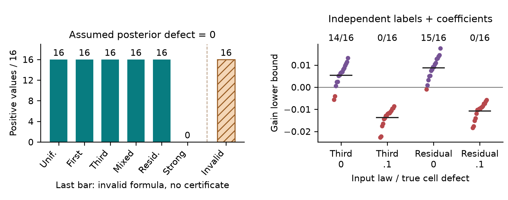
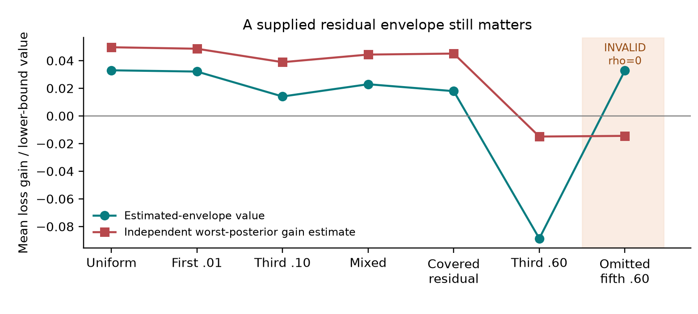

# Residual envelopes and independent label evidence

Completed 21 November 2026. The primary covered third-harmonic law gives **16/16 positive estimated-coefficient certificates** at assumed posterior defect zero, and **14/16** when an independent finite-cell label audit supplies its defect upper bound. Both positivity counts were fixed primary endpoints. The latter conclusion additionally assumes posterior constancy within the eight specified cells. No model, policy, coefficient basis, residual envelope, clip or sample budget was changed after fresh outcomes.

The advance is a conditional density-envelope result rather than an unrestricted distribution-shift certificate. It includes the previously omitted third harmonic, propagates coefficient uncertainty and a supplied residual bound, and accounts for finite label evidence. Deliberately understating the residual remains unsafe: the outside-envelope sensitivity law produces 16/16 positive estimated formula values paired with negative independent worst-posterior gain estimates. Those values are explicitly invalid, never counted as certificates.

## The mathematical extension

Let r=d(P-T#P)/d(P+T#P) be the odd orbit imbalance. For logits z,zT, let d=(z-zT)/2, S=span(d), J their Jensen gap, and t=(F(z)-F(zT))/2-midrange(d). The preceding sharp posterior result yields a per-orbit lower expression J-h_epsilon(r), where

    h_epsilon(r)=[|r|+(1-|r|)epsilon]S/2-r*t.

This penalty is convex in r. If independent evidence and explicit assumptions provide an odd interval I=[l,u] containing r everywhere, the exact worst case is **H_epsilon(I)=max(h_epsilon(l),h_epsilon(u))**. It is even, so it remains compatible with a fixed, single-coordinate-invariant top-quota mask on the same deployment law. No product of batch importance weights is used. The resulting bound is G_P>=L_A-U_H, where A uses the clipped Jensen gain. This is the joint endpoint extremum, not a sum of penalties maximized at incompatible endpoints.

If all interval endpoints have magnitude at most rbar, the deterministic item range is D[epsilon/2+(1-epsilon/2)rbar]. D remains support-wide and parameter-derived, never a test maximum. A small independently bounded rbar therefore improves both the population penalty and its finite-sample radius. Ordinary floating-point evaluation of parameter constants is used; no directed-rounding proof is claimed.

The input model is r=theta1*cos(phi)+theta3*cos(3phi)+e(phi), relative to an explicitly known invariant reference law. The residual is odd, orthogonal to the retained harmonics and bounded pointwise by supplied rho. The orthogonality identifies theta_j=2E_P cos(j phi). Each law receives 262,144 independent unlabeled coordinate inputs, giving two simultaneous Hoeffding intervals of half-width 0.019726. The propagated interval includes coefficient error plus rho, clipped symmetrically to [-1,1]. All verification moments are measured on the actual law, never transplanted from a symmetric distribution.

The residual envelope is an assumption or externally justified constraint; the two coefficient estimates do not establish it. The broader reference-law and angular assumptions also remain. A discriminator would provide a TV lower witness, not the needed support-wide upper envelope. Detailed proofs and event accounting are in THEORY.md. LIMITATIONS.md gives a finite-sample impossibility argument beyond the two-moment example: narrow orthogonal odd perturbations can have residual essential supremum one while being arbitrarily close in total variation to the symmetric law. Without regularity restrictions, a uniformly honest 95% procedure can report a residual upper bound below one at that symmetric law with probability at most 5%.

The hatched outside-envelope bar counts positive numerical values only; it is not a certificate count. The label panel marks all 16 model-policy lines in each audit, including nonpositive bounds.

## Complete covered and uncovered law comparison

All entries use epsilon=0 and 2048 verification batches. Means and ranges describe eight fixed historical models times two unchanged policies, not a distribution of new trained models. The gain column uses an independent Monte Carlo orbit-corrected estimator of the same deployment risk. The worst posterior is model-dependent.

|Input law|Status|Known-coefficient mean bound|Estimated-coefficient mean bound|Certified positive|Worst-posterior gain estimate|Negative truth lines|
|---|---|---:|---:|---:|---:|---:|
|uniform|valid assumption|+0.042556|+0.033016|16/16|+0.049695|0/16|
|small_first|valid assumption|+0.040522|+0.032106|16/16|+0.048618|0/16|
|covered_third|valid assumption|+0.022065|+0.014078|16/16|+0.038893|0/16|
|covered_mixed|valid assumption|+0.029557|+0.022936|16/16|+0.044391|0/16|
|covered_residual|valid assumption|+0.026540|+0.017937|16/16|+0.045117|0/16|
|strong_third|valid assumption|-0.080347|-0.088651|0/16|-0.014903|16/16|
|violated_residual|INVALID sensitivity|+0.042488|+0.032882|0/16|-0.014415|16/16|

The exact laws and supplied rho values were frozen in PROTOCOL.md: first .01; third .10; mixed first/third .04 each; covered residual first .01, third .04, fifth .025 with rho=.025; strong third .60; and omitted fifth .60 with falsely supplied rho=0. The uniform law is the reference control. Covered does not mean beneficial: an honest negative lower bound on a harmful case is an expected outcome. All eight epsilon values and both fixed looks remain in certificate_curves.csv.

## Independent labels under an explicit eight-cell posterior model

The label audit freezes two radial bins per coordinate (cut at .9), crossed with the two transform-paired angular half-circles. It assumes a constant binary posterior within each of these eight cells. An independent sample of 131,072 actual IID labeled inputs is used for each of two laws and two true cell defects. Conditional on the observed cell counts, each cell receives a two-sided Hoeffding interval. Empty cells receive [0,1]; expected cell counts are never substituted for observed counts. Taking the largest difference allowed by paired intervals supplies epsilon_U. These labels are new observations, not known generator probabilities treated as observed evidence.

|Law|True cell defect|Label-supported epsilon_U|Smallest cell count|Estimated-density bound mean|Certified positive|Independent cell-law gain|
|---|---:|---:|---:|---:|---:|---:|
|covered_third|0.0|0.044102|15,836|+0.005430|14/16|+0.049127|
|covered_third|0.1|0.141525|15,907|-0.013675|0/16|+0.042560|
|covered_residual|0.0|0.046253|16,110|+0.008691|15/16|+0.049506|
|covered_residual|0.1|0.143335|16,161|-0.010727|0/16|+0.042896|

The bound statistic and its range use epsilon_U, not the true generator defect. This sample is independent of coefficient estimation and verification; the same already frozen model-policy set shares it. Across the four audits this consumes **524,288 labeled examples**, separately from fitting labels. There is no new training or selector fitting. All cell counts, successes, raw sampled labels and interval endpoints are retained.

The within-cell assumption matters even with unlimited labels. For p(phi)=(1+sin(3phi))/2, pointwise posterior TV reaches one, but both half-circle means are exactly one-half under every cosine-only input law used here. Thus cell-average evidence could converge to apparent symmetry while the pointwise condition fails. This analytic counterexample is recorded in COUNTEREXAMPLES.json. We have not solved arbitrary posterior identifiability with a coarse label audit.

## All primary model-policy lines

The first two columns assume epsilon=0. The last column instead uses the independent invariant-cell audit's epsilon_U=0.044102. All three bounds include finite verification uncertainty.

|Model|Policy|Known coefficients|Estimated coefficients|Estimated coefficients + labels|
|---|---|---:|---:|---:|
|1|Interpolation|+0.027111|+0.019620|+0.010541|
|2|Interpolation|+0.012614|+0.004092|-0.004128|
|3|Interpolation|+0.033375|+0.023491|+0.013128|
|4|Interpolation|+0.019157|+0.010966|+0.002393|
|5|Interpolation|+0.020373|+0.013224|+0.005071|
|6|Interpolation|+0.028378|+0.020427|+0.011362|
|7|Interpolation|+0.028667|+0.019429|+0.009702|
|8|Interpolation|+0.021897|+0.015047|+0.006865|
|1|Folded|+0.022118|+0.015044|+0.006683|
|2|Folded|+0.010194|+0.002031|-0.005691|
|3|Folded|+0.027590|+0.018233|+0.008564|
|4|Folded|+0.016659|+0.008700|+0.000503|
|5|Folded|+0.016659|+0.009877|+0.002302|
|6|Folded|+0.023956|+0.016351|+0.007933|
|7|Folded|+0.024410|+0.015485|+0.006301|
|8|Folded|+0.019890|+0.013237|+0.005350|

## Confidence, negative outcomes and interpretation

The 95% simultaneous allocation comprises 8576 moment/method events, 14 coefficient intervals and 32 cell intervals, 8622 total. Empirical Bernstein treats whole batches as independent units. The bounded-differences alternative uses a proved top-quota replacement sensitivity over independent input/key records. Every endpoint penalty and its range are fixed conditional on the independent evidence samples. Shared policies, moments and nested 512/2048 looks are covered by the explicit union bound.

This exact endpoint implementation computes epsilon-dependent statistics, so it pays for all eight reported grid values and four independently estimated label values. It does **not** claim unreported-epsilon uniformity from the finite grid. Only rows satisfying the density and posterior assumptions are risk certificates. Moment concentration itself still applies to the numerical sensitivity formula under a violated envelope, but it cannot repair a false population inequality.

The smallest independent truth estimate minus a valid known-coefficient bound is 0.005757; for estimated coefficients it is 0.014719. These are descriptive Monte Carlo consistency diagnostics, not proofs of confidence coverage. Truth tables include ordinary IID gains, the exact known-density orbit-corrected estimator, batch standard errors, NLL and classification error. Classification error itself is not certified by this cross-entropy bound. All negative outcomes are retained.

The previous cos3 counterexample is now explicitly covered: density (1+.6cos3phi)/(2pi), model h=.2cos3phi, invariant p=1 and an independent quarter quota have true gain below -.006875. Retaining cos3 recovers its negative un-clipped orbit expression instead of the false positive obtained by pretending r=0. Equality with the true gain refers to this un-clipped expression; arbitrary Jensen clipping only lowers it further. Replacing 3 by 5 demonstrates the residual issue: rho=.6 covers it, while rho=0 does not. Both signs follow analytically from log cosh(v)<=v^2/2; deterministic quadrature only illustrates them.

## Cost, reproducibility and limits

|Work|Inputs|Model example evaluations|
|---|---:|---:|
|Independent coefficient samples|1,835,008|0|
|Independent label audits|524,288|0|
|Full verification, including nested 512 look|29,360,128|17,967,530|
|Independent truth stress|3,670,016|7,340,032|
|Deployment replay checks|Reused batches|35,840|

The 512-batch prefix costs 4,492,272 forwards. Both policies share evaluations of their selected union, which contains 68--93 inputs per batch. Deploying one policy remains 256 original plus 64 transformed evaluations. Historical selector fitting used 1,048,576 evaluations and is distinct from this round. The saved statistics require no additional model evaluations; their scalar-work counts are in STATISTICS_LEDGER.json. Concurrent wall times are descriptive, not equal-hardware comparisons.

The first truth-stage attempt stopped on its first model/law because theoretical probability zero rounded to a tiny negative value. Its source and failure record remain intact. A separately reviewed recovery clips only endpoint excursions below 1e-12 and retains every precommitted seed, sample count and setting. The largest observed excursion was 2.78e-17. The failed attempt's 65,536 regenerated truth inputs and 131,712 forward evaluations are implementation overhead, additional to the successful-stage table. They are not independent evidence. See STRESS_RECOVERY.md and its source/release hashes.

Frozen sources and historical assets are checked before execution, and every raw stage has its own hash manifest. All original studies remain untouched. The raw evidence, selected-union logits, features, masks, batch moments, confidence ranges/radii, truth logits, posteriors' definitions and exact call ledgers are retained. The largest truth identity error is 1.61e-15; extremal equality error is 1.65e-15. Root's independent proof/preflight and outcome reconstruction are separate from this author's diagnostics.

Use `python reproduce.py --output ../fresh_residual_replay` from the archived standalone branch. It refuses to overwrite an existing directory and verifies the frozen source/input hashes. The complete file map and environment are in README.md and ENVIRONMENT.json. No natural-image density envelope, within-cell posterior model or universal unlabeled safety guarantee follows from this controlled study.

## Prior work and the scope of this result

[Chen, Dobriban and Lee (2020)](https://jmlr.org/papers/v21/20-163.html) provides the group-averaging framework. [Maurer and Pontil (2009)](https://arxiv.org/pdf/0907.3740) supplies the bounded-variable concentration constants. [Gine and Nickl (2010)](https://arxiv.org/pdf/1002.4801) and [Kerkyacharian, Nickl and Picard (2012)](https://arxiv.org/abs/1102.2450) develop density confidence bands under explicit regularity assumptions; our simple coefficient intervals with a supplied residual are not replacements for those assumptions or algorithms. The new work is the specialized joint endpoint/range propagation, its independent finite-cell label extension, and this prospective controlled comparison, with no literature-wide priority claim.
