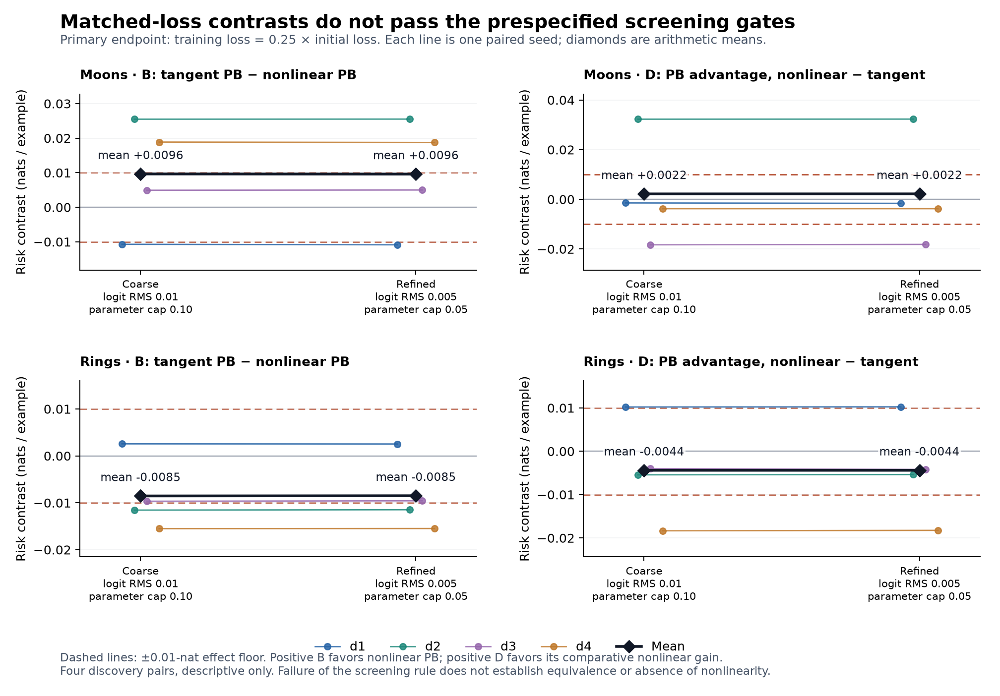

# Full-tangent gate for learned representation geometry

November 21, 2026, America/Los_Angeles. Status: **the current explanatory claim is not retained under the declared screen; no innovation has been established.**

The completed comparison does not justify expanding the proposed learned-geometry-feedback mechanism. At the primary matched-training-loss endpoint, nonlinear pullback improves on its full initial tangent counterpart by 0.00960 nats on moons and worsens it by 0.00850 nats on rings. Both magnitudes fall below the 0.01-nat screening floor fixed before evaluation. The PB-specific nonlinear interactions are smaller still. This is a bounded screening decision, not a proof that nonlinear effects vanish, that the two models are equivalent, or that initial geometry and a clock change explain every observation.

The moons result is close to the cutoff: 0.00960 versus 0.01000. The cutoff is a resource-allocation rule, not a significance boundary or a universal definition of scientific importance. Four seeds leave substantial between-training-set uncertainty. We do not lower the threshold, substitute an earlier checkpoint, or claim a strong null result. Independent confirmation seeds remain unused because the screening gate did not open.

## What was actually compared

The same 80-parameter residual architecture, mean logistic objective, fixed first-coordinate readout, and summed two-coordinate representation metric are retained. Four arms use paired data and initialization: nonlinear GD, nonlinear adaptive PB, full tangent GD, and full tangent PB. The complete tangent representation on **every** training or evaluation input is

    z_linear(x) = z_initial(x) + J_initial(x) (theta - theta_initial).

Both representation coordinates and the predictive Jacobian remain frozen. Tangent PB uses the same fixed 80-by-80 initial damped metric throughout. This is the missing initial-tangent training control; it is not a probe on the initial two-dimensional representation, a cached-metric nonlinear model, or a one-step Taylor check.

Moons uses four fresh paired training draws and a separate balanced 20,000-example evaluation draw per pair. Rings uses four fresh paired training draws and the known Gaussian-noisy-ring population law. Sample size is 256 and lambda=0.1 on the sum metric throughout. The endpoint is an actual saved state at 25% of each pair's common initial training loss. Earlier 75% and 50% levels are secondary. Scalar step normalization, Armijo descent, and a Taylor-remainder check control progress and discretization. No held-out or population score selects a step or checkpoint.

See the [original frozen protocol](PROTOCOL.md), [literature audit](LITERATURE_AUDIT.md), and [theory audit](THEORY_AUDIT.md).

## Transparent repairs before evaluation

The original 64-run protocol had a 6000-update ceiling. All nonlinear and moons trajectories attained the primary endpoint, but twelve rings tangent trajectories did not. The original records and their insufficient-coverage decisions remain in `discovery/` and `discovery_scores/`. Censoring was not treated as inability of the tangent model to fit.

Before any new evaluation scores were generated or inspected, the [coverage amendment](COVERAGE_AMENDMENT.md) extended all rings tangent trajectories to a fixed 60000-update ceiling. Every primary endpoint was attained; 46 shared initial/target states exactly reproduced the original run. Thus the original missing endpoints were an optimization-budget limitation, not evidence of a representation-capacity barrier.

Independent audit then found that the common parameter-step cap could make nominal logit-step halving leave actual steps unchanged. The [refinement amendment](REFINEMENT_AMENDMENT.md), also recorded before evaluation, halved both the target logit RMS and the parameter cap: 0.01/0.1 versus 0.005/0.05. The refined run used a fixed 120000-update ceiling, preserving the coarse maximum parameter-path allowance. All endpoints were attained. These are explicit exploratory design repairs, not retroactive changes to the frozen original study. Both original and supplemental decisions are retained.

There were 112 actual training runs: 64 original, 16 coverage reruns, and 32 corrected refinement runs. The final supplemental comparison contains 64 selected trajectories and 256 initial/target snapshot records. It is assembled without overwriting any component run.

## Primary predictive results

The table reports mean logistic risk across four pairs at the refined 0.005/0.05 setting and the primary matched loss. Lower risk is better. Moons values estimate risk on independent evaluation samples; rings values integrate the population law. Values after plus/minus are sample SD across trained pairs, not confidence intervals.

| Task | Nonlinear GD | Nonlinear PB | Tangent GD | Tangent PB |
|---|---:|---:|---:|---:|
| Moons | 0.156379 +/- 0.024741 | 0.146276 +/- 0.007868 | 0.163786 +/- 0.027933 | 0.155874 +/- 0.021994 |
| Rings | 0.193501 +/- 0.012850 | 0.197407 +/- 0.004468 | 0.189391 +/- 0.010380 | 0.188906 +/- 0.009574 |

Define B=R_tangentPB-R_nonlinearPB, so positive B favors nonlinear PB. Define D=(R_nonlinearGD-R_nonlinearPB)-(R_tangentGD-R_tangentPB), so positive D means nonlinearity increases PB's comparative advantage over GD. Neither contrast attributes an effect to metric adaptation.

| Task | Mean B +/- SD | Paired signs agreeing with mean | Mean D +/- SD | Paired signs agreeing with mean | Decision |
|---|---:|---:|---:|---:|---|
| Moons | +0.009598 +/- 0.016095 | 3/4 | +0.002191 +/- 0.021375 | 1/4 | B and D fail |
| Rings | -0.008501 +/- 0.007757 | 3/4 | -0.004390 +/- 0.011650 | 3/4 | B and D fail |

The coarse-to-refined mean-B changes are 0.00004369 nats for moons and 0.00004412 for rings, below the declared 0.003 numerical-sensitivity tolerance. The effect-size criterion, not discretization, prevents retention. Agreement at two resolutions remains a sensitivity check rather than a flow-convergence theorem.

All paired primary values are shown so that cancellation and heterogeneity remain visible:

| Task/pair | B | D |
|---|---:|---:|
| Moons d1 | -0.010868 | -0.001617 |
| Moons d2 | +0.025515 | +0.032305 |
| Moons d3 | +0.004993 | -0.018149 |
| Moons d4 | +0.018753 | -0.003774 |
| Rings d1 | +0.002534 | +0.010246 |
| Rings d2 | -0.011479 | -0.005368 |
| Rings d3 | -0.009577 | -0.004195 |
| Rings d4 | -0.015482 | -0.018244 |

Exact matching of training loss does not make the predictions identical. The mean nonlinear-versus-tangent PB training-logit RMS difference is 1.9994 on moons and 0.9930 on rings. Therefore the failed screen cannot be described as proof of predictive-path equivalence after a time change. The experiment measures small and heterogeneous predictive-risk contrasts despite clearly different predictors.

The earlier rings B at 75% initial loss is +0.01140 nats, while its primary value is negative. This is a secondary observation, not a replacement successful endpoint or an independently validated signal/noise mechanism. Existing literature already contains signal-first/noise-later behavior. No new direction-wise spectral claims are made from the radial/angular population decomposition saved by the scorer.

## Novelty decision

The original-source audit covers Chizat et al., Arbel et al., Amari et al., Yoshida-Nitanda, Wadia et al., and targeted additional threats. In particular, Yoshida-Nitanda already analyzes preconditioned Gram/cross-Gram histories, though its first-layer preconditioner restrictions do not automatically cover the present full-parameter, label-dependent metric. Zhang et al. already combines learned layerwise preconditioning with independent batches; Han et al. already analyzes signal/noise learning phases. Scope differences do not establish novelty. Exact references, theorem assumptions, and bounded interpretations are in the linked audits.

Three routine alternatives remain essential. Full tangent PB is fixed-feature kernel logistic learning after a fixed reparameterization. Nonlinear prediction with frozen M0 is also a fixed reparameterization of nonlinear GD. A positive scalar factor changes a continuous-time clock. The initial-metric curvature acceleration and signed population-gradient spectral decomposition are identities, not contributions.

The [verified two-parameter counterexample](curvature_example.json) sharpens the negative screening result: two models with identical initial full Jacobian and spectrum can give opposite unseen-risk changes from adaptive versus frozen geometry at exactly equal training prediction. The maximum analytical trajectory-relation discrepancy is 7.13e-14. A separate squared-loss calculation shows that zero-mean label noise survives through quadratic geometry feedback. Both are elementary counterexamples that eliminate universal initial-spectrum/noise claims; neither is a new theorem about the residual architecture.

**Retire the current claim that these task results already establish a useful, PB-specific learned-geometry predictive mechanism. Retain the broader research problem only.** The generic replica-metric sensitivity suggestion is not promoted into a contribution: it has not been trained, independently validated, or distinguished from existing sample-splitting/stability mechanisms.

Following the stopping rule, this round does not run the fixed-initial-metric intervention, damping expansion, independent confirmation cohort, signed spectral expansion, or compute-benefit comparison. Consequently it makes no causal assertion about adaptive metric benefit/harm, no robustness claim across damping, and no prospective predictor claim. Those limitations are part of the decision, not missing evidence silently filled by interpretation.

## Next admissible screening step

Before another network sweep, screen the narrow analytical gap: can an architecture-and-data condition control the **non-clock component** of label-dependent metric-curvature feedback over a finite interval of training progress and predict the sign of adaptive-versus-frozen-metric risk change? The condition must be computable from declared early information and cannot assume the favorable population alignment along the future fitted path.

Reject a proposed answer if it reduces to the existing quadratic toy, fixed transformed features, standard stability, layerwise learned-preconditioner/sample-splitting results, or a population-gradient inner product. Only a condition surviving those reductions deserves a new prospective protocol with independent seeds/noise levels and fixed-metric controls. No such condition has been proved in this round, so no replacement innovation claim is announced.

## Verification and reproducibility

Seven new implementation check groups and all ten existing core numerical tests pass. Multi-step tangent/kernel prediction equivalence has maximum error 3.55e-15. The independent initial/coverage audit checks 314 saved states, regenerates seeds, verifies hashes, and independently replays 10568 updates with twelve target states matching bit-for-bit. The separate refined-run audit checks all 128 additional saved states and all 256 assembled states, then independently replays 15472 further updates with six target states matching bit-for-bit. Its rings tangent-PB check confirms that the actual maximum predicted step halves when both controller limits halve. The final scorer exactly reproduces all 256 stored training losses and regenerates all eight paired datasets.

All four representative refined rings primary states pass an independent Simpson/shifted-angle quadrature check; the maximum risk discrepancy is 1.0531e-11 nats, far below the 2e-6 check tolerance. The scorer records adaptive-grid differences and rigorous omitted-tail risk bounds for nonlinear and tangent maps. Accuracy is descriptive and is not the smooth quadrature convergence target.

See [validation checklist](VALIDATION_CHECKLIST.md), [data dictionary](DATA_DICTIONARY.md), [machine-readable decisions](discovery_refined_scores/gate_decisions.json), [paired results](discovery_refined_scores/contrasts.csv), and the source/config snapshots. Run records retain diagnostic durations, but the shared controller explicitly constructs Jacobians for GD; these durations are not a fair production optimizer cost comparison. No new computational advantage is asserted.

Repository source and reusable configurations remain in their assigned locations. All research records are in this fresh independent archive; earlier protocols, outcomes, and junction targets remain unchanged. No professor or other person was contacted.
