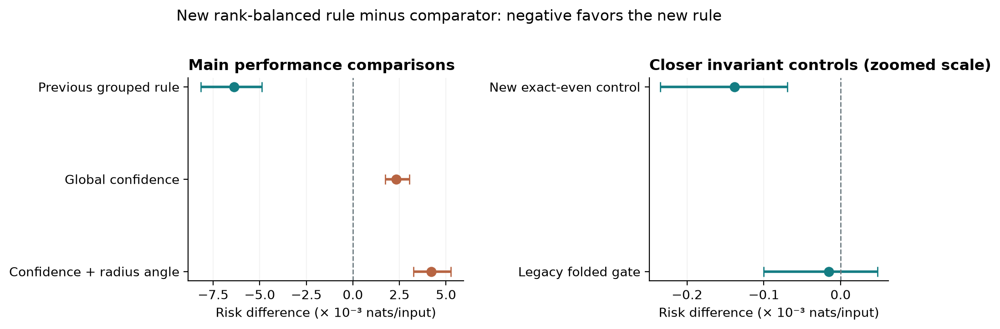

# Useful balance guarantees and richer allocation

Completed research round | 21 November 2026 | Original Idea 4, independent confirmation, and RTX 5070 Ti inference

## What this round established

The main advance is a useful conservative guarantee for the existing continuous balanced selector. Local derivative bounds reduce its mean integrated conditional-imbalance bound by **13,023 times** on 16 entirely new models. A separate unlabeled confidence sample then gives a positive expected-risk improvement lower bound for **all 16 models simultaneously at 95% family confidence**, uniformly over every measurable radial label posterior. The guarantee relies on the stated rotational symmetry; the implementation is numerically audited float64, not formal directed-rounding verification.

The stronger global selector removes the previous four-item grouping restriction while keeping exactly 64 extra predictions per 256 inputs. It lowers mean logistic loss by **5.93%** versus the previous grouped balanced rule, and beats its new exact-even control by a small amount on all 16 models. It remains worse than global confidence on all 16, with no resolved difference from the legacy folded symmetric gate. The small loss advantage over the new even control does not improve classification accuracy.

The GPU extension was completed on the actual **RTX 5070 Ti**, with nine genuinely trained MLPs at three fixed sizes. None of the limited-prediction methods beats the fastest equivalent full-prediction GPU implementation in either resident or transfer timing. The same approach does save time on the larger models using one CPU thread. More model computation therefore creates an opportunity whose value depends on the serving implementation and hardware.

## Study boundaries

| Component | Independent evidence | Result |
|---|---|---|
| Local continuous balance |16 fresh PB models; separate 262,144-input confidence sample/model|Useful positive conservative bounds|
| Global exact-quota allocation |16 fresh PB models;65,536 IID test inputs/model|Better than old grouping; loses to confidence|
| Actual inference efficiency |3 MLP widths by 3 seeds; real CPU/CUDA deployments|CPU gains at larger widths; no GPU allocation speedup|

The 64 historical PB models were used only for development. The corrected selector, tau=1 choice, training schedule and primary analysis were frozen before generating the new 921000-series/922000-series model cohort. All new PB models use the unchanged 80-parameter residual network and 500 pullback updates. No fresh outcome selected a method, width or tuning parameter.

All limited policies use 1.25 forward examples per input. Raw and full references use 1 and 2 respectively. Calibration, mathematical verification and research diagnostics are charged separately. Independent units are trained-model seeds, never angular grid nodes or timing repeats.

<!-- pagebreak -->

## 1. Turning a loose bound into a useful guarantee

For a first logit a, antipodal logit a', averaged logit m and d=(a-a')/2, let q be the deployed marginal selection probability. Conditional imbalance is b(r)=E[q d | R=r]. Unknown-posterior gain satisfies Delta(p)=C-E[p(R)b(R)]. Exact identification requires b=0 almost everywhere; a small observed grid residual is insufficient.

The original field and every deployed mask remain unchanged. The new analysis propagates local intervals for values and first/second radial and angular derivatives through each residual block. It integrates signed angular moments, removes even harmonics analytically, and controls interpolation inside each original coefficient interval. The resulting envelope applies at every radius, including between fitting anchors.

| Mean across 16 fresh models | Bound on mean absolute imbalance |
|---|---|
| Previous global analysis |1.06027854|
| Global analysis with odd harmonics only |0.56238434|
| New local analysis |0.0000814162|
| Observed mean absolute imbalance |0.0000422446|

The local bound remains **6,908 times tighter** after isolating the parity simplification. It is about 1.93 times the numerical moment magnitude. All 16 models improve both global controls and pass the frozen target: local mean no more than 1% of the old mean. The achieved ratio is 0.00768%.

### Independent confidence certificate

Center the unknown posterior at 1/2. An antithetic, input-only observation W has expectation C-E[b]/2. If |b(r)|<=B(r), then every radial posterior has gain at least E[W-B(R)/2]. The omitted radius>3 tail is nonnegative. This argument does not require a known radial density or class prevalence.

A separate 262,144-input sample per model and the empirical Bernstein inequality give simultaneous 95% confidence across all 16 models. The smallest lower bound is **0.000755336 nats/input**; the mean lower bound is **0.00278791**. Every model is positive. These statements concern expected loss, not every individual prediction or arbitrary distribution shift.

Prespecified attribution controls matter: using the same observations with the old global bound certifies 0/16 models; using the local bound with the older range-only Hoeffding correction also certifies 0/16. Both local analysis and variance-sensitive concentration are necessary for the result at this sample size.

Offline local setup averages 0.804 seconds/model:262,144 five-component interval-jet propagations plus 262,656 ordinary point forwards. The independent confidence calculation adds 524,288 forwards/model. Those costs are separate from the 66,048-forward field fit and unchanged deployment. All finite-difference, interval enclosure and confidence recomputation checks pass. Ordinary floating-point padding remains a numerical limitation.

<!-- pagebreak -->

## 2. A larger exact-budget selection family

The previous grouped rule had marginal selection probabilities restricted to[0.125,0.375], with average 0.25 at every radius. The new rule assigns an input-only score a(r)+w frac(k phi/(2pi)+phase), then selects the global top 64 of 256. Radius-dependent mixtures of these actions preserve the conditional uniform score distribution. This makes the true inclusion probability explicit: Q(F(score)), where Q is the Beta(192,64) CDF. Probabilities can approach 0 or 1, and budget can move between radii.

At each radial anchor, an unlabeled two-action mixture maximizes the estimated gain while balancing the estimated signed moment. An even-frequency version is an exact symmetry control; an unconstrained version is retained. All three share 66,048 calibration forwards plus 131,072 coordinate-only radii. No partner output is available to selection.

| Policy | Mean test logistic loss | Extra predictions per 256 |
|---|---|---|
| Raw model |0.110633|0|
| Previous grouped balanced |0.107371|64|
| New rank-balanced |0.101001|64|
| New rank-even |0.101139|64|
| Legacy folded symmetric |0.101016|64|
| Global confidence |0.098669|64|
| Confidence plus radius angle |0.096782|64|
| Full half-turn |0.100690|256|

Rank-balanced beats the previous grouped rule by 0.00636987 nats/input,16/16 wins. Its primary advantage over rank-even is only 0.000137921, with 97.5% interval[0.0000694323,0.000235070],16/16 wins. Its primary disadvantage to confidence is 0.00233157, interval[0.00173759,0.00304332],0/16 wins. Against the legacy folded gate the interval includes zero and wins are 8/16. Mean classification error is 1.4033% versus rank-even 1.4027%: the loss improvement is not an accuracy improvement.

<!-- pagebreak -->

## 3. What the richer selector does and does not guarantee

Global ranking changes the actual marginal probabilities, so its conditional moment must be recomputed using Q(F). Reusing the old group formula would be wrong. The score-law construction removes quota-repair bias, but empirical-CDF calibration, angular quadrature and radial interpolation still introduce approximation errors.

The exact-even rule has b(r)=0 structurally at every radius, regardless of CDF fitting accuracy. Its canonical half-plane implementation also preserves the symmetry numerically. The learned balanced rule can use odd actions and has a proven error bound that includes empirical-CDF uncertainty, sawtooth jumps and changes in both logits and score location between radial anchors. Its formal bound is currently too large to provide a useful guarantee.

Independent numerical integration of the actual rank marginal gives mean ambiguity width about **4.5e-4 nats/input**, versus 0.02723 for unconstrained ranking: a reduction of about 98%. The exact-even control has width zero by symmetry. The learned rule's mean maximum sampled conditional moment is 0.0328, so its tiny anchor residuals do not imply exact continuous balance.

The refined balanced centered gain averages 0.009635. Its model-specific numerical gain intervals average [0.009408,0.009862], compared with 0.009496 for the exact-even control. Every numerical lower endpoint is positive, but it exceeds the corresponding even-control gain on only 4/16 models. These are numerical estimates, not a certified advantage over all label rules.

The largest initial-to-refined width change is 3.24e-5; the integrated selection-rate discrepancy is still as large as 1.00e-4. These are convergence diagnostics rather than rigorous integration-error bounds, so the width is reported approximately. The valid pointwise 95%-family bound has a numerical integrated value around 10.11; a separate rigorous but crude known-input-law integrated cap averages 9.95. Both are far too large to certify the learned rule. The complete diagnostics cost 218,103,808 evaluation-only forward examples, separately from calibration and deployment.

The useful local certificate on the preceding page applies to the older continuous grouped field. It does **not** automatically transfer to the new global selector. Similarly, a small original-ring loss advantage over an invariant control does not imply superiority under every hidden radial label rule. Averages of model-specific worst-case endpoints are not the performance of one shared worst-case labeling law.

### Errors found and preserved

An old-only audit found sawtooth wrap samples could shift discrete gain/moment calculations by about 0.0013/0.0014. We preserved the initial pilot, shifted phases by a fixed quarter cell, reran all 64 old models and three tau values, then froze the method before fresh generation. Tau remained 1 and direct/FFT checks agreed to roundoff.

Ancillary diagnostics were specified before their author accessed fresh files or outcomes, but eight seconds after primary scoring began. A later uniform refinement assessed precision. Full chronology and both passes are retained; no policy changed.

### Tiny-model CPU cost

An isolated equivalent-serving audit checks 224 full-input policy/model combinations, with identical masks and zero output difference. Input-only policies can combine the 256 initial and 64 selected partner inputs into one 320-example call. The full reference can similarly use one 512-example call.

Fused rank-balanced still takes 0.1681 ms/batch, versus 0.06015 ms for full half-turn and 0.08431 ms for confidence. No limited rule is faster than full on any of the 16 tiny models. Rank fitting costs 0.808 seconds/model. Without a deployment saving there is no finite wall-clock break-even.

<!-- pagebreak -->

## 4. Real models on the RTX 5070 Ti

The conditional hardware branch was activated after the old-model local-bound advance. A separate CUDA 12.8/PyTorch 2.7.1 environment was installed and verified on the actual 16 GB RTX 5070 Ti. The main research environment was preserved.

Nine MLPs use two tanh hidden layers with widths 64,256 or 1024, three seeds per width, and ordinary Adam training on 1024 inputs. Data and initialization seeds are paired across widths. Parameter counts are 4,417;66,817;1,053,697. Training and calibration precede testing. These are genuine learned networks, with no repeated unused operations added to inflate cost. They are not a controlled comparison against PB training, which uses a different architecture, optimizer and training sample size.

The benchmark includes all routing, exact tie handling, gather/scatter, rotations where needed, and actual selected predictions. Fixed 64 integer indices avoid CUDA Boolean-index synchronization. Combined 320-input limited inference is compared against the fastest equivalent full implementation, including combined 512-input inference. Raw/full methods do not transfer unused tie keys. Original implementations, corrections, equivalence checks and all 2,646 retained timing rows are preserved. This hardware extension tests the folded/confidence controls; it is not a GPU implementation of the new rank-balanced rule.

| Hidden width | Folded/full loss | GPU resident speed ratio | GPU transfer speed ratio | One-thread CPU speed ratio |
|---|---|---|---|---|
|64|0.030831 /0.030791|0.177|0.257|0.630|
|256|0.036459 /0.036433|0.178|0.258|1.193|
|1024|0.034633 /0.034593|0.151|0.221|1.505|

Ratios are means of per-model fastest-full/limited latency ratios; greater than 1 means faster. The table uses the fixed-index, combined-call folded symmetric policy. Losses in this table were scored on CUDA. Each width has only three descriptive model replications. Repeated timings are not additional models.

**GPU result:** every limited policy is slower than the best full reference on every tested model, both with resident data and including transfers. There is no GPU wall-clock break-even. At width 1024, full combined GPU inference averages 0.207 ms/batch; folded combined inference 1.365 ms. The GPU successfully accelerates the network itself; selective routing has substantial overhead in this eager implementation.

**CPU result:** the larger widths do benefit. Folded combined inference is 1.193 times faster at width 256 and 1.505 times faster at width 1024, 3/3 models each. Width 1024 CPU times are approximately 10.57 ms for the fastest full reference versus 7.02 ms folded. An independent CPU quality replay covers full, folded and confidence-angle policies on all test inputs: no mask or class-decision changes versus CUDA, and risk differences below 1.77e-9. This supports the CPU quality tradeoff for those paths.

Confidence plus calibrated angles also improves mean loss against full half-turn in this descriptive MLP sweep, but remains slower on GPU. The tested limits are FP32, batch 256, this machine and this serving stack; no claim is made about compiled kernels, CUDA graphs, larger batches or other architectures.

<!-- pagebreak -->

## 5. Audit trail and recommended direction

All 240 fresh PB policy/model outcomes were reconstructed independently from saved predictions and regenerated inputs. Expected-loss discrepancies are at most 5.56e-17. All 61,440 per-batch call and quota records pass. Three complete 500-step training replays reproduce the stored parameters exactly; all 16 new states are distinct and absent from the 64-model development bank. Frozen sources, policy commits and the training/calibration/test ordering were verified.

The 16 confidence bounds were independently recomputed from stored raw observations. Three complete 262,144-input antithetic samples were regenerated; the largest observation discrepancy is 2.78e-16. This additional audit costs 1,572,864 forward examples and is recorded separately. Bounds, source corrections and initial failures are preserved in the archive rather than overwritten.

Independent hardware checks reconstruct all 2,646 timing records, 378 cost rows and 126 summaries. The separate CPU quality audit adds 27 model/policy rows, 1,728 batch call records and 663,552 charged forward examples; it does not rerun training or timing.

### Research priority

**First, transfer useful local error control to global ranking.** The current general global-rank bound is conservative. Split angular cells at known score jumps, preserve signed cancellation, and improve the CDF uncertainty calculation. The target should be a useful bound for the actual deployed marginal, with a frozen comparison against the strong invariant folded gate. This is the direct continuation of original Idea 4.

**Second, test whether the extra flexibility earns its complexity.** The present global learned rule improves a restrictive grouped baseline, but gives only a small loss gain over its own exact-even control and no convincing gain over the legacy folded gate. Prefer the simpler exact-symmetry option where robustness is the objective. Preserve confidence plus calibrated angles as the stronger empirical quality branch. Confirm any next method on a genuinely different symmetry task after its design is fixed.

**Third, make hardware work follow measured bottlenecks.** The 5070 Ti is usable and the environment is ready. Further model enlargement is not needed to improve the mathematics. A future performance study should first reduce routing/launch overhead in a compiled or fused implementation, then remeasure on a fixed real workload. The present larger-model CPU win is useful evidence about when prediction cost can pay for selection; the negative GPU result is equally important.

The round therefore completes the four requested steps while keeping three conclusions distinct: the older method now has a useful conservative guarantee; the richer method improves allocation but has not won against the strongest empirical baseline; and the hardware benefit depends on the deployment path.

### Sources and reproducibility

The mathematical confidence inequality is [Maurer and Pontil (2009), Theorem 4](https://www.cs.mcgill.ca/~colt2009/papers/012.pdf). Uniform empirical-CDF control uses [Massart (1990)](https://doi.org/10.1214/aop/1176990746). Runtime setup follows the [official PyTorch version instructions](https://pytorch.org/get-started/previous-versions/); actual installed versions and device execution are recorded locally.

REPRODUCE.md identifies all stages and environments. Component READMEs contain full tables, assumptions, costs and raw paths. VALIDATION_NOTES.md records corrections and chronology. The final SHA-256 manifest covers every archived source, model, table, figure and report; it excludes only transient bytecode and rendered preview images.
