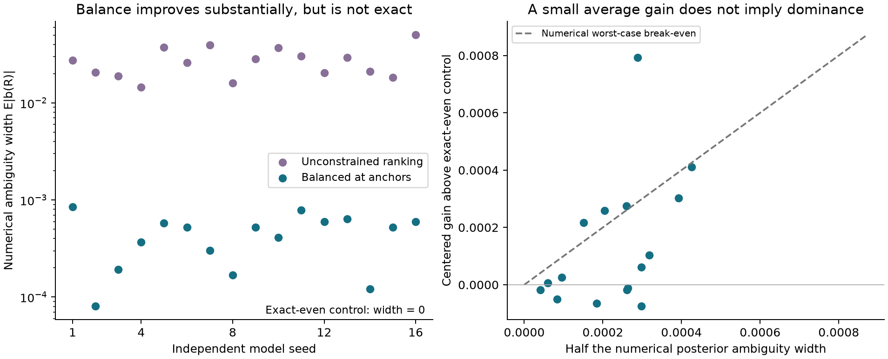

# Conditional balance under global ranking

The new allocation family substantially reduces the ambiguity caused by unknown radial posteriors, but its learned balance is approximate. Across 16 new PB500 models, the refined numerical mean ambiguity width E|b(R)| is **0.000453154 nats**, versus **0.0272293** for unconstrained ranking, a reduction of **98.34%**. The exact-even control has width zero by symmetry. The learned policy's mean maximum sampled |b(r)| is 0.032827; its zero calibration-anchor moments do not imply zero continuous conditional moments.

| Frozen method | Centered gain | Mean numerical lower gain | Mean numerical upper gain | Numerical integral of formal pointwise bound |
|---|---:|---:|---:|---:|
| Balanced at anchors | 0.0096350 | 0.0094084 | 0.0098616 | 10.11 |
| Exact even symmetry | 0.0094964 | 0.0094964 | 0.0094964 | 0 |
| Unconstrained | 0.0159428 | 0.0023281 | 0.0295574 | 16.31 |

These are gains relative to one-view inference. Each numerical interval extremizes an unrestricted radial posterior separately for each model and the table averages those model-specific endpoints. It does not describe one shared extremizing posterior, does not fix prevalence, and is not an exact continuous neural-network certificate. For an individual model, the interval is [E C-E max(b,0), E C-E min(b,0)], with width E|b|.

The balanced numerical lower endpoint is positive for 16/16 models, but exceeds the exact-even control for only 4/16. Thus the small centered-gain and original-task advantage does not imply dominance under arbitrary radial posteriors. The simultaneous 95% DKW/BV/radial bound is valid **pointwise**, uniformly over radius. Its mean numerical integral is 10.11 nats, far larger than the gains; that Gauss integral has no analytic quadrature certificate and is not itself a certified integrated upper bound. A separate rigorous deterministic integrated cap is available: because E[d|r]=0 and 0<=q<=1, |E[qd|r]|<=E[|d||r]/2. With E[R]<=sqrt(.89), E|b|<=.5 min(sqrt(.89)+C_h, sqrt(.89)L_h). This universal cap averages 9.951 nats and is also **vacuous**. Neither bound certifies the learned policy's small gain advantage. The exact-even guarantee is structural and does not need these loose bounds.

## Numerical precision and fixed refinement

The initial diagnostic plan was physically recorded at 09:41:46.830295 UTC before this investigator opened any fresh policy or outcome. Main risk scoring had begun eight seconds earlier under the parent's authorization; no resulting outcome had been revealed to this investigator. The evaluator source was committed at 09:42:58.920609 UTC before the first diagnostic policy read. This chronology is explicit in `diagnostics/SOURCE_COMMIT.json`; it is not represented as a study-wide pre-scoring diagnostic freeze.

Initial grids used four Gauss nodes per radial anchor interval and 4,096 angles, with fixed radial, angular, and phase alternatives. Their non-negligible numerical sensitivity triggered one authorized refinement, uniformly applied to all 16 models: eight radial nodes, 8,192 angles, and 64 nodes per interval in the population score-CDF integration. `DIAGNOSTIC_REFINEMENT_FREEZE.json` and `diagnostics_refined/SOURCE_COMMIT.json` preserve the evaluation-only amendment. No policy, width, model, or winner changed. The initial outputs remain intact.

The largest per-model change from the initial main grid to the final refinement is 3.24e-05 nats for the balanced ambiguity width, 2.93e-05 for its lower endpoint, and 1.31e-05 for its centered gain. The largest final integrated-rate discrepancy from the exact 1/4 identity is 0.0001; this is quadrature error, not an exact-quota deployment failure. The score-CDF 32-to-64-node comparison differs by at most 5.82e-06 on the fixed score check grid. These refinement differences are sensitivity diagnostics, not rigorous continuous integration error bounds. No further adaptive refinement was performed; interpret rounded results at this precision.

The rank marginal uses the correct Q(F_population), including its action mixture and competition against the other 255 inputs. A 262,145-point table of the exact stable binomial polynomial accelerates evaluation with a global analytic interpolation-error bound 1.37e-08; direct marginal spot checks differ by at most 5.72e-10. The exact-even moments are numerically near machine precision and are set to zero structurally only for their interval and bound. They are not silently zeroed in the raw moment arrays.

## Costs, raw files, and reproduction

The initial diagnostics use 83,886,080 model example forwards, and the uniform refinement adds 134,217,728, for **218,103,808 evaluation-only forwards**. These are separate from the frozen 66,048 calibration forwards per model and the actual 256+64 deployment budget. Coordinate/CDF/Q calculations do not evaluate the network. Stored orbit logits permit independent replay of moments without new model calls.

- `diagnostics/summary.csv` and `diagnostics/<seed>/`: all original grids, moments, orbit logits for the main grid, CDF comparisons, and provenance.
- `diagnostics_refined/summary.csv` and `diagnostics_refined/<seed>/`: the fixed refined results and orbit logits.
- `DIAGNOSTIC_SUMMARY.json`: full-precision aggregate values and sensitivities.
- `DIAGNOSTIC_FREEZE.json`, `DIAGNOSTIC_REFINEMENT_FREEZE.json`, and both source commits: transparent chronology and hashes.
- `../validation/`: independently measured original-task risks, baseline comparisons, exact call audits, and latency. This report does not replace that independent validation.

From the study root, `python selection/diagnostic_report.py` regenerates this report and figure from immutable raw arrays. `python selection/diagnose.py` and `python selection/diagnose_refinement.py` regenerate the numerical evaluations; both refuse to overwrite their output directories, so preserve existing outputs first. The complete original plus refined diagnostic computation takes about three minutes on the original CPU environment. NumPy, threadpoolctl, and the vendored model source are sufficient for evaluation; matplotlib is needed for the report figure.
