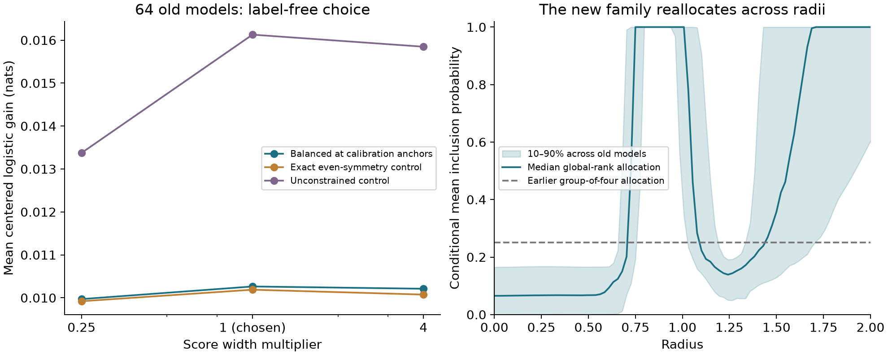

# A larger exact-quota selection family

The new selector ranks all 256 inputs globally and spends exactly 64 additional model calls. Its inclusion probabilities can approach zero or one and can allocate different amounts across radii. This is a larger feasible family than the earlier group-of-four field, whose probabilities stayed in [.125,.375] and averaged one quarter at every radius. Selection uses coordinates and stored calibration tables; no candidate partner logits are queried before choosing the mask.

The key construction preserves the score distribution while changing which orientations receive high scores. At radius r, every permitted action produces a uniform score on [a(r),a(r)+w]. This makes the exact global-rank inclusion marginal available analytically. A small linear program then fits a zero conditional moment at each calibration radius. The proof, error bound, and limitations are in [THEORY.md](THEORY.md).

Three methods are frozen:

| Method | What is optimized | Balance statement |
|---|---|---|
| `rank_balanced` | Best anchor objective with a zero estimated moment | Approximate continuous balance; explicit error bound |
| `rank_even` | Best even-frequency action | Exact continuous half-turn balance |
| `rank_unbalanced` | Best action without a moment constraint | No balance guarantee |

The exact-even control is essential. A zero anchor residual does not prove that the learned policy is balanced between radii, or under the true score distribution. The new bound charges empirical-CDF error, angular jumps, and changes in both network logits and score location between anchors. It can be numerically loose. Independent validation must measure the true rank-marginal moments; the prior group-of-four moment formula does not apply.

## Old-model development and freeze

All 64 prior original-ring PB500 models were used for development. The only searched parameter was the width multiplier tau in {.25,1,4}. Selection used 16,384 held-out inputs per old model and an entirely label-free centered logistic gain. Neither labels nor any hidden posterior chose the multiplier. All 576 model/tau/method rows are retained.

| Width multiplier | Mean old centered gain, balanced method |
|---:|---:|
| 0.25 | 0.009970224 |
| **1, selected** | **0.010264076** |
| 4 | 0.010211279 |

At the selected width, the exact-even and unconstrained controls have old centered gains 0.010189015 and 0.016128319. These are development surrogates, not confirmation results or gains under the original label posterior. The larger unconstrained value does not establish safety under other radial posteriors. The balanced policy uses odd-frequency actions with mean mass 0.532 across the old input distributions, so it is not merely the even control under another name.

An independent old-only audit detected a genuine numerical problem in the initial calibration grid: sawtooth discontinuities caused direct-coordinate versus FFT differences up to about .0013 in the objective and .0014 in the moment. The complete original run and source versions remain under `development/` and the `*_v1` files. The recorded correction shifts every action phase by one quarter of a grid cell. The same bounded old64/three-width study was rerun as `development_v2/`; it selected the same width.

The final algorithm was frozen at **2026-11-21 09:38:35.525441 UTC**, before any new confirmation model was opened. `FREEZE.json` contains source, protocol, choice, and data hashes. Source SHA-256 is `9f6e3e96a85fa62657ec1430aececc846cffa3ce338786356d514d942d00ae31`. The final 1,152 direct action checks agree with FFT calibration to at most 2.95e-17; all exact-quota, even-score, even-mask, and zero-bound checks pass. An independent audit also checked the hull optimum and the full bound derivation.

## Cost and artifacts

Each model uses 66,048 calibration example forwards (129 radii × 512 angles), shared by the three policies, plus 131,072 coordinate-only calibration draws. Deployment uses 256 initial and exactly 64 partner forwards. Offline fitting, coordinate sampling, and evaluator-only integration are reported separately; they are not free deployment calls.

- [PROTOCOL.md](PROTOCOL.md): frozen scope, seeds, API, and reproduction details.
- [THEORY.md](THEORY.md): score-law proof, exact rank marginal, exact-even control, and approximation bound.
- [FREEZE.json](FREEZE.json): timestamp and immutable hashes.
- [development_v2/scores.csv](development_v2/scores.csv): all corrected old outcomes and mask hashes.
- [development/model_manifest.csv](development/model_manifest.csv): old model provenance and hashes; `development/models.npz` is the portable state bank.
- [numerical_checks/summary.json](numerical_checks/summary.json): direct checks, with individual rows in the same directory.
- [DEVELOPMENT_SUMMARY.json](DEVELOPMENT_SUMMARY.json): machine-readable old summary.
- `../validation`: independent new-model calibration, deployment comparisons, continuous-moment diagnostics, and timing. Those results are separate from the old tuning data here.

From the archived study root, `python selection/report.py` verifies frozen hashes and regenerates this old-development figure/summary. `python selection/checks.py` repeats the checks into a fresh `numerical_checks` directory; preserve the existing directory before rerunning. `python selection/develop.py` repeats the corrected old study using the portable old state bank and refuses to overwrite retained results. Full reruns take minutes on the original CPU environment. NumPy and threadpoolctl are required; matplotlib is used only for reporting. The vendored source under `../source` is the only model-code dependency; no external old-study paths are needed for corrected reproduction.

## Independent conditional-moment evaluation

The completed fresh 16-model diagnostics are in [DIAGNOSTICS.md](DIAGNOSTICS.md), with [the numerical summary](DIAGNOSTIC_SUMMARY.json) and [the comparison figure](conditional_balance.png). The learned global policy reduces numerical posterior ambiguity by about 98% relative to unconstrained ranking, but its approximate width remains about 4.5e-4 nats. The exact-even control remains exactly balanced; the learned general-purpose bounds are too loose for a useful certificate. Numerical refinement and its remaining error are reported separately from policy training and actual deployment cost.
