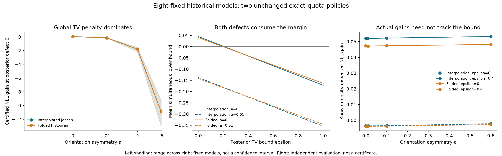

# Input-law mismatch: a valid multiclass bound, a conservative empirical limit

The multiclass extension is valid under explicit assumptions, but the global input-TV penalty was too large to certify the tested nonzero shifts. At the smallest shift a=.01, both unchanged policies still reduced expected loss for all eight fixed models, while all sixteen certificates were nonpositive. No range, shift, clip, policy, model, or sample budget was retuned after seeing this result.

## What was confirmed

For logits z and zT, d=(z-zT)/2 and the log-sum-exp Jensen gap J, the expected coordinatewise symmetrized gain is

    E[M {J - (p-pT) dot d / 2}].

Under an asymmetric input law, this need not equal the deployment gain before the input-law correction.

With posterior TV at most epsilon, input TV(P,T#P) at most eta, and a deterministic bound span(d)<=D, the simultaneous lower bound is

    gain on P >= L_A - epsilon U_B/2 - D eta,
    A=E_P[M min(J,c)], B=E_P[M span(d)].

The moments are verified on the same input law P as the risk. The mask must remain unchanged when one input is transformed and all other records and keys are fixed. A fixed quota alone is insufficient. The range span(d), unlike an absolute logit norm, ignores arbitrary common logit offsets. The theorem covers multiclass cross-entropy; it does not certify classification error or online model adaptation. Full proof, concentration constants, and primary literature are in [THEORY.md](THEORY.md).

The numerical multiclass audit used 49,152 logit/posterior pairs with 2, 3, and 10 classes and four logit scales. Maximum identity error was 1.07e-14; maximum common-offset discrepancy was 1.25e-13. Posterior-TV, loss-range, and Jensen-range inequalities passed. This is an algebra audit, not a trained multiclass confirmation. Binary identities were also checked on every independent stress input, with maximum error 1.34e-15.

## Prospective controlled experiment

Eight fixed prior legacy models, indexed 1 through 8, retained their historical interpolated Jensen and folded-histogram selectors. There was no new training or selector fitting. Each policy selects exactly 64 of 256 inputs and deploys with 320 model evaluations. The compact task has two independent amplitudes and a phase density proportional to 1+a cos(phi). Its exact input defect is eta=2a/pi. Four separately sampled laws used a=0,.01,.1,.6.

The primary verification budget was 2,048 independent batches per model/law, with a nested 512-batch secondary look. Both policies, moments, concentration methods, looks, models, and laws were included in a 512-event union bound with joint coverage at least 95%. The resulting affine bound is uniform in epsilon; displaying several epsilon values incurs no extra testing. Independent performance evaluation used 65,536 IID inputs per model/law and the known synthetic posterior. No sampled test labels were used. Cosine and model-adversarial label defects were fixed in advance.

## Primary result at zero posterior defect

Values are means across eight fixed historical models, in nats. They are not new-model confidence intervals. Each individual certificate is part of the simultaneous family.

| Phase shift a | Known input TV eta | Interpolation lower bound | Folded lower bound | Positive certificates, out of 16 |
|---:|---:|---:|---:|---:|
| 0 | 0 | 0.045005 | 0.040325 | 16 |
| .01 | .006366 | -0.137404 | -0.142093 | 0 |
| .1 | .063662 | -1.779326 | -1.784009 | 0 |
| .6 | .381972 | -10.900995 | -10.905661 | 0 |

The deterministic D averaged 28.6566, ranging from 24.3425 to 34.2206. At a=.01, its mean penalty alone was .182434. With zero label defect, the inferred tolerable input-TV margin at a=0 averaged only .001573 for interpolation and .001410 for folded; minima were .001218 and .001099. These margins are consequences of the frozen bounds, not extra shifts that were tested. At the 512-batch look the mean tolerable margins were .001545 and .001382: increasing verification precision cannot remove a dominant deterministic penalty.

At a=0, the mean certified posterior-TV limits were .205812 and .196719, with minima .176437 and .169771. Once a=.01, the bound already fails at epsilon=0. Negative lower bounds do not establish negative gain; they fail to certify a benefit.

## Empirical risk and the density diagnostic

The following expected risks use direct independent IID evaluation at epsilon=0. Classification error is reported as a separate measurement.

| a | Policy | Expected NLL | Expected error |
|---:|---|---:|---:|
| 0 | Raw | .692148 | 37.1443% |
| 0 | Full averaging | .621269 | 33.7069% |
| 0 | Interpolation, 64 extra views | .639903 | 34.8313% |
| 0 | Folded, 64 extra views | .644649 | 35.0199% |
| 0 | Confidence, 64 extra views | .685063 | 35.2262% |
| .6 | Raw | .693582 | 37.1895% |
| .6 | Full averaging | .620911 | 33.6893% |
| .6 | Interpolation, 64 extra views | .640537 | 34.8567% |
| .6 | Folded, 64 extra views | .645658 | 35.0666% |
| .6 | Confidence, 64 extra views | .686034 | 35.1923% |

For the even policies, a predeclared known-density conditional-orbit estimator provides a second unbiased estimate of the same deployment gain. It is H+a cos(phi)(f-fT)/2, with H=(f+fT)/2, calculated from inputs drawn directly from P_a. The conditional proof in THEORY.md keeps all other records under P_a; it does not replace their joint law with the uniform law. This diagnostic uses the known posterior and density and is not a new label-free certificate.

At a=.01 and epsilon=0, known-density mean gains were .051992 (interpolation) and .047172 (folded), positive for every model, despite the failed certificates. At a=.6 they were .053243 and .048182. In this particular odd-density-tilt family the distribution of all even scores and moment weights is unchanged, while the unpaired risk component can change. These outcomes do not establish robustness to arbitrary shifts.

The prescribed adversarial posterior stress does produce harm. At epsilon=1, every model was harmed by either policy at every input shift. Mean gains at a=0 were -.023909 and -.022080; at a=.6 they were -.022435 and -.020942. At epsilon=.4, interpolation harmed 6/8 models at a=0 and 5/8 at a=.6; folded harmed 7/8 and 5/8. Adversarial posteriors depend on each fixed model, so these are not eight replications on one common label population. All intermediate defect values, cosine worlds, direct IID estimates, density corrections, and batch Monte Carlo standard errors remain in stress_results.csv. Confidence allocation is an empirical comparator outside the structural guarantee.



## Costs and integrity

| Item | Actual cost |
|---|---:|
| New training or selector fitting | 0 forwards |
| Historical standalone selector fitting, both policies for eight models | 1,048,576 forwards |
| Certificate coordinate inputs, all laws/models | 16,777,216 |
| Certificate model evaluations at 2,048 batches | 10,266,050 forwards |
| Nested 512-batch prefix | 2,566,878 forwards; included above |
| Independent performance evaluation | 4,194,304 shared forwards |
| Extra actual deployment replays | 30,720 forwards |
| Sampler diagnostics | 262,144 coordinate-only inputs; 0 forwards |

The certificate queries both views only on the two masks' union. Observed union sizes ranged from 67 to 92 per 256-input batch, so verification used 134 to 184 model evaluations per batch. This is an offline verification saving, not the deployment call count. All 96 actual limited-policy deployment replays used 256+64 forwards. Full averaging uses 512 forwards per deployment batch.

Certificate work took 24.28 seconds and stress work 19.84 seconds on this run. These are descriptive preparation/evaluation times, not isolated serving benchmarks or a hardware speed claim. Model training and historical calibration costs are separate. Raw logits, packed masks, per-batch moments, all seeds and hashes, 65,536 certificate call-ledger rows, and raw performance records are retained. No execution failure occurred. Negative bounds and harmful posterior-stress cases are retained.

The frozen source and historical input hash manifest is FREEZE.json (SHA256 7373e62581a4be0ca5e5ce87c81932eb48c1e9329d6a4c6d53549c9251fff665). ROOT_APPROVAL.json preceded all fresh 217-family samples. CLIP_COMMIT.json preceded verification. CERTIFICATE_COMMIT.json and STRESS_COMMIT.json identify the saved raw results. Analysis and this prose are postprocessing; they do not modify frozen scientific sources.

## What remains unavailable on natural images

The separate [TV_UPPER_BOUND_OBSTRUCTION.md](TV_UPPER_BOUND_OBSTRUCTION.md) proves a qualified impossibility statement: a TV upper confidence bound uniformly valid over unrestricted continuous laws must be vacuous with its coverage probability even at a fixed invariant uniform null. Finite known alphabets and explicit regularity or model-family assumptions can avoid that obstruction. A discriminator supplies a lower-bound witness, not the required upper bound. Posterior symmetry cannot be identified from unlabeled inputs alone either.

For a CNN, deterministic interval propagation on a transform-closed pixel cube can bound the required logit span, often very loosely. A numerically evaluated FP64 interval calculation with heuristic padding is not a formally rounded machine proof. Even a rigorous output-range bound does not supply natural-image input-TV or label-TV bounds. No real-CNN certificate is claimed here.

The grounded next step is a tighter transformation-specific loss-difference bound together with independently justified input-law and posterior assumptions, or labeled deployment validation when such assumptions are unavailable. This experiment does not justify simply collecting more unlabeled verification inputs, shrinking D to an observed maximum, or treating the paired evaluation law as the original natural law.

## Reproduction

The archived branch is self-contained after historical inputs were vendored. Requirements are Python, NumPy, threadpoolctl, and Matplotlib. To replay in a clean output folder, copy run.py, math_utils.py, common.py, PROTOCOL.md, THEORY.md, assets.py, analyze.py, HISTORICAL_INPUTS.json, FREEZE.json, ROOT_APPROVAL.json, and the reference/ and historical/ directories, preserving their relative names. Do not copy generated commits, results, or output directories. Then run:

```text
python run.py prepare
python run.py checks
python run.py certificate
python run.py stress
python analyze.py
```

The stages intentionally refuse to overwrite existing results. Replaying preserves the original frozen approval rather than manufacturing a new release. assets.py is provenance tooling that accesses the prior sibling study; it is not needed for the self-contained replay because the exact historical inputs and source dependencies are already included. Exact logits and deterministic arrays are reproducible; wall times and compressed container hashes can depend on environment details.
