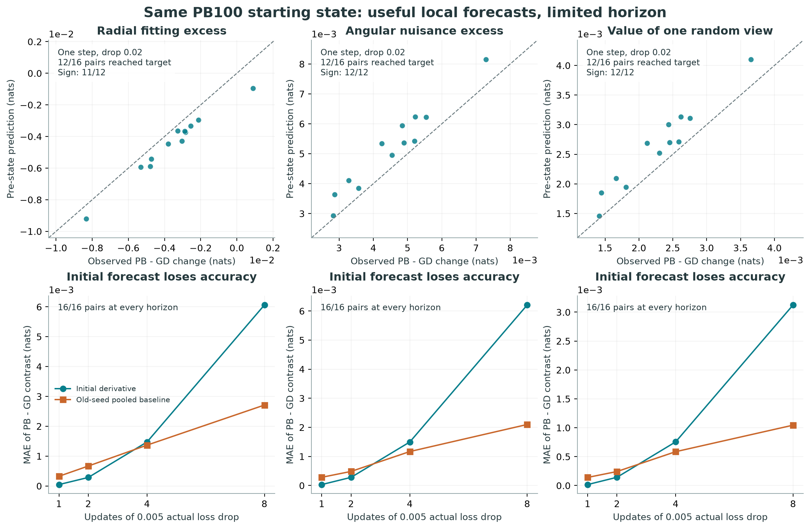
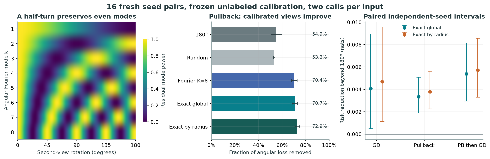

# Predicting loss matched updates and choosing a second view

Matching the actual training-loss decrease reveals a predictable local tradeoff between radial fit and angular error, but the prediction has a limited horizon. On independent noisy-ring seeds, pullback improves radial fitting more than gradient descent from the same starting state while leaving a larger angular penalty. A first-order forecast identifies this difference accurately near the starting state and becomes less accurate over longer trajectories. Separately, independent unlabeled calibration chooses rotations that improve two-view inference beyond a fixed half-turn. These are distinct findings about the training update and the inference procedure; neither establishes a universal generalization advantage for pullback.

## Equal progress makes the update comparison interpretable

The network is the original 80-parameter, two-residual-block tanh model. Its classifier reads the first representation coordinate. Pullback uses the full two-coordinate representation Jacobian and damping 0.1. At a shared parameter state, let v be either optimizer's descent direction and q = -DL[v] its predicted training-loss decrease per unit step. For a desired actual decrease delta, a training-only scalar search solves L(theta + s v) = L(theta) - delta. The prospective first-order prediction for any diagnostic Q is delta DQ[v] / q. Its derivation, the second-order correction, and the symmetry identities are supplied in [the mathematical note](THEORY.md).

We explored six old seed pairs and froze the code, targets, baselines and protocol before generating 16 new pairs. Initial states and trained states were retained: PB100 at rate 8 for the original rings, and GD300 at rate 0.125 for the matched synthetic tasks below. Single-step targets were 0.00001 and 0.02 nats. Multi-step branches recomputed the optimizer direction after each 0.005-nat decrease, while the forecast remained fixed at the starting state. Every updated state was generated using training data only; prediction tables and model hashes were committed before endpoint scoring. The ray search used a parameter-displacement cap of 4. Across all three tasks, 950 of 1,152 requested cases reached their target; 202 cap failures remain in the data. These are failures of the specified search, not proofs that the loss target is globally impossible.

The diagnostics split population excess logistic risk into the risk of the symmetry-averaged logit and its remaining Jensen penalty. For radial labels, these are radial fitting excess and angular nuisance excess. We also predict the value of averaging the first logit with one independent uniformly rotated view. The fitting derivative uses the known population posterior: it is a mechanism diagnostic, not an estimator available from training labels alone. Zero change, old-seed pooled slopes, and a tangent using the realized training-only displacement are retained competitors. The last uses information from the completed scalar search and is not a fully pre-update forecast.

At the original 100-update pullback state, a single 0.02-nat training-loss decrease was reachable for both methods in 12 of 16 new pairs. The following entries compare pullback minus GD from exactly the same state. A positive view-value contrast means that an extra view becomes more valuable under pullback, not that single-view risk is lower.

| Diagnostic | Mean observed contrast | Correct predicted signs | Forecast MAE | Old-seed MAE |
|---|---:|---:|---:|---:|
| Radial fitting excess | -0.003567 | 11/12 | 0.000890 | 0.001585 |
| Angular nuisance excess | +0.004528 | 12/12 | 0.000652 | 0.001059 |
| Value of one random view | +0.002271 | 12/12 | 0.000339 | 0.000527 |

The paired 95% seed-bootstrap intervals for these three mean contrasts were [-0.004781, -0.002393], [0.003865, 0.005252], and [0.001931, 0.002626] nats. At the tiny target, all 16 pairs had correct contrast signs for each diagnostic. The intervals are pointwise, and the three diagnostics are not independent tests. On 32,768 independently drawn inputs per seed, the complete-pair single-view risk contrast was +0.000901 nats, with interval [-0.000392, 0.002465]. Thus the radial improvement did not establish a net generalization benefit.

The forecast does not remain reliable indefinitely. After eight 0.005-nat updates, all 16 original-ring pairs were still covered, but the initial derivative's MAEs were 0.00606, 0.00621 and 0.00312 nats for fitting, nuisance and view value. The old-seed baseline's corresponding errors were approximately 0.00271, 0.00210 and 0.00105. Its advantage was positive in all three paired confidence intervals. This is a reproducible boundary of the local approximation, rather than evidence that matched training loss identifies an entire trajectory.

## Matched tasks expose a transfer boundary

To change the label signal while retaining the same input distribution, we sampled u uniformly in [0,1], angle phi uniformly on the circle, and radius r = 0.3 + 1.2u. The radial task has posterior logit 3 cos(2 pi u); the angular task has posterior logit 3 cos(2 phi). Both have the same posterior-value distribution, class probability 1/2, Bayes logistic risk 0.389551, and Bayes accuracy 83.611%. Each paired task uses identical inputs and initialization. Equal Bayes difficulty does not imply equal approximation or optimization difficulty for this finite network.

The radial task permits all rotations. The angular task is averaged only over the valid subgroup consisting of identity and a half-turn. Its fitting term retains informative angular structure and can also retain reflection nuisance; its nuisance is specifically the half-turn-antisymmetric component. For this task, the two-view value equals that nuisance exactly and is not a third independent endpoint.

First-order predictions were locally accurate at the tiny target, but substantial-drop transfer failed in important strata. At radial initialization with a 0.02-nat drop, the fitting contrast sign was correct in only 6/13 reachable pairs; its 0.000877 MAE exceeded the zero predictor's 0.000828. At the trained radial state, no complete pair reached that large target under the fixed cap. Angular initial nuisance was also better predicted by the old-seed baseline. All strata and failures are included in the [direction 1 results](direction1/README.md).

A separately frozen second-order follow-up used 16 additional, previously unused seed pairs. Its primary radial initial fitting endpoint improved: in 13 complete 0.02-drop pairs, MAE fell from 0.000470 to 0.000264, a 44% reduction; the paired benefit interval was [0.0000916, 0.0003292]. However, angular fitting worsened from 0.001667 to 0.004393 in seven complete pairs. Independent analytic second derivatives reproduced the finite-difference forecasts closely enough to rule out numerical differentiation as the explanation. The correction helped this radial cohort while worsening the angular cohort. [Full second-order results](direction1/second_order_followup/FOLLOWUP.md).

The first matched design controls population class prevalence; its finite training class counts fluctuate. We therefore froze an additional exact-balance control before another 16 unused seed pairs. Each task has exactly 128 positive and 128 negative training labels, with the same inputs and initialization across tasks. Antithetic input-label pairs preserve each point's correct task distribution and create dependence within each training pair. Under this control, the radial fitting advantage of second order did **not** replicate: in ten complete substantial-drop pairs, first- and second-order MAEs were both about 0.000313, and the benefit interval [-0.000109, 0.0000845] included zero. Radial nuisance and view-value errors still fell by approximately half. Only two angular pairs reached the substantial target, so their transfer results are descriptive. Because both balance and dependence change, this does not isolate the causal effect of balancing alone. It prevents presenting the earlier 44% fitting improvement as a robust task-general finding. [Exact-balance control](direction1/balanced_control/BALANCED_CONTROL.md).

## A half-turn removes only part of the error spectrum

For a circular logit with Fourier coefficient c_k, averaging two views separated by angle alpha multiplies c_k by exp(i k alpha/2) cos(k alpha/2). The residual mode power is therefore multiplied by cos²(k alpha/2). At 180 degrees, all odd modes vanish and all even modes remain. This is exact for logit variance. Logistic loss weights fluctuations nonlinearly, so a curvature-weighted Fourier spectrum is only a local proxy for risk reduction.

Under the radial task's joint rotation symmetry, the true expected gain equals the unlabeled logistic Jensen gap: the mean of B(h) and B(h rotated), minus B of their mean logit, where B(a) = log(1 + exp(a)). Label terms cancel in expectation. We compared a fixed half-turn, a uniform random rotation from the 128-angle group, curvature-weighted Fourier K=8 selection, exact Jensen selection of a model-specific global angle, and exact selection within eight radius bins. Every two-view policy uses exactly two network calls per input. The global angle is shared across inputs for one trained model; it is not assumed to be the same across models.

Old archived models supplied exploration. The frozen confirmation trained 16 new paired seeds for GD, pullback and a 100-pullback/400-GD schedule, with 500 total updates each. For every fixed model, 512 independent unlabeled calibration radii were expanded into 128-angle orbits. The 65,536 resulting forward evaluations were reused to score 64 distinct candidate separations. Radius-specific choices preserve the input-label law because they do not depend on orientation. All selectors were saved and hashed before refined population integration and a separate 32,768-input iid test per seed.

| Two-view policy | Pullback risk | Angular loss removed |
|---|---:|---:|
| Fixed 180 degrees | 0.106110 | 54.9% |
| Uniform random rotation | 0.106444 | 53.3% |
| Fourier K=8 global angle | 0.102843 | 70.4% |
| Exact Jensen global angle | 0.102776 | 70.7% |
| Exact Jensen angle by radius | 0.102325 | 72.9% |

The pullback single-view risk was 0.117658. The exact global selector improved on the half-turn by 0.003335 nats, with paired interval [0.001906, 0.005082]; it won on 15/16 seeds and tied on one. Radius-specific selection improved further by 0.000450 [0.000289, 0.000671], winning on all 16 seeds. The percentages are ratios of mean gains to mean angular penalties. The previous cohort's roughly 60% half-turn removal was not a universal constant: this fresh cohort gave 54.9%.

The global selector also improved on the half-turn for GD by 0.004068 [0.000495, 0.008948] and for the hybrid by 0.005375 [0.002961, 0.008156]. These are within-model inference comparisons. Comparing schedules at 500 updates does not match their optimization progress and does not establish which training method is superior.

The weighted K=8 proxy selected competitive angles but was less reliable as a quantitative gain forecast: on pullback, its mean gain bias was -0.002476 nats and its prediction RMSE was 0.004079, versus 0.001906 RMSE for exact calibration. Unweighted spectral energy performed worse, particularly for the hybrid. K=4, 8, 16 and 64, weighted and unweighted, global and radial variants are retained; none was removed because it lost. [Gain curves](figures/calibration_gain_curves.png) separate angle ranking from gain-magnitude accuracy. The population-optimal angle is retained only as a diagnostic ceiling and never deployed.

Calibration cost is additional to the two deployment calls: 65,536 forward example evaluations per model, shared by all fitted selectors, took about 0.07 seconds on this small CPU model. Measured median deployment times per 256 inputs were 0.0823 ms for a half-turn and 0.1044 ms for the calibrated global angle. Equal call counts therefore do not imply equal latency, and these local timings are not accelerator-serving benchmarks. On separate sampled-label test data, pullback risks were 0.106223 for the half-turn, 0.102666 for exact global and 0.102316 for radius-specific choice, independently confirming the ordering.

## Predicting value does not automatically change the chosen view

The first linked experiment uses the same PB100 states and 0.02-drop branches as the matched-loss study. Independent unlabeled calibration compares retaining the pre-state angle, selecting with loss-clock-predicted logits, selecting with the realized-step tangent, a first-order gain forecast, and recalibrating the updated model. All selectors are committed before endpoint risk is measured. The 28 reachable branches comprise 12 GD and 16 pullback branches, with four retained failures. Every policy, including updated-model recalibration, selects 180 degrees. The forecast can improve gain-magnitude prediction without changing the decision; its additional routing benefit is exactly zero in this experiment. These shared states are a connection between the two directions, not an independent replication.

To test a state with competing angles, a PB500 follow-up used another independent cohort of 16 training/initialization pairs. A 0.02-drop feasibility pilot failed for every old GD branch and is preserved. Before the new cohort, a training-only rule selected the largest of 0.005 and 0.001 that both methods could reach in at least four of six old pairs; it chose 0.005. In confirmation, eight GD and all 16 pullback branches reached that target. The prospective forecast changed the stale angle in only 2/8 GD and 1/16 pullback cases. Mean risk improvements over retaining the old angle were just 0.0000136 and 0.0000100 nats, with intervals touching zero. The bridge supports predicting second-view value more clearly than it supports a general advantage in choosing a new angle. Each forecasted branch used 65,536 pre-update forward example evaluations plus 65,536 directional-derivative evaluations; updated-model recalibration adds another 65,536 forwards. Directional derivatives are additional work, not free forward calls. [Bridge results and feasibility record](direction2/BRIDGE.md).

## Validation and interpretation

Primary scoring integrates the known population distribution on independently refined grids. It is not presented as iid data. Separate iid inputs and sampled labels check the resulting risks. Independent auditing reconstructed all 48 calibration tables, checked numerical derivatives and actual training drops, reproduced held-out scores with a different quadrature construction, and counted actual deployment calls. The largest main-study training-drop error was below 1e-15 nats; independently recomputed rotation risks differed by at most 3.2e-11 nats. Seed resampling, coverage tables and failed search attempts accompany the estimates. [Independent audit](audit/AUDIT.md).

The methodological contribution is the controlled connection between a loss-normalized local response, a task's actual symmetry, and a budget-matched inference decision. Separating optimizer direction from step magnitude follows [Agarwal et al. (2020)](https://arxiv.org/abs/2002.11803). Convex-risk benefits of symmetry averaging and log-loss diversity decompositions are established by [Lyle et al. (2020)](https://arxiv.org/abs/2005.00178) and [Wood et al. (2023)](https://jmlr.org/papers/v24/23-0041.html). The rotation gains here change test-time computation on fixed networks; they do not improve the networks' underlying single-view predictors.
