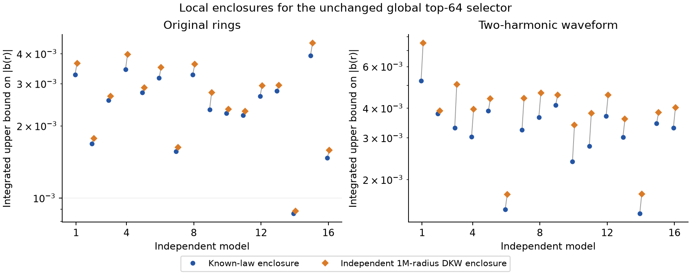

# Useful guarantees for the unchanged global-rank selector

All 64 frozen enclosure computations completed without failure: two verification
methods applied to the same 32 new PB models, with 16 models per task. Both
verification methods produce positive independent expected-gain lower confidence
bounds on all 32 models. The empirical method uses a new unlabeled radius sample
and does not require the analytic radial distribution in its pointwise guarantee.

The selector is unchanged. It still selects exactly 64 partner predictions per
batch of 256 using its original learned scores and action keys. The analysis uses
the actual inclusion probability of global ranking, Q(F(score)), where Q is the
Beta(192,64) CDF. No true score CDF, posterior or verification outcome is used to
refit or deploy the policy.

## Independent confirmation

The certificate algorithm and all numerical settings were frozen at
2026-11-21 10:15:25.550960 UTC. Fresh training was released afterward, and the
validation policy commit was written at 10:17:30.961775 UTC before testing. The
development evidence consists of the previous rings models 1, 8 and 16, and a
separately declared waveform development model. All weaker pilot settings are
preserved.

| Task | Verification | Mean integrated imbalance bound | Positive models | Smallest gain lower bound | Mean gain lower bound |
|---|---|---:|---:|---:|---:|
| Rings | Known input law | 0.0025127423 | 16/16 | 0.0026081387 | 0.0078715296 |
| Rings | Independent 1M radii + DKW | 0.0027407236 | 16/16 | 0.0021707869 | 0.0075277688 |
| Harmonic waveform | Known input law | 0.0032380248 | 16/16 | 0.0136319823 | 0.0342597154 |
| Harmonic waveform | Independent 1M radii + DKW | 0.0040667125 | 16/16 | 0.0125918938 | 0.0333023153 |

Gain is expected logistic-loss improvement over raw prediction, in nats per
input. Each verification method has its own 95% family confidence statement
covering all 32 models. These are two separately labeled families, not a joint
95% statement across both methods. The root confidence calculation uses 262,144
independent antithetic input observations per model. The empirical method also
uses 1,048,576 independent verification-only radii per model, with 32 DKW and 32
expected-gain confidence events in its family allocation.

The integrated imbalance columns use the known synthetic input distribution for
descriptive comparison, including for the empirical method. They are not inputs
to its distribution-unknown guarantee. That guarantee evaluates the pointwise
envelope on an additional independent sample. The corresponding mean pointwise
bounds in the root sample are 0.00183570 and 0.00248764 for known-law rings and
waveform; they are smaller than the displayed conservative whole-band integrals.

## Why the bound is now useful

The previous general global-rank analysis used broad spatial derivative and
bounded-variation penalties. The new calculation retains signed cancellation
inside local cells and treats score jumps explicitly.

First, positive radial-cell masses and endpoint score locations give a
deterministic bracket for the true score CDF. Alternatively, a separate radius
sample gives a uniform DKW band. Both routes enclose the actual global-rank
inclusion probability and its score derivative. The empirical calibration CDF
used to fit the original action mixture is not mistaken for the deployment CDF.

Second, every angular interval is split at the action's sawtooth jumps. Local
Taylor bounds on the network's antisymmetric logit difference are combined with
monotone probability sums. No smooth midpoint rule crosses a discontinuity.

Third, local signed derivative enclosures control the entire radial interval.
For a derivative range [L,U], interpolation error is bounded by
(U-L) times radial width times t(1-t). This includes changes in logits, score
location and action mixture weights. Every-radius validity is therefore separate
from the small residual that was fitted only at anchors. Even-frequency actions
are removed analytically because their imbalance is exactly zero.

For the known-law calculations, the mean integrated endpoint/angular/radial
components are 0.00064310/0.00026022/0.00160943 on rings, and
0.00021724/0.00087881/0.00214197 on waveform. Radial interpolation is now the
largest component on average; the computation does not claim exact balance.

The root then centers the unknown posterior at one half and applies a separate
bounded-variable confidence inequality to the lower gain observation. Its code,
raw observations and full confidence allocation are in `root_audit/certificate.py`
and `root_audit/CERTIFICATE.md`.

## Geometry and assumptions

Rings use the ordinary two-dimensional rotation action. The transfer task uses
x=(cos(phi),sin(phi),r cos(2phi),r sin(2phi)) and the linear four-dimensional group
representation R_theta direct-sum R_(2theta). Its orbit parameterization is
nonlinear, and its half-turn flips only the first coordinate pair. It has a
different input law, Bayes difficulty and 144-parameter model. Both tasks still
use SO(2) and a one-dimensional quotient.

The claims assume IID deployment inputs, uniform orientation conditional on
radius, the stated group action, positive score width and the fixed frequencies
1 through 4. Rings must have no mass at the origin, where orientation would not
be recoverable; both actual rings laws satisfy this regular-orbit condition.
The empirical route does not remove these symmetry assumptions. Its radius
sample must represent the deployment input law and remain independent of policy
fitting and the later gain-confidence sample.

The unknown label posterior may be any measurable function of radius in [0,1],
with no fixed class-prevalence requirement. This is stronger than checking a few
chosen labeling worlds, but it is not a claim about labels that vary with
orientation or about arbitrary future input-distribution shifts.

A positive lower bound establishes expected improvement over the raw predictor.
It does not establish exact conditional identification, improvement in every
batch or classification accuracy, or superiority over an invariant selector.
The exact-even control already has a Jensen nonharm guarantee. The new result
extends useful quantitative protection to the orientation-sensitive learned
global selector; whether its flexibility improves prediction quality is a
separate empirical comparison in the main report.

## Verification cost

| Task and method | Mean numerical setup seconds/model | Interval-jet propagations, total | Score-CDF query inputs, total |
|---|---:|---:|---:|
| Rings, known | 21.12 | 46,479,760 | 541,899,272 |
| Waveform, known | 34.88 | 89,692,460 | 1,042,772,755 |
| Rings, empirical | 23.19 | 46,479,760 | 541,899,272 |
| Waveform, empirical | 40.12 | 89,692,460 | 1,042,772,755 |

The total is 272,344,440 five-component interval-jet propagations and
3,169,344,054 score-CDF query inputs. Derivative bounds additionally use
176,316,224 location-CDF endpoint query inputs. These are workload counts,
not total FLOPs: CDF distribution construction, beta-table preparation, memory
movement and other array operations also have costs. Point-interval evaluations
are included in the interval-propagation count. They are not ordinary model
forwards and should not be conflated with deployment costs.

The summed numerical-construction time is 1,908.91 seconds across four parallel
single-BLAS-thread workers. These are descriptive setup times under concurrent
execution, excluding compressed-output writes. They are not a serving benchmark.
The root's expected-gain verification adds 16,777,216 ordinary forward examples
per method, or 33,554,432 across the two methods. The empirical radius sample
adds 33,554,432 coordinate-only observations. All these costs are offline and
separate from selector fitting and the unchanged 320-forward-examples-per-batch
deployment.

## Audits, preserved failures and numerical limitations

The first coarse rings-model-1 bound was 0.171998 and was not useful. Successive
old-only configurations, the initial source version and all raw pilot outputs
remain in `pilot/`. The final settings were chosen before fresh access. All 32
new models are retained, and no fresh configuration was retuned.

An independent, prospectively fixed six-model audit checks models 1, 8 and 16
in both tasks. All checks pass: 222 orbit probes, 4,800 jet probes, 1,542 CDF
probe points and 1,548 inclusion-probability/centered-gain input points. It reports
zero enclosure violations and uses 3,643,896 ordinary model forwards plus 1,920
analytic jet propagations. Full results are in
`transfer/INDEPENDENT_CHECK_SUMMARY.json`.

A separate post-computation diagnostic checks both score and location CDF bands
at 1,025 points for all 32 models. No known/empirical intervals are disjoint.
Eight coarse known-law location-CDF intervals extended beyond the empirical band;
direct piecewise-profile threshold integration resolves all eight actual values
inside the band. Both the initial observation and the resolution are retained in
`empirical_overlap_check.*` and `empirical_atom_check.*`. This finite-grid check
does not prove the uniform DKW event and does not change any policy or bound.

The mathematical enclosure result is in real arithmetic. The recorded numerical
implementation uses float64 with padding and independent checks, not verified
directed rounding. The computed confidence conclusions are conditional on those
numerical enclosures being valid. No formal machine-checked floating-point proof
is claimed.

`THEORY.md` contains the derivations, `PROTOCOL.md` the immutable configuration,
`summary.csv/json` the complete aggregates, and `REPRODUCE.md` the runnable stages.
The raw signed moments, derivative ranges, pointwise envelopes, verification
samples, source hashes and per-model provenance are retained for recomputation.
