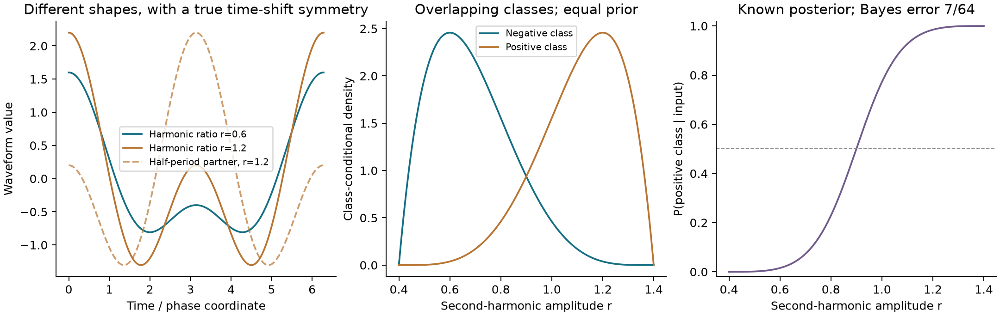

# Transfer to a two-harmonic waveform task

This task tests the frozen rank selector on a different symmetry representation: four waveform coefficients `(cos phi, sin phi, r cos 2phi, r sin 2phi)`. The class depends on harmonic shape through r; phase is uniform and irrelevant. A phase shift acts as `R_theta direct-sum R_(2theta)`. The selected half-period partner flips only the first two coordinates. Using the Euclidean antipode would apply the wrong transformation.

The amplitude r lies in [.4,1.4]. Its two equally likely class laws are shifted Beta(2,5) and Beta(5,2), giving a known nonlinear posterior and Bayes classification error .109375. Training sets have exactly 128 examples of each class. Calibration and evaluation inputs follow the iid population mixture. The task changes ambient dimension, nonlinear orbit geometry, partner transformation, input law, and posterior law. It still has a scalar quotient that is monotone in the full input norm; this is not multidimensional-quotient or real-world validation.

## Fixed model and bounded pilot

The model is an ordinary two-block 4D residual network with eight hidden units per block and 144 parameters, trained on raw coefficients. It is not given r as an extra feature. Four independent pilot seeds evaluated exactly two rates for GD and two for pullback training, always 500 updates. All 16 fits and evaluation data are retained. The rate choice uses supervised pilot conditional risk; no selector hyperparameter is chosen using these labels.

| Optimizer | Rate | Mean conditional risk | Full partner risk | Training loss | Seconds/model |
|---|---:|---:|---:|---:|---:|
| GD | 0.1 | 0.6972 | 0.6942 | 0.6793 | 0.047 |
| GD | 0.3 | 0.6670 | 0.6605 | 0.6358 | 0.047 |
| PB | 8 | 0.3831 | 0.3329 | 0.1707 | 1.114 |
| PB | 16 | 0.5515 | 0.4032 | 0.0955 | 1.110 |

The frozen primary recipe is PB8 with damping .1 for 500 updates. GD.3 is retained as descriptive context and is visibly underfit. Equal update counts are not equal compute. This limited pilot and subsequent selector comparisons are not an optimizer-superiority benchmark.

## Frozen transfer and costs

The task, model, training recipe, and selector adaptation were frozen at **2026-11-21 10:11:28.091373 UTC**, before the sixteen new confirmation models were generated. `FREEZE.json` records all hashes. The rank family keeps tau 1, frequencies 1..4, the quarter-grid phase offset, 129 radial anchors, 512 angles, the same zero-moment hull optimization, and the same radius-only randomization. Only the model/input geometry and radial-law helpers change.

Calibration uses 66,048 model example forwards plus 131,072 coordinate-only radii. Every limited-view deployment evaluates 256 first views and exactly 64 correct partners, for 1.25 calls/input. The full two-view reference costs 2 calls/input. Independent validation retains confidence, invariant-folded, exact-even, unconstrained and other predeclared controls; it owns the new outcomes under `../validation`.

All eight chosen pilot states passed adapter checks: exact call counts and quotas, bitwise even-score invariance, invariance of even masks under flipping any subset of inputs, and direct-coordinate agreement with FFT action moments. The analytical population-scoreCDF agrees with independent split quadrature to at most 4.2e-14. The new radial law has polynomial CDF and first-moment primitives, so the evaluator can integrate the piecewise-linear score-location distribution analytically. Calibration still uses the frozen empirical-CDF method; the exact population formula is not secretly substituted into deployment.

## Files and reproduction

- [THEORY.md](THEORY.md): task, group, posterior, model, score-law proof, and geometry-specific bounds.
- [PROTOCOL.md](PROTOCOL.md): fixed seeds, scopes, costs, API, and baseline requirements.
- [FREEZE.json](FREEZE.json): immutable source and pilot hashes.
- `pilot/`: all 16 training recipes, raw data, traces, and results; `pilot_policy/`: eight calibrated pilot policies and checks.
- [CERTIFICATE_REVIEW.md](CERTIFICATE_REVIEW.md): independent read-only review of the certificate argument and source.
- `INDEPENDENT_CHECK_PROTOCOL.json` and `independent_checks/`: uniform-subset independent numerical checks of the fresh bounds.
- `../validation/`: the independent sixteen-model confirmation and measured deployment results.

From the archived study root, `python transfer/report.py` verifies frozen hashes and regenerates this report and figure. `python transfer/pilot.py` and `python transfer/checks.py` reproduce the bounded pilot and checks into fresh output directories; preserve the existing outputs before rerunning. NumPy and threadpoolctl are required, with matplotlib for reporting. The task/model and rank adapter are local and self-contained.

## Independent transfer confirmation

On the sixteen new PB models, the unchanged balanced rank family improves over confidence and the exact-even rank control. The invariant folded baseline remains better on every model. This is a transfer result for a fixed method, not a claim that it is the best allocation policy.

| Policy | Actual calls/input | Mean conditional logistic risk |
|---|---:|---:|
| One view | 1 | 0.393727 |
| Full half-turn reference | 2 | 0.335819 |
| First-view confidence | 1.25 | 0.369954 |
| Invariant folded baseline | 1.25 | 0.348744 |
| Rank balanced at anchors | 1.25 | 0.356020 |
| Exact-even rank control | 1.25 | 0.356936 |
| Unconstrained rank | 1.25 | 0.363493 |
| Confidence plus calibrated angle | 1.25 | 0.361917 |
| Full calibrated-angle reference | 2 | 0.320166 |

The following paired differences are balanced rank risk minus the reference risk; negative values favor balanced rank. Intervals resample model seeds, not individual batches. The confidence and exact-even contrasts were primary; the folded comparison is a retained secondary control.

| Reference | Risk difference | Prespecified98.75% paired seed-bootstrap interval | Balanced wins |
|---|---:|---:|---:|
| First-view confidence | -0.013935 | [-0.023360, -0.006222] | 14/16 |
| Exact-even rank control | -0.000916 | [-0.002495, -0.000193] | 14/16 |
| Invariant folded baseline | +0.007275 | [+0.005221, +0.009746] | 0/16 |

GD remains an underfit descriptive context; its model and compute budget are not matched to PB. The full references use twice as many model calls as one view and are separate-budget references. Original-task risk comparisons do not replace the all-invariant-posterior certificate or establish exact conditional balance for the learned policy. Independent validation owns raw per-model/per-batch risks, sampled-label results, invariant-world controls, calibration hashes, and deployment call ledgers in `../validation`. No fresh result changed the task, training recipe, score family, or calibration settings.

## Independent certificate audit

The fixed six-model subset (seeds 1,8,16 in both tasks) passed all 222 high-resolution conditional-moment probes, 4,800 point-jet tests, 1,542 CDF probes, and 1,548 rank-marginal/centered-variable checks. No failed enclosure was omitted. [INDEPENDENT_CHECKS.md](INDEPENDENT_CHECKS.md) records the numerical scope, remaining angular sensitivity, exact call accounting, and raw artifacts. These checks supplement the reviewed real-arithmetic argument and do not claim a machine-checked floating-point proof.
