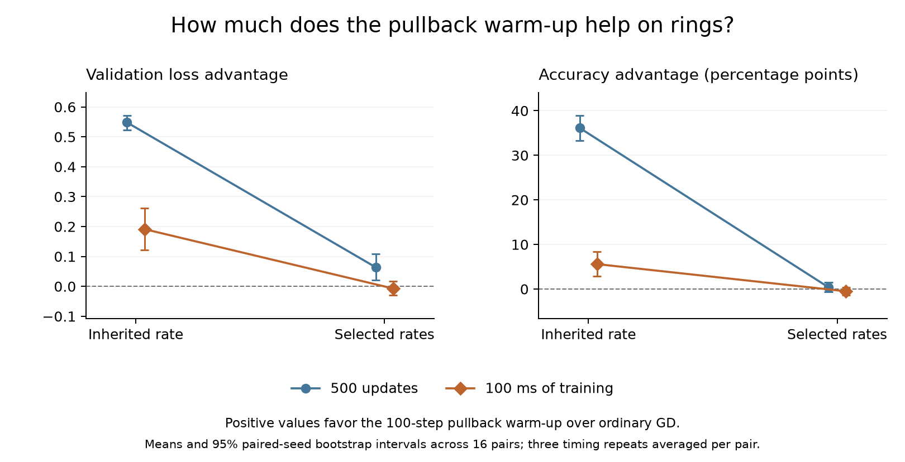

# How GD catches up on concentric rings

At 500 updates, switching to the rates previously selected on rings raised ordinary GD's mean validation accuracy from 62.01% to 97.34%. Keeping the inherited rate and giving both methods 100 ms also helped GD, which completed about 1,242 updates and reached 92.52%. Starting from the original fixed-step comparison, either change removed much of the warm-up's lead. Their effects overlapped.

## Paired results

The hybrid uses 100 pullback updates followed by GD. The inherited GD rate is 0.125 for both methods. The rings-selected rates are 0.5 for ordinary GD and 2.0 for the hybrid's GD phase. These rates were selected in the preceding 100 ms study on separate tuning draws, then carried unchanged into both budget conditions. The pullback rate is 8 and damping 0.1. Each cell uses the same 16 fresh training/initialization/validation triplets. Each method-policy trajectory provides both endpoints. Three timed repetitions are averaged within each triplet.

| Budget | Rate policy | Mean updates GD / hybrid | Validation accuracy GD / hybrid | Validation loss GD / hybrid | GD loss minus hybrid loss, paired 95% interval |
| --- | --- | ---: | ---: | ---: | ---: |
| 500 updates | Inherited | 500 / 500 | 62.01% / 98.14% | 0.6611 / 0.1130 | 0.5481 [0.5222, 0.5705] |
| 500 updates | Rings-selected | 500 / 500 | 97.34% / 97.73% | 0.1337 / 0.0698 | 0.0639 [0.0215, 0.1093] |
| 100 ms | Inherited | 1,242 / 527 | 92.52% / 98.11% | 0.3017 / 0.1103 | 0.1914 [0.1218, 0.2612] |
| 100 ms | Rings-selected | 1,239 / 510 | 98.21% / 97.71% | 0.0657 / 0.0729 | −0.0071 [−0.0303, 0.0172] |

Positive values favor the hybrid. The bars are pointwise percentile intervals formed by resampling the 16 complete paired seed blocks. The loss comparison was primary. At 500 steps with selected rates, accuracies were close and the hybrid retained lower mean logistic loss. At 100 ms with selected rates, the hybrid had lower loss on 5/16 pairs. Its mean accuracy margin was −0.50 percentage points with a paired interval of [−1.43, 0.37]. Neither outcome distinguishes a reliable winner in that cell.

## How the factors interact

| Change | Reduction in the hybrid accuracy lead (percentage points) | Reduction in the hybrid loss advantage |
| --- | ---: | ---: |
| Change only rates at 500 steps | 35.74 | 0.4843 |
| Change only budget at inherited rates | 30.54 | 0.3567 |
| Change rates after fixing 100 ms | 6.10 | 0.1985 |
| Change budget after adopting rings-selected rates | 0.90 | 0.0710 |
| Change both from the original 500-step cell | 36.64 | 0.5552 |

The reduction from changing rates at 500 steps exceeds the reduction from changing rates at 100 ms by 29.65 percentage points (paired interval 25.42 to 33.86), or 0.2857 loss units (0.1801 to 0.3871). Thus the gain assigned to each change depends on the order in which the comparison is made. The arms' absolute changes show where the overlap comes from: with the inherited rate, extra updates moved GD from 62.01% to 92.52%, while the hybrid changed from 98.14% to 98.11%. With rings-selected rates, GD had already reached 97.34% at step 500.

Comparing the two single changes directly from the inherited 500-step starting point, the rate change closed 5.20 percentage points more of the accuracy gap (paired interval 3.15 to 7.29) and 0.1276 more of the loss gap (0.0836 to 0.1731). This contrast compares the two specified interventions.

At the selected rates, 500 updates took a mean 40.2 ms for GD and 99.7 ms for the hybrid. The 100 ms endpoint is accumulated core-update wall time on this CPU, excluding data generation and validation. These findings apply to the specified rates, switch step, generator, and measured implementation. This design does not search for the best rate for a 500-step objective.

## Reproduction and data

Use the installed project package, NumPy, threadpoolctl and Matplotlib. From this directory run `python run_cross.py --out fresh_results`, then `python analyze.py --results fresh_results`. New timing results may vary by machine. The archived fixed-step states agreed exactly across repeats. All 192 trajectories completed and all 192 time endpoints had a verified upper and lower time bracket. The runtime order was balanced across the four method-policy combinations.

- [Design recorded before execution](PLAN.md), [previous selection record](prior_selection.json), and [prior rings timing study](../early-pullback/new-directions-rings-budget/README.md)
- [Training driver](run_cross.py), [generator](generator.py), and [descriptive analysis and figure code](analyze.py)
- [384 endpoint records](results/rows.csv), [paired effects](results/paired_effects.csv), [full summary and intervals](results/summary.json), and [environment, hashes and run order](results/design_record.json)
- [Vector figure](results/crossed_rings.svg)
