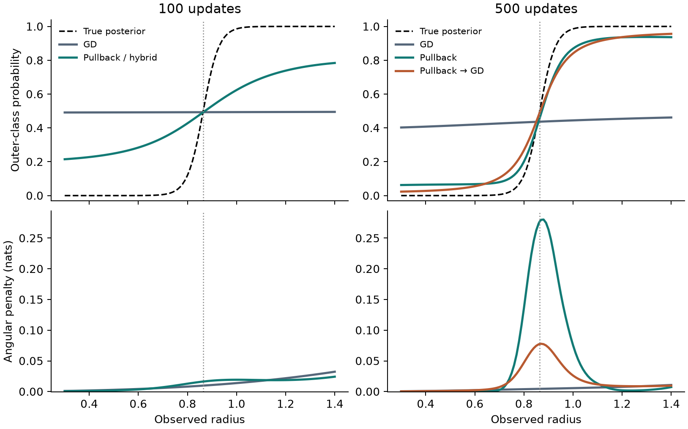

# Learning radius and controlling a second feature on noisy rings

In this two-dimensional classifier, the optimizer learns two features and the decision reads only the first. The population law depends only on radius. We measured how fast the classifier learned the radial probability rule, then intervened on the price the optimizer attaches to moving the unused second feature. The experiments use the same noisy-ring generator and the same risk decomposition.

## 1. What the early pullback updates learned

On the eight original pairs and inherited learning rates, the population logistic loss after 100 updates was 0.70420 for GD and 0.33718 for pullback. Of this 0.36702-nat mean gap, 0.36570 nats (99.64%) came from fitting the probability of the outer class as a function of radius. Both methods reduced their loss from angle-dependent predictions. At 500 updates GD actually had the lowest angular penalty in all eight pairs compared with full pullback. A model predicting roughly the same probability at every angle can still miss the change in class probability from the inner to the outer ring.

The upper panel below takes each model's mean logit over rotations at a fixed radius, applies the logistic link, then averages across seeds. The dotted line marks the Bayes decision radius near 0.8642. The lower panel shows the conditional extra loss due to angular variation, before weighting over radii. Bayes population loss is 0.02829529 nats. [Derivation and oracle](../../docs/rings_oracle_note.tex) · [First-stage results](stage1_findings.md)

A sensitivity check used the previously selected rings rates on the same eight pairs. At 100 updates GD at rate 0.5 still had higher population loss than pullback in every pair. By 500 updates this faster GD reduced mean radial excess to 0.07691, close to pullback's 0.06721. Raising the post-switch GD rate to 2 gave radial excess 0.00527 and angular excess 0.03237. The mix of errors depends strongly on learning rate and training stage. [Learning-rate sensitivity](stage1/rate_check/README.md)

## 2. What charging for second-coordinate motion changed

The second stage retained the original eight draws and used eight additional independent draws. The native full-pullback comparison kept learning rate 8, damping 0.1, data, initial parameters, and the training objective fixed. The manipulated variable was the multiplier on squared second-feature motion in the training metric. All 16 seeds ran all four weights.

| Second-coordinate weight | First-coordinate path | Second-coordinate path | Radial excess | Angular excess | Population loss at 500 |
| ---: | ---: | ---: | ---: | ---: | ---: |
| 0 | 2.7600 | 1.7604 | 0.06718 | 0.01897 | 0.11445 |
| 1/9 | 2.7595 | 0.2680 | 0.06609 | 0.01497 | 0.10936 |
| 1 | 2.7592 | 0.1054 | 0.06653 | 0.01494 | 0.10977 |
| 9 | 2.7611 | 0.0358 | 0.06707 | 0.01480 | 0.11017 |

Path lengths sum the actual per-update RMS movement over the fixed training inputs in the original coordinate units. Changing the weight from 0 to 9 reduced the mean second-feature path by a factor of about 49. The mean first-feature path changed by about 0.04%. The three pointwise paired bootstrap intervals for population-loss change versus weight 1 all included zero at the primary 500-update endpoint. For example, the weight-0 loss difference was +0.00468 nats [−0.00091, +0.01078]. Its angular contribution was +0.00404 [−0.00001, +0.00832]. At the secondary 100-update endpoint weight 0 improved mean loss slightly (−0.00234 [−0.00483, −0.00042]), predominantly through radial fit.

The control that matched predicted first-coordinate step length to the weight-1 candidate at the same current state produced 500-step losses of 0.11458, 0.10949, 0.10977, and 0.11003. In the secondary switch schedule, the weight applied for the first 100 steps only. Native switch losses at step 500 were 0.09464, 0.10578, 0.10350, and 0.09943. Its zero-weight versus unit-weight interval also included zero. The sweeps identify a strong effect on where the second feature travels, with limited precision for small end-of-training risk differences in this setting. [All paired comparisons](stage2/paired_weight_effects.csv) · [Cohort breakdown and intervals](stage2/summary.json) · [Figure](stage2/weight_effects.png)

## The mathematical link

At a fixed state, increasing the unused-feature weight reduces the predicted immediate training improvement for a fixed learning rate. Specifically the derivative of that predicted improvement per unit rate equals minus the squared predicted second-feature motion per unit rate. All 48 common states obeyed the predicted ordering. The finite-update ordering held in 46 of 48 at the inherited rate, and in 33 of 48 when first-feature motion was matched. These are repeated local comparisons at six states on each of eight seeds. [Proof, counterexample and local measurements](stage2_local.md)

## Numerical checks and reproduction

The first-stage replay reproduced all eight initial states, 16 data splits, and 48 archived non-initial checkpoint records. Stage two produced 384 logical records for 288 distinct parameter states. Warm-up prefixes and the weight-1 control are reused. All trajectories were finite. Population scores were integrated over the known data law after training, with a separate validation sample retained for comparison. One fresh weight-1 state required increasing the maximum polar-grid resolution from 768 to 1,536 samples along each dimension, keeping the same convergence tolerances and retraining no models. A different radial integration formula and angular grid checked all distinct endpoints of the first fresh seed plus that high-resolution state, with maximum discrepancy 2.07e-8 nats. All 32 common first- and second-stage endpoints reproduced their original hashes and scores. Bootstrap intervals resample complete seed pairs within the original and fresh cohorts and describe variation in trained models. [Numerical audit](stage2/numerical_audit.json) · [Integration controls](stage1/polar_audit.json)

Install the original project package and its recorded dependencies. The first-stage replay and analysis commands are in [the first-stage note](stage1_findings.md), with the prior [rings replay inputs](../early-pullback/new-directions-rings/README.md). For a complete new run, use a fresh copy of the source scripts and design notes here and keep the same subfolder names. Build the stage1 replay and population scores first. Then run `python stage2_run.py train`, `python stage2_run.py score`, `python stage2_summary.py`, and `python stage2_audit.py`. The training driver refuses to overwrite its output directory. The local branch study and rate check have their own design notes and scripts. [Stage 2 protocol](stage2_plan.md) · [Per-seed endpoints](stage2/rows.csv) · [Weights at each checkpoint](stage2/states.npz) · [Training provenance](stage2/training_record.json)
