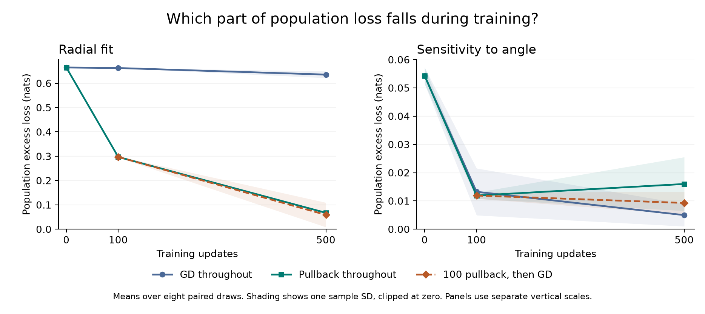

# Pullback learns the radial rule earlier at the inherited rates

On the eight original concentric-rings pairs, 0.36570 of the 0.36702-nat mean population loss gap between GD and pullback after 100 updates came from radial fit. That is 99.64% of the mean paired gap. Pullback had lower radial excess on all eight pairs. The angular contribution to this gap was 0.00133 nats on average, and favored pullback on only three pairs. Equal elapsed time and rings-selected rates answer a separate comparison examined in the earlier crossed-controls study.

## Measuring the two contributions

The model's first feature is its logit. At a fixed radius, average that logit over uniformly spaced angles and then apply the logistic link. **Radial excess** measures the regret of this resulting probability relative to the known ring posterior, weighted across radii by their population density. **Angular excess** measures the extra population logistic loss caused by angle-dependent variation around the mean logit at the same radius. It quantifies the cost of variation under this loss; its magnitude also depends on the confidence level. A constant prediction can have zero angular penalty and very poor radial fit. The two contributions add to population loss in excess of the 0.02829529-nat Bayes risk.

| Checkpoint | Radial excess | Angular excess | Total population logistic loss |
| --- | ---: | ---: | ---: |
| Shared initialization | 0.66485 | 0.05433 | 0.74748 |
| GD, step 100 | 0.66267 | 0.01323 | 0.70420 |
| Pullback and warm-up, step 100 | 0.29698 | 0.01191 | 0.33718 |
| GD, step 500 | 0.63564 | 0.00498 | 0.66891 |
| Pullback, step 500 | 0.06721 | 0.01599 | 0.11149 |
| 100 pullback, then GD, step 500 | 0.05885 | 0.00928 | 0.09643 |

Each entry averages eight paired trajectories. The warm-up and full pullback share exactly the same first 100 updates. Across the first 100 steps the angular penalties of GD and pullback both fell by about 0.04 nats. In that same interval GD's radial penalty improved by 0.00218 nats, compared with 0.36787 for pullback. At 500 updates GD had the smallest angular penalty of the three schedules in the mean and a lower angular penalty than full pullback on every pair. Its radial probability estimates still fit poorly. The warm-up schedule's additional mean improvement over full pullback at step 500 combined 0.00836 nats of radial improvement and 0.00671 nats of angular improvement. The eight draws and three measured checkpoints limit conclusions about the detailed shape of the learning curves.

## Verification and reproducibility

All eight initial-state hashes and all sixteen data hashes matched. All 48 non-initial method/checkpoint records reproduced their archived parameter hashes and all original train/validation metrics exactly. The 72 scheduled evaluations at 0/100/500 updates map to 48 distinct states after grouping the shared initialization and pullback prefixes. Every unique state passed grid refinement; the largest successive-grid difference across reported loss quantities was 1.84e-7 nats, and the maximum decomposition identity residual was 1.12e-16 nats. The oracle, constant-logit, purely radial error, and purely angular error examples passed the analytic controls. The loss integration uses known class probabilities and population weights, with no finite validation or test labels.

Run `python stage1_replay.py --archive PATH_TO_ORIGINAL_NEW_DIRECTIONS_RINGS --out fresh_replay` with the installed experiment package. Then run `python stage1_analyze.py --replay fresh_replay --out fresh_replay/population`.

[Design](stage1_plan.md) · [Replay checks](stage1/replay_audit.json) · [State bank](stage1/states.npz) · [Component measurements by state](stage1/population/states.csv) · [Means and sample SDs](stage1/population/means.csv) · [Paired changes](stage1/population/paired_changes.csv) · [Integration checks](stage1/population/audit.json) · [Vector figure](stage1/population/population_components.svg)
