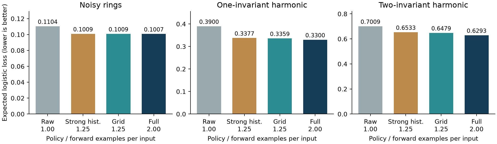
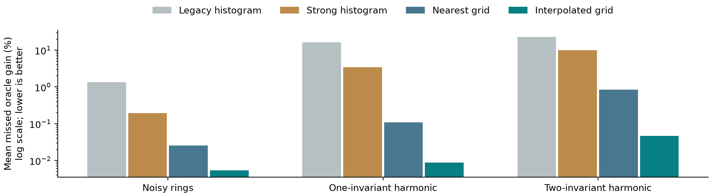

# Symmetric allocation reaches its useful frontier

Literature review, strong controls, genuine two-invariant transfer, and cheaper verification. Completed 21 November 2026. All three authorized objectives are complete; previous studies remain unchanged.

## What the new evidence supports

Across 48 newly trained models, an input-only interpolated Jensen-gain table improves expected logistic loss over a development-selected strong symmetric histogram. The rings effect is tiny. Both harmonic tasks show consistent 16/16 modelwise wins. This is a restricted fixed-half-turn comparison, not universal dominance over augmentation methods.

|Task (16 new models each)|Raw loss|Strong histogram|Interpolated grid|Reduction versus raw|
|---|---|---|---|---|
|Rings|0.110406|0.100898|0.100881|8.63%|
|One-invariant harmonic|0.389960|0.337676|0.335891|13.87%|
|Two-invariant harmonic|0.700872|0.653311|0.647930|7.55%|

The new rule captures 99.995%, 99.991%, and 99.953% of the modelwise exact-quota Jensen oracle gain on the three tasks. This oracle evaluates both views everywhere and costs 2.00 forwards/input. It is a headroom diagnostic, not a free deployable competitor.

Quantitative absolute gain bounds are positive for all 48 models at only 128 independent batches. A standalone policy needs 16,384 network forward examples at this look. The prespecified 512-batch primary analysis costs 65,536 and retains 86.0%, 96.2%, and 96.8% of the corresponding 2048-batch lower bounds, averaging the per-model ratios. No baseline-relative certificate is positive, even at 2048 batches.

<!-- pagebreak -->

## 1. Challenge a genuinely strong simple baseline

The previous 32 models and four new-task pilot models are development data only. Each fresh grid uses 65,536 calibration forwards; each histogram uses 32,768 IID input pairs, also 65,536 forwards. Development chooses 64x32 bins for each one-invariant task and 16x16x16 bins for the two-invariant task. The old 128-cell histogram is retained. Nearest-grid and interpolation share exactly the same stored grid.

The primary comparison is model-paired expected loss, interpolation minus strong histogram. Negative favors interpolation. Twenty thousand paired bootstrap draws give 98.333% marginal intervals, with Bonferroni nominal 95% coverage across the three primary comparisons. These finite-replication bootstrap intervals are approximate; they are distinct from the rigorous gain certificates.

|Task|Mean loss difference|Primary interval|Wins|
|---|---|---|---|
|Rings|-0.00001766|[-0.00003369, -0.00000506]|13/16|
|One-invariant harmonic|-0.00178497|[-0.00221849, -0.00135043]|16/16|
|Two-invariant harmonic|-0.00538083|[-0.00633723, -0.00455380]|16/16|

The relative loss reductions against the strong histogram are only 0.0175%, 0.529%, and 0.824%. The nearest-grid control already captures 99.974%, 99.891%, and 99.153% of oracle gain. Much of the improvement over a coarse histogram therefore comes from a better calibration design and resolution; the evidence does not justify a claim that complexity or orientation-sensitive selection is necessary.

An important counter-result: confidence selection has lower rings loss (0.098917) than interpolation(0.100881). It lacks the same uniform half-turn safety property. On the evaluator-only half-posterior world, its rings loss rises from raw 1.368141 to 1.373493; interpolation lowers it to 1.358839. In all three alternate half-turn-invariant worlds, the symmetric rules retain their structural justification. These worlds never influence fitting or selection.

<!-- pagebreak -->

## 2. Transfer to two independent invariant coordinates

The new support is X=(r1 cos(phi), r1 sin(phi), r2 cos(2phi), r2 sin(2phi)), with independent r1, r2 uniform on[0.4,1.4] and uniform phase. The group rotates the first coordinate pair bytheta and the second by 2theta. The half-turn flips only the first pair.

The two pair norms separate orbits on this phase-coupled support. Total norm discards information. The posterior is 0.5+0.4 tanh(4z1)tanh(4z2), zj=2(rj-0.9): it depends on both amplitudes. The quotient is genuinely two-dimensional here; on unrestricted ambient R4, relative phase would add another invariant.

The task law was frozen before a four-seed, three-recipe training pilot. PB4/500 beats PB8/500 and PB8/1000 by development expected loss and is then fixed for all 16 fresh models. The model has 144 parameters; no capacity increase or GPU is required for this transfer.

|Fresh mean metric|Raw|Interpolated grid|Full half-turn|Bayes benchmark|
|---|---|---|---|---|
|Expected logistic loss|0.700872|0.647930|0.629271|0.492907|
|Expected error|37.124%|35.002%|34.044%|22.656%|
|Mean predicted confidence|73.610%|70.923%|70.415%|Not comparable|
|Accuracy|62.876%|64.998%|65.956%|77.344%|

This confirms a useful extension, but the underlying models remain weakly calibrated. Raw mean loss exceeds the constant 50%-probability predictor's log(2)=0.693147, despite accuracy above chance. The raw model's confidence exceeds its actual expected accuracy by 10.734 percentage points; interpolation reduces that gap to 5.925 points. Binned posterior calibration error falls from 0.1081 to 0.0640. These are descriptive diagnostics on held-out outcomes, not a fitted calibration policy.

The remaining Bayes gap is much larger than the available selection headroom. Training regularization and a separately validated probability-calibration procedure are higher priorities than a more elaborate selector. Positive temperature scaling alone would leave classification signs and error unchanged, so improved probability calibration and improved classification must be assessed separately.

The complete task checks, training pilot, 64 fresh diagnostic rows, 640 reliability-bin rows and 1024 quotient-cell rows are retained. No seeds, failed runs or unfavorable recipes were dropped; all 48 primary training runs completed.

<!-- pagebreak -->

## 3. Lower verification cost with a valid dependence argument

For a fixed half-turn-even pointwise score, exact top 64-of 256 selection is unchanged when any one input is flipped. Under a half-turn-invariant input law and posterior, expected logistic-loss gain equals expected selected Jensen gap. Its nonnegativity is structural; statistical verification quantifies a positive amount of improvement.

Verification evaluates both model views only on the selected-set union. For one policy, 128 forward examples suffice per 256-input batch. Two policies share overlapping work. This changes the admissible policy family; it is not an acceleration of the previous asymmetric policy's conditional-imbalance certificate.

Two concentration methods were frozen before fresh execution. Empirical Bernstein uses independent whole batches. Bounded differences uses the fact that replacing one input/tie pair changes a selected sum of weights in [0, c] by at most c. It handles quota dependence explicitly. For two policies the bound is 2c; the signed comparison uses the unclipped global Jensen bound Jmax for c, not the absolute-gain clipping levels. Both sharp sensitivity constants were independently proved and tested.

All 48 models x 3 claims x 3 fixed looks x 2 bound methods share a 0.05 error budget (864 events). Taking the maximum of the two lower bounds is valid under this joint family. The original 432-event outputs are retained as historical diagnostics; only the final 864-event tables support this report. Clipping levels are fixed at 0.25 for rings and 0.5 for the harmonic tasks.

|Task|Mean bound at 128|Primary 512|Full 2048|Mean modelwise retention|
|---|---|---|---|---|
|Rings|0.004539|0.006080|0.006848|86.0%|
|One-invariant harmonic|0.044146|0.047101|0.048728|96.2%|
|Two-invariant harmonic|0.045256|0.048355|0.049914|96.8%|

All 48 candidate bounds and all 48 strong-histogram bounds are positive already at 128 batches. A standalone policy costs 16,384 /65,536 /262,144 forward examples at the three looks. At 512, actual shared two-policy costs average 70,438 /74,953 /81,201 on rings /one-invariant /two-invariant tasks. All three looks were collected; no early stopping saved work in this completed experiment.

For context, the earlier asymmetric certificate used 524,288 ordinary forwards per model/mode plus expensive auxiliary construction. The new primary standalone count is 8 times smaller; the 128-batch count is 32 times smaller. This is a different, restricted symmetric pipeline and a different quantitative bound. It is not a measured wall-clock or GPU speedup.

The signed comparison against the strong histogram remains uncertified: 0/48 positive even at 2048. Its global range bound is too loose for these small differences. Empirical superiority and an absolute safe-improvement guarantee must remain separate claims. Rings' signed bound also uses a known-distribution tail allowance; absolute clipped bounds do not require that tail calculation.

<!-- pagebreak -->

## What the literature changes about the research claim

Primary sources were searched before the new method and confirmation protocol were frozen. This focused review supports a narrower claim than a general new principle of safe augmentation.

- Chen, Dobriban and Lee, JMLR 2020: orbit averaging, variance reduction and the connection to conditional averaging are established. Our exact-quota mask argument is a specialized application of symmetry and convexity. [Published paper](https://jmlr.org/papers/v21/20-163.html).
- Kim et al., NeurIPS 2020, and Shanmugam et al., ICCV 2021: per-instance augmentation choice and learned aggregation already exist. The present study's transparent, input-only gain surrogate and explicit query accounting should be compared with strong controls. [Loss-based augmentation](https://papers.neurips.cc/paper_files/paper/2020/file/2ba596643cbbbc20318224181fa46b28-Paper.pdf), [aggregation](https://openaccess.thecvf.com/content/ICCV2021/papers/Shanmugam_Better_Aggregation_in_Test-Time_Augmentation_ICCV_2021_paper.pdf).
- Jhawar and Wang, September 2026 preprint: indistinguishable unlabeled worlds can require different actions; action identification and full-risk identification differ. Their Theorems 1-2 overlap the generic obstruction. We make no first general impossibility or label-free selection claim. [Version 1 full text](https://arxiv.org/html/2609.11235v1).
- Shanmugam et al., CVPR 2025: augmentation with conformal coverage guarantees is prior art; its labeled policy/calibration setup and coverage target differ from our logistic-risk identity. [Author record](https://arxiv.org/abs/2505.22764).
- Dym and Gortler, FoCM 2025(online 2024): orbit-separating invariants matter. Our two-amplitude argument is elementary and support-specific, not a consequence proving general R4 sufficiency. [Published paper](https://doi.org/10.1007/s10208-024-09641-2).
- Maurer and Pontil 2009 and McDiarmid 1989 supply established concentration tools. Our study-specific step is the top-quota sensitivity calculation and honest accounting across all models, claims, looks and methods. [Empirical Bernstein](https://arxiv.org/abs/0907.3740), [bounded differences](https://doi.org/10.1017/CBO9781107359949.008).

Test-time augmentation keeps model parameters fixed while combining transformed views. Test-time adaptation changes deployment parameters or state. The 2026 identifiability and monitoring papers concern adaptation; their information and dependence warnings inform this design, but their particular guarantees are not imported automatically. Schirmer et al. (NeurIPS 2025) require a proxy-error relation for label-free monitoring; Han et al. (October 2026 preprint) show failures of monitoring assumptions with dependent forecasting feedback. Our fresh inputs are IID and policies are frozen before verification.

The defensible contribution is a reproducible allocation/verification frontier under an exact symmetry and exact quota, with competitive controls, a genuine two-coordinate transfer and explicit negative results. A focused search is not an exhaustive novelty audit. Detailed source notes and theorem locations are in the literature, method, task and certification folders.

<!-- pagebreak -->

## Recommended next direction, in order

1. Improve the underlying two-invariant predictor and its probability calibration. Use a new, explicitly separate training/validation/calibration split; retain PB and ordinary-gradient controls, fixed capacity and all seeds. Select a bounded regularization/early-stopping grid on validation only, then freeze before fresh testing. Success should mean both lower raw loss and preserved selection benefit, with calibration/error reported separately. This addresses a much larger gap than the remaining less-than 0.05% oracle-gain headroom.

2. Move the theoretical question from exact symmetry to controlled symmetry error. Under an invariant input law, a known bound on the difference between p(x) and p(Tx) gives a label-imbalance penalty to the Jensen gain identity. Specify how such an error budget is justified using independent labeled evidence or domain knowledge; it cannot be inferred from unlabeled inputs alone. Freeze a stress grid, report where the lower bound reaches zero, and compare against confidence and the strong symmetric histogram. This is a proposed follow-up, not a result established on real data here.

3. Use one task with a defensible real transformation and measure total cost. Reuse the strong histogram and nearest-grid controls. Include calibration, selection overhead, model inference and verification separately. Start with the current CPU workflow; use the existing 5070Ti only if the chosen predictor is actually costly enough for model evaluations to dominate. Prior small-model GPU timings do not justify a new speed claim. Stop growing the selector if its extra improvement is below a predeclared practical threshold.

## Verification and reproducibility

All 48 models, 144 policy tables, 48 performance sets and 3,145,728 fresh performance inputs were retained. Independent reconstruction checks all 384 metric rows(error at most 4.45e-16), all masks and output relations(no discrepancies), 240 committed files and all 48 input/label/tie streams. Six 100-step training replays are exact. Actual deployment ledgers contain 98,304 records and 35,389,440 forward examples. Calibration costs 6,291,456 shared forward examples across 48 models; legacy/nearest reuse is explicitly recorded.

The final certificate computation processes 98,304 independent batches, 25,165,824 coordinate inputs and 14,497,086 actual shared forwards. Independent reconstruction verifies all 864 individual bounds exactly, all 48 deterministic range/tail calculations, and six 128-batch input/model replays. These latter replays use 113,282 additional audit forwards, reported separately. The original run took 45.13 seconds including its audits on this machine; concurrent execution makes this descriptive, not a controlled runtime comparison.

Freezes precede training, calibration precedes performance and verification, and no fresh outcomes select methods or sample sizes. A proposed rings seed collision with an old pilot was caught and corrected to 1161..1166 before any fresh state existed. A certificate approval-key alias was added before verification; it changed no frozen source or scientific choice.

Limitations: synthetic supports; 16 model replications per task; fixed half-turn and 25% quota; imperfect raw-model calibration; no real-data or GPU validation this cycle; no positive baseline-relative certificate; float 64 numerical verification rather than a directed-rounding machine proof. The rings posterior helper overflows at extreme artificial radii 15/40; all sampled/calibration checks are finite, and the label-free certificate never calls that helper. Stabilize it before reusing this API for extreme-radius studies.

The archive includes the report, primary-source review, all freezes and protocols, executable methods and audits, training states, calibration tables, predictions, raw ledgers, certificate batches, diagnostic tables and publication-quality figures. Prior studies are unchanged. Fresh reproduction is portable within this archive; rerunning historical development additionally requires the earlier study named in its scripts.
