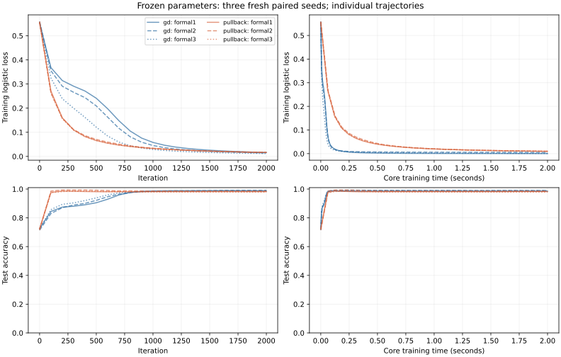
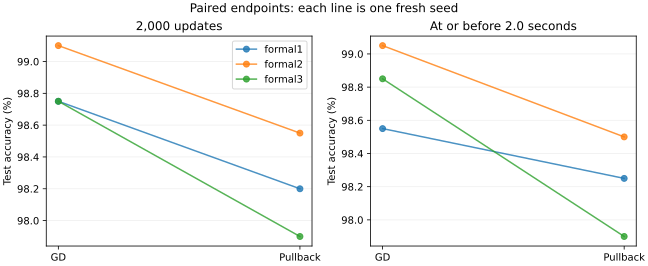

# Formal paired evaluation

Frozen parameters: GD learning rate 0.125; pullback learning rate 8 and damping 0.1.
Three fresh paired seeds. Training finished before any test data were evaluated.
The iteration and time endpoints are separate; neither is selected using test scores.

| Endpoint | Method | Test accuracy, mean +/- sample SD | Test loss, mean +/- sample SD | Mean updates | Mean core seconds |
| --- | --- | ---: | ---: | ---: | ---: |
| iteration | gd | 98.87% +/- 0.20 pp | 0.034791 +/- 0.002649 | 2000.0 | 0.145888 |
| iteration | pullback | 98.22% +/- 0.33 pp | 0.079854 +/- 0.008172 | 2000.0 | 1.222024 |
| time | gd | 98.82% +/- 0.25 pp | 0.062223 +/- 0.019908 | 27195.7 | 1.999951 |
| time | pullback | 98.22% +/- 0.30 pp | 0.082635 +/- 0.009224 | 3280.3 | 1.999629 |

Sample SD describes variation across three seeds; it is not a confidence interval or a significance test.
Time endpoints retain the last whole update at or before 2.0 seconds; crossing states are preserved.
The time comparison uses iteration-tuned settings and is a cost diagnostic, not a separately time-tuned benchmark.
Pullback damping was selected at the upper boundary of the fixed tuning grid.

See endpoint_metrics.csv for per-seed endpoints, summary.json for paired differences, and trajectories.json for checkpoint weights and timing brackets.
metrics.csv contains offline evaluations; spectra.csv and spectral_metadata.json preserve checkpoint diagnostics for the next analysis stage.
Linear probes and the final feature-quality interpretation have not been performed.
