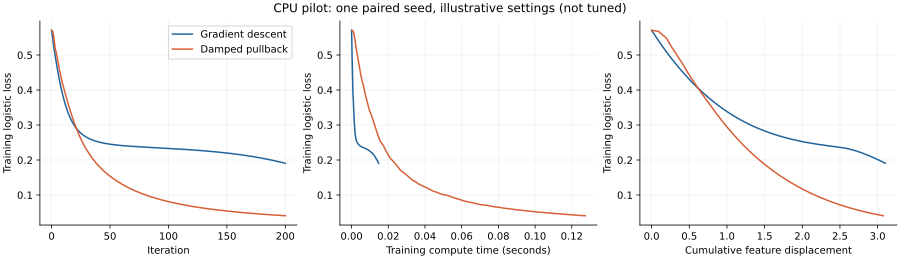
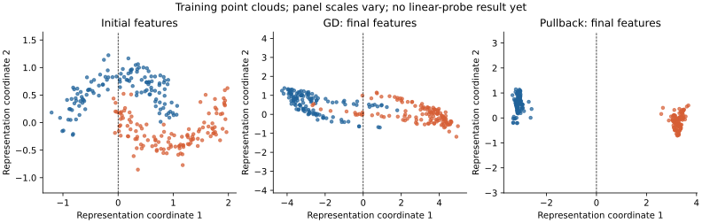

# CPU pilot results

One paired seed, 200 steps by default, illustrative hyperparameters, no tuning.
Test data were neither generated nor evaluated. These results establish feasibility, not optimizer superiority.

| Method | Initial train loss | Final train loss | Final validation loss | Validation accuracy | Training seconds | Diagnostics seconds |
| --- | ---: | ---: | ---: | ---: | ---: | ---: |
| gd | 0.570782 | 0.190637 | 0.268577 | 87.50% | 0.0147 | 0.0275 |
| pullback | 0.570782 | 0.040684 | 0.090131 | 98.44% | 0.1274 | 0.0332 |

Training compute includes forward/gradient evaluation, required Jacobian construction, Gram construction, linear solve, and parameter update.
Evaluation, feature displacement, spectra, and checkpoint collection are recorded as diagnostics.
Warmup, file writes, imports, and plotting are excluded from training compute; warmup and loop wall time are separately recorded in summary.json.
Plotting took 1.468 seconds; this is not included in either training compute or diagnostics.

See config.json, environment.json, summary.json, per-step CSV files, and checkpoint JSON files for provenance.
The held-out linear-probe evaluation and multi-seed tuned comparison remain future stages.
