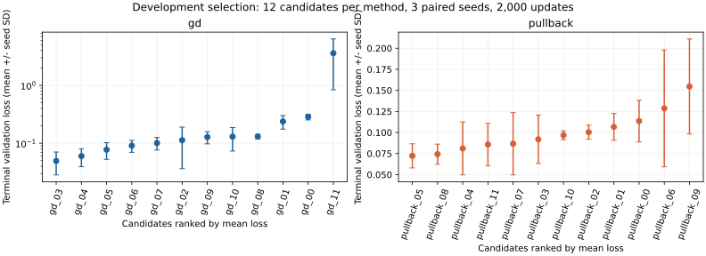

# Validation-only tuning results

This is development model selection, not independent final performance evaluation.
The rules were committed before execution. Test and formal data were neither generated nor evaluated.

| Method | Selected ID | Learning rate | Damping | Mean validation loss | Seed SD | Mean validation accuracy |
| --- | --- | ---: | ---: | ---: | ---: | ---: |
| gd | gd_03 | 0.125 | - | 0.049446 | 0.021092 | 98.31% |
| pullback | pullback_05 | 8 | 0.1 | 0.072279 | 0.014322 | 98.18% |

## Budget and recorded failures

Each method was allocated 12 configurations x 3 development seeds x 2,000 updates.
This equalizes candidate-run and update budgets, not elapsed computation. No failed trial is replaced.

- gd: 36/36 runs completed; 6.006 seconds core training; 3.783 seconds diagnostics.
- pullback: 36/36 runs completed; 49.074 seconds core training; 5.059 seconds diagnostics.

## Grid boundaries

- gd: learning-rate boundary = False; damping boundary = False.
- pullback: learning-rate boundary = False; damping boundary = True.

The selected settings are the best eligible configurations within this fixed grid, not a global optimum.
Boundary selections are reported without expanding the search after seeing the results.

The frozen next-stage settings are in [formal.json](formal.json). No formal run has been executed.
All per-seed outcomes, terminal checkpoints, and sampled learning curves are preserved in results.json, terminal_checkpoints.json, and histories.csv.
